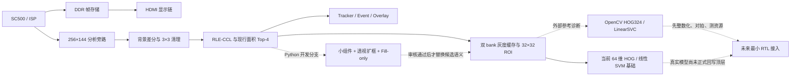

# 项目演进、当前架构与后续计划

更新时间：2026-09-27  
当前阶段：VIRAT 真实数据开发验证；正式 RTL 接入门禁关闭  
适用范围：当前工程事实、关键选择依据、未决问题和下一阶段执行顺序

## 1. 当前结论

项目已经具备完整的视频基础链路和候选检测基础，也具备 32×32 ROI、64 维硬件 HOG 与线性 SVM 的实现基础。两批候选人工审核已经规范化收口，HOG324 也通过了当前小样本 pilot 路线门禁。当前仍不能称为“真实人车识别闭环完成”，因为新增候选的裁剪可用率未过门槛，分数拒识没有可行阈值，整数 HOG 与生产 RTL 尚未建立，独立 blind test 仍保持封存。

目前最合理的架构是分层推进：

1. 保留已经工作的 SC500、ISP、DDR、HDMI 和现行候选 RTL 基线。
2. 在 Python 中先解决候选覆盖、ROI 语义、特征有效性和定点范围。
3. 候选规则和分类模型分别通过跨场景证据后，再冻结两者之间的接口。
4. 取得实际资源、周期和连续采集数据后，只实现必要的 RTL 改动。
5. 最后用一次封存测试验证冻结后的整体方案，不根据测试结果回调参数。

因此，当前没有继续扩大 CDC、bank 队列或 HDMI 调度逻辑，也没有把外部 Python 项目整体搬进 FPGA。现阶段的目标是把算法不确定性先消除，并给后续 RTL 留下清楚、可逐级对拍的整数合同。

## 2. 当前架构



| 层 | 已有能力 | 当前边界 |
|---|---|---|
| 视频采集、存储、显示 | SC500→ISP→DDR→HDMI 主链已经存在 | 连续调度、跨时钟复位和显示源帧差值仍需系统测量 |
| 部署候选链 | 256×144 背景差分、清理、RLE-CCL、面积 Top-4、Tracker、事件、画框 | 小目标行人覆盖不足 |
| 新候选策略 | Python 中完成小组件、透视扩框、NMS、最终四输出比较和人工审核 | `fill_only_T100`目标比例通过，但裁剪可用率未过门槛，尚未冻结和转 RTL |
| ROI 与分类 | 双 bank 灰度缓存、帧身份、32×32 ROI、64 维硬件特征和线性 SVM 核基础 | 真实分类尚未形成正式顶层闭环 |
| 数据与验证 | VIRAT 开发数据、场景隔离、哈希、两批候选审核收口、blind reserve 封存 | 只有两个验证 scene，ped/vehicle/invalid 尚未各达到 100 个唯一组，正式 test 尚未运行 |
| 外部参考 | OpenCV HOG/LinearSVC 的隔离诊断已完成 | HOG 内部仍是浮点参考，不是 RTL 等价实现 |

HDMI 当前框颜色不能解释为最终机器学习分类结果。现有 158/158 个 bbox 与 area 一致性只证明已有短窗口候选链的局部 Python/RTL 对拍，不能外推为新候选算法、连续系统或完整分类链已经通过。

## 3. 已完成的成果

### 3.1 工程备份与回退点

在开始外部项目参考前，已经创建完整工程备份：

- 源目录：`E:\project\qiansai\anlogic_topic2_work\lab1_sc500_road_vision`
- 备份目录：`E:\project\qiansai\anlogic_topic2_work\backups\lab1_sc500_road_vision_pre_external_reference_20260927_1505`
- 文件数：30,144
- 总字节数：3,948,955,986
- 源与备份 SHA-256 不一致数：0
- 收据：[备份收据](../backups/lab1_sc500_road_vision_pre_external_reference_20260927_1505_RECEIPT.json)
- 清单 SHA-256：`1b61fd0bb9fb2c7a07660549e114fc4be795c77fcb67519fe509eb0fa370f746`

这一步保留了外部参考探索前的可回退状态。工程当前不是 Git 仓库，因此备份收据和文件哈希是这一阶段的主要回退证据。

### 3.2 真实数据闭环基础

早期合成样本和工具链结果只用于证明程序能够运行。用户确认 `video/first` 存在机位和初始背景抖动后，项目没有继续用它作为正式证据，而是转向具有来源、协议、标注、帧号和哈希的 VIRAT Ground 数据。

目前完成的开发数据包括：

- 六个开发场景完成核查。
- 429 个已审计的真值框 ROI：train 360，其中 ped 160、vehicle 200；val 69，其中 ped 45、vehicle 24。
- scene 级隔离，未把相邻帧随机拆分到不同集合。
- `010106` 和 `010108_01` 保持 hash-only 封存，内容未用于开发。
- 两个曾被目视检查的“test”场景按开发 holdout 管理，不能冒充独立 blind test。

2026-09-26 的旧 `evaluation/READINESS_REPORT.md` 中“尚无真实数据”的描述是历史状态，不能再作为当前结论。

### 3.3 当前 64 维模型与真实候选诊断

64 维特征在当前 69 个真值框验证 ROI 上得到：

- Person recall：0.600
- Vehicle recall：1.000
- 验证准确率：0.7391

在 70 个已审核的验证 CCL 候选上得到：

- Person recall：0.55
- Vehicle recall：1.00
- invalid 误接受率：1.00
- 浮点与当前定点分类不一致：0

invalid 误接受率为 100% 是二分类器强制二选一的必然基线，不能把 SVM margin 当作概率。拒识阈值必须在含 invalid 的冻结验证集上选择，同时报告对人车召回的损失。

260 维特征曾在两个短且时间相关的验证窗口中得到真值框 ped/vehicle recall 0.9111/0.9167、有效 CCL 候选 ped/vehicle recall 0.85/1.00。该结果没有 invalid、固定点和 RTL 证据，只能作为“更丰富空间特征可能有效”的诊断，不能称为达标模型。

### 3.4 候选覆盖问题定位

分类之前已经出现明显上限：现行面积≥16、Top-4 候选在两个连续预热的验证窗口中，对行人的 IoU≥0.1 覆盖均为 0。进一步分析表明，很多目标区域存在前景响应，丢失主要来自：

- 小组件面积排名靠后；
- 框只覆盖头肩或局部；
- 粘连、遮挡和背景运动改变组件形状；
- 每帧四个候选的固定预算。

这说明只继续调 SVM 无法恢复根本没有进入 ROI 链的目标，因此优先级从“马上换分类器”转为“先验证固定预算候选策略”。

### 3.5 小组件、透视框和最终四输出策略

Python 原型先保留面积 Top-4 主候选，并增加最多四个面积 2～15 的小组件，内部候选不超过 8。目视检查发现不少小框只覆盖头肩，因此增加按分析图像纵坐标分段的透视扩框：较近目标使用至少 6×16、顶部留 2 像素，较远目标至少 4×4；扩框后再做 NMS。

随后比较三种最终最多四输出：

- `3主+1小`
- `2主+2小`
- `内部8候选再选四个`

新增场景 `VIRAT_S_000206_07_001501_001600` 否定了“内部 8 个统一竞争”的方案。在 y=100 时，该策略虽然提高行人几何覆盖，却丢失 561 条原基线已覆盖的 vehicle annotation rows，面积 rank-0 主候选也只保留 311/900。由此形成了“主候选优先，小候选不能无条件挤掉主候选”的架构原则。

领导者随后定义 guarded 规则：保留主候选，小候选填空；实验分支最多替换一个末位弱主候选。四个开发窗口共扫描 24 组替换参数，全部在新增场景违反 vehicle IoU≥0.25 和 0.5 的逐窗口零损失门禁，因此本轮替换机制被否决。

`fill_only_T90/T100/T110` 均保留所有主候选并保持开发窗口 vehicle 基线覆盖零损失。T90 相比 T100/T110 只增加 1 条 ped@IoU0.25、2 条 ped@IoU0.1，IoU0.5 相同，且差异来自长训练窗口。因此选择扫描中点 `fill_only_T100` 进入人工审核，T90/T110 保留为敏感性对照。这个选择不是阈值冻结。

T100 在四个开发窗口中的 ped@IoU0.25 annotation-row 净增为 `+47/+2/+105/+13`。这些数字是时间相关的几何覆盖行数，不是独立目标数、检测召回或分类准确率。

审核收口结果：

- 旧 `internal8_to4` 批次有 120 项实质记录；3 项不确定记录不计入指标，7 项背景备注缺失保留为开放审核缺口。该批只用于失败证据和回归检查，不进入训练、验证或阈值选择。
- 新 `fill_only_T100` 成对批次的 54 个唯一时间组已全部规范化：19 个完整行人、14 个截断行人、21 个背景碎片，24 个裁剪可用、30 个不可用。
- 新增槽位语义目标比例为 33/54=61.1%，通过预先设定的 60% 门槛；语义目标中可用裁剪比例为 24/33=72.7%，没有通过 80% 门槛，因此候选语义未冻结。
- 原始 CSV 未修改，规范化产物统一使用 `review_basis_canonical=human_visual_review`；输入、图像和来源视频哈希已回读验证。

相关证据见 [候选决策](evaluation/python_references/GUARDED_FINAL4_DECISION.md) 和 [状态文件](evaluation/status.json)。

### 3.6 外部 Python 项目参考与首轮对照

外部项目只作为算法、训练和验证方法参考，不直接移植厂商工具链或运行时。首轮使用本机已有 OpenCV 4.13.0 和 scikit-learn 1.9.0，未安装额外依赖，也未访问 test、blind 或 holdout。

同一 train/val ROI、同一 LinearSVC 诊断设置下的结果如下：

| 特征 | 维数 | Val accuracy | Ped precision / recall | Vehicle precision / recall |
|---|---:|---:|---:|---:|
| 当前 RTL 兼容特征 | 64 | 73.91% | 1.000 / 0.600 | 0.571 / 1.000 |
| OpenCV HOG，4 bins | 144 | 47.83% | 0.667 / 0.400 | 0.357 / 0.625 |
| OpenCV HOG，9 bins | 324 | 92.75% | 1.000 / 0.889 | 0.828 / 1.000 |

HOG324 的验证混淆矩阵为 `[[40,5],[0,24]]`，值得继续验证；它在验证场景 `000200` 的行人召回为 76.19%，在 `000203` 为 100%，仍存在场景差异。HOG144 明显弱于当前 64 维方案，不再作为优先路线。

对 HOG144/HOG324 的输出采用无符号 Q1.12、线性权重采用有符号 16 位，并把训练期 StandardScaler 代数折叠进权重和偏置后，train/val 相对浮点分类均为 0 个不一致。保守累加上界需要 35 个有符号位，实测 HOG324 需要 29 位。

这次只量化了 OpenCV 浮点 HOG 的输出和线性层。梯度、方向插值、L2-Hys、倒数平方根、舍入和饱和仍未形成整数合同，因此它不是 Python/RTL 等价证据。完整产物见：

- [诊断脚本](external_reference_exploration/opencv_hog_diagnostic.py)
- [诊断报告](external_reference_exploration/results/opencv_hog_diagnostic/report.json)
- [外部方案研究草案](evaluation/EXTERNAL_PYTHON_TO_RTL_RESEARCH_DRAFT_2026-09-27.md)

脚本 SHA-256：`0baf138faf66aea78dcc979d1a262b9c743684ba262b62b8619db988ba4ff658`。

完成候选人工审核后，又按 `experiment_roi_contract_v1` 对 54 组 fill-only ROI 和 70 个既有 CCL ROI 运行了真实候选诊断。严格门禁只使用两个验证 scene，不把 `000206` 的 6 个 train 组计入：

- `000200`：64 维行人 28/38，HOG324-Q 37/38；车辆均为 16/16。
- `000203`：64 维行人 7/9，HOG324-Q 9/9；车辆均为 16/16。
- 合并：行人从 35/47 提高到 46/47，多正确 11 个；车辆保持 32/32；balanced accuracy 增加 11.70 个百分点。

因此预先声明的 pilot 路线门禁通过，只授权继续扩充数据和建立整数参考。124 个候选 ROI 的浮点描述子输出与量化线性层分类不一致为 0，最大归一化分数误差为 0.00172545；OpenCV HOG 内部仍是浮点，不能解释为整数 Python/RTL 等价。包括纯验证合并集在内的所有整数拒识阈值扫描均没有同时满足建议 recall 与 invalid FAR 目标的点，所以未选择阈值；未来阈值选择只使用冻结验证集和显式人工 invalid。

完整结论见 [HOG324候选pilot决策](evaluation/HOG324_CANDIDATE_PILOT_DECISION_2026-09-27.md)。

## 4. 到达当前架构的关键选择过程

| 选择点 | 当时可选方案 | 采用的选择 | 主要依据 |
|---|---|---|---|
| 是否立即大改 CDC/bank/HDMI | 直接实现双邮箱、排队、独立释放；先测量 | 暂停大改 | 算法和调度同时变化会放大验证面；现有夹具只证明四对象计算，不证明连续采集 |
| 是否继续用本地 `video/first` | 继续作为真实数据；换公开固定机位数据 | 换 VIRAT | 原视频机位与背景不稳定，难以建立可靠 scene 隔离和背景模型证据 |
| 是否先调分类器 | 继续调 SVM；先查候选覆盖 | 先查候选 | 部署 Top-4 对行人低 IoU 覆盖为 0，分类器看不到目标 |
| 小候选如何进入最终四个 | 固定 3+1；固定 2+2；内部 8 统一排序；保护主候选后填空 | `fill_only` 进入审核 | 内部统一排序在新增场景严重损失 vehicle 主候选；24 个替换配置均未通过零损失门禁 |
| 透视阈值选多少 | 90、100、110 | T100 作为审核点，90/110 作敏感性对照 | 三者差异很小，选择中点可避免追逐开发集微小最大值；阈值仍应按相机配置 |
| 外部项目如何利用 | 整体移植；作为参考并重建整数合同 | 参考式采用 | FINN/hls4ml 等成熟硬件后端依赖其他厂商工具，不能直接替代安路 TD 流程 |
| 下一种特征 | HOG144；HOG324；立即 tiny-CNN | 先深入 HOG324 | HOG144 已失败；HOG324 在相同验证集上有明显收益；CNN 需要更高的数据和验证成本 |
| 何时写新 RTL | Python 有一次好结果即写；跨场景、invalid、整数合同、资源门禁后再写 | 后者 | 避免把开发集过拟合和浮点算子复杂度固化到硬件接口中 |

四对象计算夹具在 100 MHz 下测得最后一次 RAM 读取/可释放点约 4110 周期，最终分类约 4176 周期，即 41.76 μs。它支持“最后一次 RAM 数据被目的端捕获后即可 ack 和释放 bank，后续分类依赖已复制的任务身份”的方向。该夹具不含真实双时钟连续采集、CDC、等待、丢帧和 HDMI 延迟，不能据此证明双 bank 吞吐充足。

## 5. 当前不变量与硬件接口原则

在后续方案评审中，以下原则保持不变：

1. `source_frame_id`、`bank_id`、`bank_generation` 和 boxes 构成一次任务身份；发布后直到目的端完成复制，payload 必须稳定。
2. ack 只能在最后一次同步 RAM 读取的数据已被目的端捕获后产生，其语义同时是“本任务以后不再读取该 bank”。
3. 源端只在同步后的 ack 与事务身份匹配时释放 bank。
4. 首版优先单任务串行，不先增加目的端排队槽、独立释放邮箱或未经测量的 N+2 超时。
5. HDMI 分类快照携带源帧号；显示端完整复制后在下一个 HDMI VSYNC 生效并冻结一帧，同时记录 HDMI 帧号与源帧号差值。
6. 只有连续吞吐和占用测量证明串行协议不足，才重新评估队列、独立释放通道或更多 bank。

这些是未来最小接入的接口方向，尚未授权修改正式顶层。

## 6. 当前计划

### 阶段 A：候选审核已收口，质量门禁未通过

1. 预先定义的新增目标比例门槛已通过，可用裁剪门槛未通过。
2. 旧 120 项和新 54 组已经逐项规范化；不确定项保持显式排除，不用自动规则补标签。
3. `fill_only_T100` 仅以 `experiment_roi_contract_v1` 保持本轮诊断可复现，不冻结为生产候选语义；透视阈值保持相机可配置。
4. 下一批必须使用未参与规则制定的新 scene，并重新检查目标比例和裁剪可用率。

审核产物仍不导入训练，internal8 仍只作失败历史。当前直接阻断项是新 scene 的可用完整裁剪证据，而不是继续整理旧批次。

### 阶段 B：验证 HOG324 是否跨场景且适用于真实 CCL 框

1. 使用更多开发 scene 做 leave-one-scene-out 或等价的逐场景诊断，确认收益不是由少数背景或摄像机条件产生。
2. 在同一批已人工审核的 CCL ROI 上比较当前 64 维、HOG324 和强制二选一基线。
3. 纳入 `invalid`，报告每类 precision/recall、invalid 误接受率、按场景指标和失败样本。
4. 不使用 blind reserve，不根据 test 结果选模型或阈值。

当前两个 scene 的 pilot 路线门禁已通过，但规模不足以冻结。继续条件是至少三个独立固定机位验证 scene，ped、vehicle、invalid 各至少 100 个唯一组，参与逐 scene 判断的类别每 scene 至少 20 组；拒识还必须出现满足冻结目标的可行点。

### 阶段 C：建立 HOG324 的整数硬件参考

若阶段 B 通过：

1. 用整数算法定义梯度、无符号方向桶、方向插值、空间累加、L2-Hys 近似、归一化、舍入和饱和。
2. 对照 OpenCV 浮点参考，量化精度损失，并决定是否保留完整插值/归一化，或采用更适合 RTL 的近似。
3. 输出 ROI 像素、梯度、方向桶、cell/block、324 维特征、乘积、累加值、分数和类别的黄金向量。
4. 分析最坏累加范围、ROM/BRAM、DSP/乘法器复用、每 ROI 周期和四对象总周期。

仅从维数看，324 维线性层是当前 64 维的约 5.06 倍；OpenCV HOG 还包含插值和 L2-Hys，实际代价不能按特征数直接推断，必须在整数参考确定后再综合。

### 阶段 D：仅在手工特征不足时启动 tiny-CNN 挑战路线

若 HOG324 在真实 CCL 或 invalid 上仍不能达到冻结目标，再使用相同 ROI、相同 scene 划分和相同指标训练受限整数 tiny-CNN：

```text
Conv3x3 s2 1→8 + ReLU
Conv3x3 s2 8→16 + ReLU
Conv3x3 s2 16→24 + ReLU
4×4 Global Average Pooling
Linear 24→3（ped / vehicle / invalid）
```

初步规模约为 147,528 MAC/ROI、4,752 B INT8 权重和 2,048 B 峰值 activation。探索上限设为权重≤32 KiB、峰值 activation≤32 KiB、MAC≤1M/ROI。Brevitas/QKeras 可用于量化训练，QONNX/FINN 和 hls4ml 可借鉴逐层验证、folding 和 trace 方法；最终仍需生成安路工程可维护的明确 RTL，而不是依赖不能在 TD 中落地的厂商后端。

### 阶段 E：冻结算法与最小 RTL 接入

在候选、预处理、模型、定点格式、拒识阈值和接口全部冻结后：

1. 获取当前 TD 工程真实 LUT、FF、BRAM、DSP 和时序余量。
2. 根据帧率、候选数和 bank 占用测量确定可接受周期预算。
3. 实现最小有界 RTL，并进行逐级 Python/RTL bit-exact 对拍。
4. 检查极限组件数、label/run 容量、所有累加溢出、复位、跨时钟握手和连续帧行为。
5. 测量 EOF→CCL→Tracker、四对象处理、bank 等待/占用、灰度丢帧、配对失败和 HDMI 生效延迟。
6. 只有实测表明单任务串行不足，才增加队列、独立释放邮箱或 bank 数量。

### 阶段 F：冻结后只运行一次独立测试

在模型、预处理、候选规则、定点格式和阈值全部冻结后，才解除 blind reserve，运行一次独立 test。正式测试未达到冻结目标时，记录失败并返回设计阶段，不能针对该测试集继续调阈值。

建议但尚未冻结的 V1 目标仍为：

| 指标 | 建议目标 |
|---|---:|
| Person Recall | ≥85% |
| Vehicle Recall | ≥90% |
| invalid 误接受率 | ≤10% |
| RTL / 定点 Python 分类不一致 | 0 |

## 7. 多智能体执行与额度控制

后续继续采用“领导者定门禁、执行者产出、验证者独立复核、审查者只读审查”的分工：

- `arch_lead`：只在候选语义、算法接口、定点合同或硬件边界需要冻结时参与决策。
- `py_reference`：负责数据、Python 参考、训练、量化和黄金向量。
- `verify`：独立检查 scene 泄漏、哈希、指标、映射和 Python/RTL 对拍。
- `review`：在每批产物完成后审查结论是否超出证据边界。
- 协调者：维护任务边界、文件所有权、状态一致性和最终集成。

为了减少额度和计算消耗：

1. 先用清单、哈希和小批量 smoke test 拦截输入错误。
2. 参数扫描只使用明确的开发窗口，先粗筛再对少数候选做完整回放。
3. 不重复解码视频；复用已收据化的 ROI、候选和中间结果。
4. 没有周期测量需求时跳过 VCD；RTL 只回放能回答当前问题的短窗口。
5. 模型比较共享同一数据和预处理，失败路线及时停止。
6. 不在当前环境盲目安装大型训练/综合框架；只有挑战路线通过数据门禁后再配置依赖。
7. blind/test 保持封存，避免因重复测试造成证据失效。

## 8. 当前最近的执行项

当前最近的工作不是写生产 RTL，而是以下三件事：

1. 在至少一个新的固定机位开发 scene 采集和审核候选，优先补足完整人体裁剪与 invalid，使三类逐步达到各 100 个唯一时间组。
2. 并行建立 HOG324 的全整数 Python 合同，先定义梯度、方向桶、归一化、舍入、饱和与范围，再估算周期和资源；不写生产 RTL。
3. 在扩充后的验证集重跑候选质量、逐 scene 分类和整数拒识曲线。只有候选、分类、拒识和整数资源同时通过，才冻结接口；否则回到候选规则或启动受限 tiny-CNN 挑战。

执行过程中若缺少材料，最可能需要用户提供的是：同一 VIRAT 固定机位附近的连续短片或匹配标注，以及安路 TD 当前综合报告中的器件型号、LUT/FF/BRAM/DSP 使用量和关键时序余量。缺少这些材料时，可以继续完成数据与 Python 工作，但不会用估算代替正式硬件结论。

## 9. 新固定机位开发场景的执行结果

用户补充的 `VIRAT_S_010107_02_000282_000312` 已完成输入核验和首轮冻结规则回放。视频为1280×720、479帧、23.97 FPS、3,871,156 bytes，视频与objects标注的SHA-512均匹配官方Kitware条目。首帧、中间帧和末帧抽查显示机位固定、画幅不变、框映射正确。

本场景采用独立 `dev_validation_extension` overlay，没有覆盖历史 catalog。候选链从frame 0连续更新背景，前120帧预热，之后把余下359帧分为三个连续区间完整运行。结果保留全部1127个baseline主候选，并由fill-only增加274个small候选；单帧最多4个。按轨迹至少间隔30个源帧后得到83个审核代表，其中main 53、small 30，覆盖34个时序轨迹。

现有HOG64/HOG324模型已直接对1401个fill-only候选评分，没有重新训练、改C、改T100或选择拒识阈值。由于人工类别仍为空，这些输出只能描述分数分布，不能形成accuracy、recall或invalid FAR。下一步唯一的数据依赖是完成人工审核清单；审核收口后再统计本场景的新增槽位语义目标比例、语义目标可用裁剪比例、三类唯一组数和两种特征的逐scene指标。

审核入口为 `evaluation/scene_extensions/virat_010107_02_t100/review_manifest.csv`，14页联系表位于同目录 `contact_sheets/`；`candidate_condition` 统一填写 `complete/truncated/merged/background_fragment/other`。冻结收据SHA-256为 `b25b7df3d24d051de6a0bad693871314334ad4ccef8aa8bd9e977a09ef261337`。生产RTL仍未修改，接口冻结门禁保持关闭。

数据隔离方面另有一项需长期保留的审计事实：一次宽范围文本搜索可能扫描旧 blind reserve 的两份annotation TXT，虽无内容输出且视频未读取，旧reserve已不再满足严格OS层“从未访问”。后续正式blind如要求该标准，应另选新场景并隔离存放。

## 10. 010107 人工审核后的路线收缩（2026-09-28）

83个审核代表已经收口：26个ped、53个invalid、4个rider bicycle、0个vehicle。用户确认4个ignore均为人骑自行车，因此它们以 `semantic_subtype=rider_bicycle` 计入真实语义候选质量，但不并入当前ped/vehicle二分类，也不作为invalid。

新场景否决了`fill_only_T100`的部署候选身份。small分支只有8/30个可训练人车目标，加入骑行者也只有9/30；全场景相应为26/83和30/83，均显著低于预声明60%/50%门槛。main分支本身也有32个invalid，说明问题贯穿背景/前景与CCL链，并非只来自small填空。全部26个ped虽然标为crop usable，却由13个merged和13个truncated组成，没有完整单目标ROI。

HOG324-Q相对HOG64仅从9/26提高到11/26，绝对行人召回仍低；两个模型对invalid的原生误接受率都是100%，且没有满足建议ped/invalid联合目标的绝对分数阈值。由于本场景没有vehicle候选，不能形成车辆保持证据。因此本阶段不写RTL、不继续扫T100，也不启动tiny-CNN。

下一步先把53个invalid和26个ped按背景更新、cleanup、run、连通域、排序与扩框阶段定位，导出有符号灰度变化、背景亮度、差分、组件几何、fill ratio、peak及短时持续性。只有诊断显示可分性后，才各做一次暗化响应消融和持续性/形状消融；每次同时报告删除invalid和损失ped，并回放旧开发窗口检查车辆主框与输出预算。010107从此是规则开发场景，后续改善不再称独立验证。

首轮失败来源定位已经完成。三阶段像素存活率门槛对small无区分力；`2-of-3`持续性会删除18/21个small invalid，但也删除4/8个small ped和唯一small rider，不能采用。统一signed polarity也被分支反转现象否决。三项均只保留为诊断证据，不进入RTL。

当前最近的人工依赖缩小为22个去重invalid的背景子类复核。复核包同时带5个真实目标保护对照，panel展示原始720p上下文、前后帧、背景估计、signed diff和raw/clean/run mask。完成逐项子类后，才决定是否值得研究背景更新/前景冻结机制；在此之前不新增候选规则、不训练tiny-CNN、不改变接口冻结状态。
