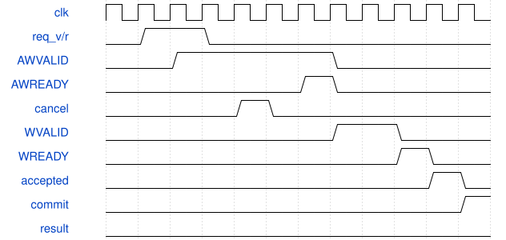
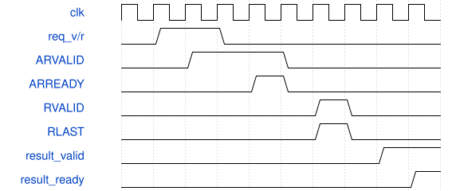

# paxi_single_outstanding_bridge 模块规范

> RTL: `cnn/hw_validation/ddr/paxi_single_outstanding_bridge.v`

## 1. 模块目的

未提供模块目的。

## 2. 参数

| 参数 | 默认值 | 说明 |
| --- | --- | --- |
| — | — | 本模块没有可配置参数。 |

## 3. 时钟与复位

- 时钟：`{"name": "i_clk", "edge": "rising", "domain": "ddr_user"}`
- 复位：`{"name": "i_rstn", "polarity": "active_low", "synchrony": "asynchronous_assert", "scope": "coordinated_bridge_and_controller_hard_reset"}`

## 4. 接口信号规范

| 信号 | 方向 | 位宽 | 时钟域 | 语义角色 | 描述 |
| --- | --- | --- | --- | --- | --- |
| `i_clk` | input | 1 | ddr_user | clock | DDR user clock |
| `i_rstn` | input | 1 | ddr_user | coordinated_reset | Active-low hard reset shared with the endpoint |
| `i_req_valid` | input | 1 | ddr_user | request_valid | Holds the complete upstream request stable |
| `i_req_write` | input | 1 | ddr_user | request_operation | Selects a write when high |
| `i_req_byte_addr` | input | 32 | ddr_user | request_address | Sixteen-byte-aligned logical byte address |
| `i_req_write_data` | input | 128 | ddr_user | request_write_payload | One complete write beat cached before AW |
| `i_req_write_mask` | input | 16 | ddr_user | request_high_active_mask | One masks the corresponding write byte |
| `i_req_epoch` | input | 32 | ddr_user | request_epoch | Coordinated-restart generation |
| `i_req_owner` | input | 32 | ddr_user | request_owner | Return owner retained through drain |
| `i_cancel` | input | 1 | ddr_user | local_cancel | Cancels the sole active owner without erasing it |
| `o_req_ready` | output | 1 | ddr_user | request_ready | Accepts one local request while idle |
| `i_commit_confirmed` | input | 1 | ddr_user | external_commit_proof | Reviewed external event proving the active write has committed |
| `i_result_ready` | input | 1 | ddr_user | result_ready | Consumes a held successful result |
| `o_result_valid` | output | 1 | ddr_user | result_valid | Holds result metadata and data stable |
| `o_result_write` | output | 1 | ddr_user | result_operation | Marks a write result |
| `o_result_committed` | output | 1 | ddr_user | result_commit_status | High only for a write retired after explicit proof |
| `o_result_epoch` | output | 32 | ddr_user | result_epoch | Epoch of the held result |
| `o_result_owner` | output | 32 | ddr_user | result_owner | Owner of the held result |
| `o_result_read_data` | output | 128 | ddr_user | result_read_payload | Attributed one-beat read data |
| `o_paxi_accepted_valid` | output | 1 | ddr_user | acceptance_telemetry | Pulses for an accepted AR or completed AW and W pair |
| `o_paxi_accepted_write` | output | 1 | ddr_user | acceptance_operation | Marks write-channel acceptance without claiming commit |
| `o_paxi_accepted_epoch` | output | 32 | ddr_user | acceptance_epoch | Epoch associated with the acceptance pulse |
| `o_paxi_accepted_owner` | output | 32 | ddr_user | acceptance_owner | Owner associated with the acceptance pulse |
| `o_drain_done` | output | 1 | ddr_user | drain_status | High only with no request, reservation, or held result |
| `o_protocol_fault` | output | 1 | ddr_user | fault_status | Sticky fail-closed protocol fault |
| `o_late_discard_count` | output | 32 | ddr_user | late_discard_counter | Counts terminal events arriving after cancellation |
| `o_cancelled_drain_count` | output | 32 | ddr_user | cancelled_drain_counter | Counts accepted transactions fully drained after cancellation |
| `i_paxi_arready` | input | 1 | ddr_user | paxi_arready | Actual controller read-address ready |
| `o_paxi_arvalid` | output | 1 | ddr_user | paxi_arvalid | Read address valid held through acceptance |
| `o_paxi_araddr` | output | 25 | ddr_user | paxi_araddr | Byte address shifted right by one |
| `i_paxi_awready` | input | 1 | ddr_user | paxi_awready | Actual controller write-address ready |
| `o_paxi_awvalid` | output | 1 | ddr_user | paxi_awvalid | Write address valid held through acceptance |
| `o_paxi_awaddr` | output | 25 | ddr_user | paxi_awaddr | Byte address shifted right by one |
| `i_paxi_wready` | input | 1 | ddr_user | paxi_wready | Actual controller write-data ready |
| `o_paxi_wvalid` | output | 1 | ddr_user | paxi_wvalid | Write data first presented one cycle after AW acceptance |
| `o_paxi_wdata` | output | 128 | ddr_user | paxi_wdata | Cached write beat held under backpressure |
| `o_paxi_wmask` | output | 16 | ddr_user | paxi_high_active_mask | Cached high-active mask held under backpressure |
| `i_paxi_rvalid` | input | 1 | ddr_user | paxi_rvalid | No-READY controller return valid |
| `i_paxi_rlast` | input | 1 | ddr_user | paxi_rlast | Must mark the single expected return beat |
| `i_paxi_rdata` | input | 128 | ddr_user | paxi_rdata | Controller read-return payload |

## 5. 周期行为与延迟

- A valid upstream request is cached while idle, then checked for the reserved range and sixteen-byte alignment before any PAXI valid is presented.
- ARVALID and AWVALID remain asserted with stable addresses from first presentation through their own READY handshakes, including after local cancellation.
- Write data is already cached before AW and WVALID first asserts in the cycle after AW acceptance; WVALID, WDATA, and the high-active mask remain stable until WREADY.
- Read acceptance occurs only on ARVALID and ARREADY. Write acceptance telemetry occurs only after both AW and W have independently accepted.
- An accepted read retains owner and return reservation until the one RVALID and RLAST beat retires. An accepted write retains owner until a later explicit commit confirmation.
- Cancellation before first AR or AW presentation stops issue. Cancellation after presentation preserves channel validity and ownership, drains the attributed terminal event, increments cancellation telemetry, and never publishes success.
- Result metadata and read data remain stable until result ready. A same-cycle cancel suppresses result valid and wins over the result handshake as an explicit shared-flush exception, not as ordinary ready/valid behavior.
- Unexpected return, missing RLAST, early commit confirmation, or an invalid address enters a sticky fail-closed state cleared only by coordinated hard reset.

## 6. WaveDrom 时序图

### Write cancellation after AW presentation

AW remains presented across cancellation and backpressure. W appears only after AW acceptance. The later explicit commit drains the cancelled owner without a result.

- WaveJSON：[paxi_single_outstanding_bridge_write-cancel-backpressure.json5](waveforms/paxi_single_outstanding_bridge_write-cancel-backpressure.json5)

### Read return ownership and result hold

AR accepts independently, the one no-READY return is captured with RLAST, and the result remains stable until ready.

- WaveJSON：[paxi_single_outstanding_bridge_read-success-backpressure.json5](waveforms/paxi_single_outstanding_bridge_read-success-backpressure.json5)

## 7. 边界、反压与错误

- Cancellation while ARVALID or AWVALID is stalled must not withdraw VALID or change address.
- Cancellation after AW but before W acceptance must continue holding W until WREADY, then wait for explicit commit proof.
- Commit confirmation in the W-handshake cycle is rejected as early by this conservative attribution contract.
- A read return coincident with cancellation is discarded with its known owner and counted, never published.
- The first and last legal blocks pass; an unaligned, lower, or end-exclusive address fails closed.
- A held successful result can be cancelled before ready and must not complete successfully.

## 8. CDC 与综合约束

- Synthesizable Verilog-2001 with one globally outstanding controller request and no timeout.
- Each request transfers exactly sixteen bytes in the inclusive block-start range 0x03400000 through 0x03fffff0.
- The address conversion is fixed to PAXI address equals byte address shifted right by one.
- i_rstn may clear ownership only when the same hard reset also resets the controller endpoint so no old return can arrive afterward.
- i_commit_confirmed must remain low in production until a build-matched vendor contract proves its ordering and visibility semantics.
- The two-clock manual rule is treated as a W presentation deadline. This bridge presents W one cycle after AW acceptance; delayed W acceptance under WREADY backpressure still requires vendor confirmation.

## 9. 验证与验收

- PY_ADDR_BOUNDARY checks the reserved range and sixteen-byte alignment in the Python reference.
- TB_WRITE_CANCEL_BACKPRESSURE checks AW stability across cancel, delayed W acceptance, high-active mask stability, accepted-only telemetry, and late commit discard.
- TB_WRITE_SUCCESS checks strict AW-before-W sequencing and requires a later explicit commit event before success.
- TB_READ_CANCEL_BACKPRESSURE checks AR stability across cancel and attributed late-return discard.
- TB_READ_SUCCESS checks the last legal address, single RLAST beat, owner metadata, and result backpressure stability.
- TB_CONSERVATION checks accepted equals successful plus cancelled-drained at a fully drained boundary.
- TB_PROTOCOL_FAULTS checks end-exclusive address rejection, missing RLAST, unexpected return, and same-cycle W commit rejection.

## 10. 可追溯性

- 规格模块：`paxi_single_outstanding_bridge`
- RTL 路径：`cnn/hw_validation/ddr/paxi_single_outstanding_bridge.v`
- 交付要求：本文档、WaveJSON 和 SVG 必须与同一版本规格一同发布。
