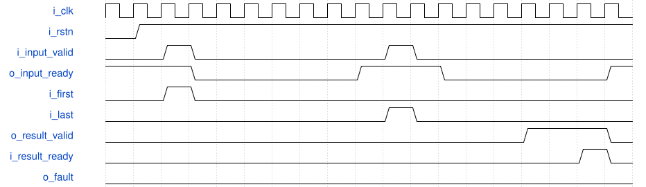

# road_mac_probe 模块规范

> RTL: `road_mac_probe.v`

## 1. 模块目的

Single-inflight signed INT8 8-input by 3-output MAC arithmetic probe with explicit INT32 overflow faulting.

## 2. 参数

| 参数 | 默认值 | 说明 |
| --- | --- | --- |
| — | — | 本模块没有可配置参数。 |

## 3. 时钟与复位

- 时钟：`{"name": "i_clk", "edge": "posedge", "frequency_hz": 100000000}`
- 复位：`{"name": "i_rstn", "active": "low", "synchronous": false, "values": "All valid, fault, accumulator, and pipeline registers clear to zero."}`

## 4. 接口信号规范

| 信号 | 方向 | 位宽 | 时钟域 | 语义角色 | 描述 |
| --- | --- | --- | --- | --- | --- |
| `i_clk` | input | 1 | i_clk | clock | 100 MHz probe clock. |
| `i_rstn` | input | 1 | i_clk | reset | Asynchronous active-low reset that cancels in-flight work. |
| `i_input_valid` | input | 1 | i_clk | input_valid | Holds the complete input payload valid until accepted. |
| `i_first` | input | 1 | i_clk | sequence_first | Selects the bias payload instead of the retained accumulator. |
| `i_last` | input | 1 | i_clk | sequence_last | Requests publication after this accepted beat. |
| `i_lane_mask` | input | 8 | i_clk | lane_enable | Enables each activation lane for all three outputs. |
| `i_activation_data` | input | 64 | i_clk | activation_payload | Eight signed INT8 activations with lane zero in the least-significant byte. |
| `i_weight_data` | input | 192 | i_clk | weight_payload | Three consecutive groups of eight signed INT8 weights. |
| `i_bias_data` | input | 96 | i_clk | bias_payload | Three signed INT32 biases with output zero in the least-significant word. |
| `i_result_ready` | input | 1 | i_clk | output_ready | Accepts the held normal result or fault terminal. |
| `o_input_ready` | output | 1 | i_clk | input_ready | Allows one new beat when no earlier beat remains in flight. |
| `o_result_valid` | output | 1 | i_clk | output_valid | Qualifies a held result or fault terminal until ready is asserted. |
| `o_result_data` | output | 96 | i_clk | result_payload | Three signed INT32 accumulator results, forced to zero when fault is high. |
| `o_fault` | output | 1 | i_clk | overflow_fault | Marks any channel candidate outside the signed INT32 range. |

## 5. 周期行为与延迟

- An input transfers only when i_input_valid and o_input_ready are high on a rising edge.
- Each enabled lane computes three signed INT8 products, giving 24 registered products per accepted beat.
- Registered pair, quad, and dot stages reduce each group of eight products without truncation.
- A first beat adds each dot product to its matching bias; a continuation beat adds to the retained accumulator.
- A non-last normal beat commits the three candidates without asserting o_result_valid.
- A last normal beat commits and publishes the three candidates.
- Any signed INT32 overflow suppresses commit, publishes o_fault with zero result data, and cannot be interpreted as success.
- While o_result_valid is high and i_result_ready is low, result data and fault remain unchanged.
- A terminal beat raises o_result_valid nine rising-edge intervals after its input acceptance.

## 6. WaveDrom 时序图

### Two-beat accumulation with held result

The first non-last beat commits internally. The continuation last beat later publishes one result, which remains stable until result ready is asserted.

- WaveJSON：[road_mac_probe_multi-beat-backpressure.json5](waveforms/road_mac_probe_multi-beat-backpressure.json5)

## 7. 边界、反压与错误

- A zero mask adds no products but still obeys first and last semantics.
- INT8 -128 times -128 produces positive 16384 and is retained without narrowing.
- Bias is selected only for an accepted first beat.
- Positive or negative signed INT32 overflow publishes fault and leaves the retained accumulator unchanged.
- Reset during any pipeline stage cancels the transaction without a late result.
- Input payload must remain stable while valid is high and ready is low.

## 8. CDC 与综合约束

- Synthesizable Verilog-2001 only.
- The implementation accepts at most one beat in flight and does not claim full-layer throughput.
- The accepted-beat interval is eleven cycles after a normal continuation beat, and thirteen cycles after an immediately accepted terminal; each output stall cycle extends the terminal interval one-for-one.
- The 24 registered multipliers describe spatial arithmetic only; this probe does not accept 24 products per cycle.
- Each combinational source cone and real-operation budget remains at or below three.
- The arithmetic probe contains no ROM, DDR, requantization, activation LUT, or production top-level connection.

## 9. 验证与验收

- Python unittest covers 1024 fixed-seed random single-beat cases plus negative extrema, masks, multi-beat accumulation, stalls, reset, and overflow.
- The Verilog testbench consumes Python-generated vectors and compares every normal terminal exactly.
- At fixed cycles after each acceptance, the Verilog testbench compares all 24 products, 12 pair sums, 6 quad sums, and 3 dot sums against Python-generated banks.
- The Verilog testbench requires the terminal valid indication exactly nine cycles after input acceptance.
- The Verilog testbench holds output ready low for three cycles and checks stable valid, data, and fault.
- The Verilog testbench asserts reset during reduction and checks that no terminal survives.

## 10. 可追溯性

- 规格模块：`road_mac_probe`
- RTL 路径：`road_mac_probe.v`
- 交付要求：本文档、WaveJSON 和 SVG 必须与同一版本规格一同发布。
