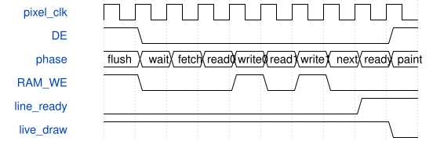

# road_box_age_overlay 模块规范

> RTL: `road_box_age_overlay.v`

## 1. 模块目的

固定两拍视频延迟的64框与既有AGE叠加

## 2. 参数

| 参数 | 默认值 | 说明 |
| --- | --- | --- |
| — | — | 本模块没有可配置参数。 |

## 3. 时钟与复位

- 时钟：`{"domain": "75MHz HDMI pixel", "timing": {"pixel_hz": 75000000, "width": 1280, "height": 720, "line_pixels": 1650, "frame_lines": 750, "normal_line_blank_samples": 370, "scan_cycles_per_entry": 5, "worst_scan_cycles": 320, "line_prepare_conservative_budget": 330, "sof_to_next_first_active_consumption_cycles": 39970, "sof_map_clear_cycles": 1280, "renderer_video_registers": 1, "combined_video_registers": 2, "source_of_sof": "rising mixer-output VS in blanking; table and renderer share same qualified edge"}}`
- 复位：`{"assertion": "common low reset cancels local line-valid immediately", "release": "supplied pixel-domain synchronous-release reset; explicit1280-address clear before paint"}`

## 4. 接口信号规范

| 信号 | 方向 | 位宽 | 时钟域 | 语义角色 | 描述 |
| --- | --- | --- | --- | --- | --- |
| `i_clk` | input | 1 | 未声明 | i_clk | i_clk |
| `i_rstn` | input | 1 | 未声明 | i_rstn | i_rstn |
| `i_sof` | input | 1 | 未声明 | i_sof | i_sof |
| `i_vsync` | input | 1 | 未声明 | i_vsync | i_vsync |
| `i_hsync` | input | 1 | 未声明 | i_hsync | i_hsync |
| `i_de` | input | 1 | 未声明 | i_de | i_de |
| `i_rgb` | input | 24 | 未声明 | i_rgb | i_rgb |
| `i_table_active_valid` | input | 1 | 未声明 | i_table_active_valid | i_table_active_valid |
| `i_table_count` | input | 7 | 未声明 | i_table_count | i_table_count |
| `i_table_entry` | input | 97 | 未声明 | i_table_entry | i_table_entry |
| `i_table_draw_valid` | input | 1 | 未声明 | i_table_draw_valid | i_table_draw_valid |
| `i_age_upper_ms` | input | 64 | 未声明 | i_age_upper_ms | i_age_upper_ms |
| `o_table_read_index` | output | 6 | 未声明 | o_table_read_index | o_table_read_index |
| `o_vsync` | output | 1 | 未声明 | o_vsync | o_vsync |
| `o_hsync` | output | 1 | 未声明 | o_hsync | o_hsync |
| `o_de` | output | 1 | 未声明 | o_de | o_de |
| `o_rgb` | output | 24 | 未声明 | o_rgb | o_rgb |
| `o_line_ready` | output | 1 | 未声明 | o_line_ready | o_line_ready |
| `o_prepare_busy` | output | 1 | 未声明 | o_prepare_busy | o_prepare_busy |
| `o_last_prepare_cycles` | output | 9 | 未声明 | o_last_prepare_cycles | o_last_prepare_cycles |
| `o_fault` | output | 1 | 未声明 | o_fault | o_fault |

## 5. 周期行为与延迟

- FINAL97 source coordinates each20bit, integer12bit<<8; frozen NMS already RNE scales once. No second rounding.
- Field layout: class[0],score[16:1],x0[36:17],y0[56:37],x1[76:57],y1[96:77].
- Nonzero fractional bits are malformed display input: skip that box only, never modify original table or invent rounded geometry.
- Clamp integer ends to width1280/height720. x0>=x1 or y0>=y1 means no paint, not table error or removed result.
- Half-open1px outline: x0/x1-1 verticals, y0/y1-1 horizontals; width1/height1 remain valid.
- person0 green00ff00, vehicle1 cyan00ffff; person wins cross-class overlap; white AGE glyphs have final priority.
- Reuse frozen road_age_overlay unchanged; feed renderer registered SOF and equal-delay video. It latches table age on the following blank edge.
- Combined RGB/VS/HS/DE have exactly two pixel registers; preserve raw RGB alongside the same two registers.
- After AGE, live permission loss must remove even a previously queued box color immediately. With fixed nonwhite box colors and white-only transparent AGE, final live-invalid mux retains white pixels and otherwise selects equally delayed raw RGB. This preserves AGE and ordinary white background without duplicating glyph logic.
- Known finite age remains text when boxes expire; UINT64_MAX/10000+ renders AGE_INVALID. New table instance2000ms; old500ms sources untouched.

## 6. WaveDrom 时序图

### 行消隐准备与连续像素输出

Five cycles per entry, no same-address consumed read/write; physical timing unverified.

- WaveJSON：[road_box_age_overlay_normal.json5](waveforms/road_box_age_overlay_normal.json5)

## 7. 边界、反压与错误

- 0/1/32/33/64,overlap,tiny/right/bottom edges,late preparation,reset,map clear,age2000/invalid

## 8. CDC 与综合约束

- Only independent box_overlay_joint_20261016 writes. No production/video chain replacement, TD, training, bitstream, board, Flash or timing exceptions.
- No new source identity/publisher/slotcredit/DDR implementation. Existing actual C9 pipeline/table/time reused read-only in joint test.
- Injected boxes test renderer, not recognition. Real7box path uses frozen HEAD112 -> correct vendor ROM -> actual postprocess/publisher/table -> renderer.
- Functional pass does not prove physical mapping/timing, full67 layers, DDR loop,1FPS or precision.
- {'new_DSP': 0, 'new_ERAM': 0, 'incremental_Slice_management_target': 600, 'line_event_bits': 23040, 'ideal_64bit_per_Slice_storage': 360, 'qualification': 'capacity estimate only; native packing, deep mux, control and AGE must be measured by C7 TD; no resource pass claim'}

## 9. 验证与验收

- Python complete-frame pixels
- actual vendor distributedRAM
- real C9 ROM/postprocess/publisher/table chain

## 10. 可追溯性

- 规格模块：`road_box_age_overlay`
- RTL 路径：`road_box_age_overlay.v`
- 交付要求：本文档、WaveJSON 和 SVG 必须与同一版本规格一同发布。
