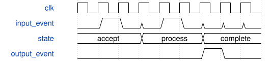

# road_capture_slots 模块规范

> RTL: `road_capture_slots.v`

## 1. 模块目的

完整输入帧双槽生命周期控制

## 2. 参数

| 参数 | 默认值 | 说明 |
| --- | --- | --- |
| — | — | 本模块没有可配置参数。 |

## 3. 时钟与复位

- 时钟：`{"domains": "single i_clk domain; no CDC supplied"}`
- 复位：`{"assertion": "i_rstn low asynchronously cancels state and transactions", "release": "caller supplies locally synchronized release; external DDR drain is not implemented"}`

## 4. 接口信号规范

| 信号 | 方向 | 位宽 | 时钟域 | 语义角色 | 描述 |
| --- | --- | --- | --- | --- | --- |
| `i_clk` | input | 1 | 未声明 | i_clk | i_clk |
| `i_rstn` | input | 1 | 未声明 | i_rstn | i_rstn |
| `i_sof` | input | 1 | 未声明 | i_sof | i_sof |
| `i_epoch` | input | 32 | 未声明 | i_epoch | i_epoch |
| `i_frame_id` | input | 32 | 未声明 | i_frame_id | i_frame_id |
| `i_timestamp` | input | 64 | 未声明 | i_timestamp | i_timestamp |
| `i_capture_end` | input | 1 | 未声明 | i_capture_end | i_capture_end |
| `i_capture_bytes` | input | 19 | 未声明 | i_capture_bytes | i_capture_bytes |
| `i_frame_error` | input | 1 | 未声明 | i_frame_error | i_frame_error |
| `i_write_visible` | input | 1 | 未声明 | i_write_visible | i_write_visible |
| `i_visible_slot` | input | 1 | 未声明 | i_visible_slot | i_visible_slot |
| `i_visible_epoch` | input | 32 | 未声明 | i_visible_epoch | i_visible_epoch |
| `i_visible_frame_id` | input | 32 | 未声明 | i_visible_frame_id | i_visible_frame_id |
| `i_read_claim_valid` | input | 1 | 未声明 | i_read_claim_valid | i_read_claim_valid |
| `i_read_claim_slot` | input | 1 | 未声明 | i_read_claim_slot | i_read_claim_slot |
| `i_read_claim_epoch` | input | 32 | 未声明 | i_read_claim_epoch | i_read_claim_epoch |
| `i_read_claim_frame_id` | input | 32 | 未声明 | i_read_claim_frame_id | i_read_claim_frame_id |
| `i_last_read_consumed` | input | 1 | 未声明 | i_last_read_consumed | i_last_read_consumed |
| `i_release_slot` | input | 1 | 未声明 | i_release_slot | i_release_slot |
| `i_release_epoch` | input | 32 | 未声明 | i_release_epoch | i_release_epoch |
| `i_release_frame_id` | input | 32 | 未声明 | i_release_frame_id | i_release_frame_id |
| `o_claim_ready` | output | 1 | 未声明 | o_claim_ready | o_claim_ready |
| `o_capture_active` | output | 1 | 未声明 | o_capture_active | o_capture_active |
| `o_capture_slot` | output | 1 | 未声明 | o_capture_slot | o_capture_slot |
| `o_capture_base` | output | 32 | 未声明 | o_capture_base | o_capture_base |
| `o_capture_accepted` | output | 1 | 未声明 | o_capture_accepted | o_capture_accepted |
| `o_frame_skipped` | output | 1 | 未声明 | o_frame_skipped | o_frame_skipped |
| `o_free_mask` | output | 2 | 未声明 | o_free_mask | o_free_mask |
| `o_ready_mask` | output | 2 | 未声明 | o_ready_mask | o_ready_mask |
| `o_reading_mask` | output | 2 | 未声明 | o_reading_mask | o_reading_mask |
| `o_quarantine_mask` | output | 2 | 未声明 | o_quarantine_mask | o_quarantine_mask |
| `o_slot_epochs` | output | 64 | 未声明 | o_slot_epochs | o_slot_epochs |
| `o_slot_frame_ids` | output | 64 | 未声明 | o_slot_frame_ids | o_slot_frame_ids |
| `o_slot_timestamps` | output | 128 | 未声明 | o_slot_timestamps | o_slot_timestamps |
| `o_protocol_error` | output | 1 | 未声明 | o_protocol_error | o_protocol_error |

## 5. 周期行为与延迟

- FREE -> CAPTURING -> WAIT_VISIBLE -> READY -> READING -> FREE.
- SOF allocates only pre-edge FREE, slot0 first; no free means whole frame skipped.
- 442368-byte successful end is not READY until external matching write_visible.
- Matching same-edge full capture_end and write_visible may publish.
- Claim consumes pre-edge READY only; release consumes matched pre-edge READING only.
- Malformed capture quarantines its slot until reset; another slot remains independent.
- SOF during active capture quarantines old capture and skips new; independent other-slot events still apply.
- External visibility and last-read facts are controlled TB events, not physical DDR proof.

## 6. WaveDrom 时序图

### 组件事件与可见性边界

Illustrative event sequence, not an external DDR latency guarantee.

- WaveJSON：[road_capture_slots_normal.json5](waveforms/road_capture_slots_normal.json5)

## 7. 边界、反压与错误

- reset, simultaneous events, partial input, stale events, overload

## 8. CDC 与综合约束

- Do not modify production, arithmetic, timing exceptions or real peripheral protocol.
- No physical mapping, bitstream, board or real DDR visibility claim.

## 9. 验证与验收

- double-slot lifecycle, same-edge end/visible, stale identity, quarantine, release

## 10. 可追溯性

- 规格模块：`road_capture_slots`
- RTL 路径：`road_capture_slots.v`
- 交付要求：本文档、WaveJSON 和 SVG 必须与同一版本规格一同发布。
