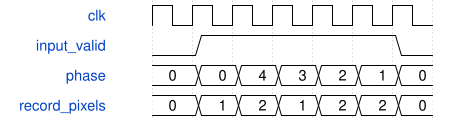

# road_area_resize 模块规范

> RTL: `road_area_resize.v`

## 1. 模块目的

精确2/5面积缩放

## 2. 参数

| 参数 | 默认值 | 说明 |
| --- | --- | --- |
| — | — | 本模块没有可配置参数。 |

## 3. 时钟与复位

- 时钟：`{"domains": "single i_clk domain; no CDC supplied"}`
- 复位：`{"assertion": "i_rstn low asynchronously cancels state and transactions", "release": "caller supplies locally synchronized release; external DDR drain is not implemented"}`

## 4. 接口信号规范

| 信号 | 方向 | 位宽 | 时钟域 | 语义角色 | 描述 |
| --- | --- | --- | --- | --- | --- |
| `i_clk` | input | 1 | 未声明 | i_clk | i_clk |
| `i_rstn` | input | 1 | 未声明 | i_rstn | i_rstn |
| `i_rgb` | input | 96 | 未声明 | i_rgb | i_rgb |
| `i_valid` | input | 1 | 未声明 | i_valid | i_valid |
| `i_sof` | input | 1 | 未声明 | i_sof | i_sof |
| `i_eol` | input | 1 | 未声明 | i_eol | i_eol |
| `o_pixels` | output | 48 | 未声明 | o_pixels | o_pixels |
| `o_pixel_mask` | output | 2 | 未声明 | o_pixel_mask | o_pixel_mask |
| `o_sof` | output | 1 | 未声明 | o_sof | o_sof |
| `o_eol` | output | 1 | 未声明 | o_eol | o_eol |
| `o_eof` | output | 1 | 未声明 | o_eof | o_eof |
| `o_frame_error` | output | 1 | 未声明 | o_frame_error | o_frame_error |
| `o_busy` | output | 1 | 未声明 | o_busy | o_busy |

## 5. 周期行为与延迟

- AWB96 high lane first; each lane R[23:16], G[15:8], B[7:0].
- 1280x720 to 512x288; horizontal 11-bit and vertical 13-bit; round once after /25.
- 128 record queue; each record contains one or two horizontal sums; worker emits at most one pixel per cycle.
- Ordinary fixture: 320 active beats plus 480 gap clocks per row; overflow cancels frame.
- Output low byte R,G,B; mask01; SOF first pixel, EOL each 512th, EOF final pixel.
- No camera backpressure; short/long row, reentrant SOF, overflow or reset flush partial frame.

## 6. WaveDrom 时序图

### 五拍水平相位与变长记录

Each valid AWB96 beat creates one record. Vertical worker drains one pixel per clock; final pipeline latency is measured separately.

- WaveJSON：[road_area_resize_record-flow.json5](waveforms/road_area_resize_record-flow.json5)

## 7. 边界、反压与错误

- reset, simultaneous events, partial input, stale events, overload

## 8. CDC 与综合约束

- Do not modify production, arithmetic, timing exceptions or real peripheral protocol.
- No physical mapping, bitstream, board or real DDR visibility claim.

## 9. 验证与验收

- three complete pixelwise frames and malformed frame tests

## 10. 可追溯性

- 规格模块：`road_area_resize`
- RTL 路径：`road_area_resize.v`
- 交付要求：本文档、WaveJSON 和 SVG 必须与同一版本规格一同发布。
