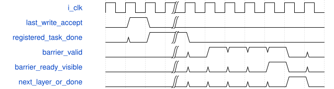

# road_csp_complete_client 模块规范

> RTL: `rtl/road_csp_complete_client.v`

## 1. 模块目的

未提供模块目的。

## 2. 参数

| 参数 | 默认值 | 说明 |
| --- | --- | --- |
| — | — | 本模块没有可配置参数。 |

## 3. 时钟与复位

- 时钟：`{"name": "i_clk", "edge": "posedge", "frequency_mhz": 100}`
- 复位：`{"name": "i_rstn", "active": "low", "synchronous": false}`

## 4. 接口信号规范

| 信号 | 方向 | 位宽 | 时钟域 | 语义角色 | 描述 |
| --- | --- | --- | --- | --- | --- |
| `i_clk` | input | 1 | 未声明 | native | 与算术owner同域100MHz |
| `i_rstn` | input | 1 | 未声明 | native | 共同复位，外部服务须同时取消旧响应 |
| `i_start` | input | 1 | 未声明 | native | ready时接受一个固定图tile |
| `i_tile_y` | input | 7 | 未声明 | native | 0至68且四对齐 |
| `i_tile_x` | input | 8 | 未声明 | native | 0至124且四对齐 |
| `i_cancel` | input | 1 | 未声明 | native | 取消后不释放外部存储，需共同复位 |
| `i_table_loaded` | input | 1 | 未声明 | native | 外部owner已有同包完整SiLU表 |
| `o_start_ready` | output | 1 | 未声明 | native | 空闲且表有效才接任务 |
| `o_busy` | output | 1 | 未声明 | native | 故障时保持占有，不冒充排空 |
| `o_done` | output | 1 | 未声明 | native | 末层可见性确认后一拍完成 |
| `o_fault` | output | 1 | 未声明 | native | 粘滞协议错误 |
| `o_layer` | output | 3 | 未声明 | native | 当前五个卷积阶段 |
| `o_parameter_valid` | output | 1 | 未声明 | native | 一组参数读取请求 |
| `o_parameter_channel` | output | 5 | 未声明 | native | DW通道或PW三输出起点 |
| `o_parameter_group` | output | 2 | 未声明 | native | 八输入组编号 |
| `o_parameter_window` | output | 3 | 未声明 | native | DW并集宽3或5；PW为0 |
| `i_parameter_ready` | input | 1 | 未声明 | native | 请求真实被参数服务接受 |
| `i_parameter_response_valid` | input | 1 | 未声明 | native | 注册参数响应，保持至response_ready |
| `o_parameter_response_ready` | output | 1 | 未声明 | native | 仅等待本请求时消费 |
| `i_parameter_response_layer` | input | 3 | 未声明 | native | 响应阶段身份 |
| `i_parameter_response_channel` | input | 5 | 未声明 | native | 响应输出通道身份 |
| `i_parameter_response_group` | input | 2 | 未声明 | native | 响应归约组身份 |
| `i_parameter_response_window` | input | 3 | 未声明 | native | 响应DW窗口形态 |
| `i_parameter_weight` | input | 192 | 未声明 | native | OIHW映射到三路八输入 |
| `i_parameter_data` | input | 248 | 未声明 | native | 原bias/pre/post字段紧凑排列 |
| `i_parameter_error` | input | 1 | 未声明 | native | 外部参数读取故障 |
| `o_read_valid` | output | 1 | 未声明 | native | 单个逻辑字节读请求 |
| `o_read_address` | output | 32 | 未声明 | native | 冻结graph逻辑字节，非native地址 |
| `i_read_ready` | input | 1 | 未声明 | native | 服务接受请求，不代表响应已到 |
| `i_read_response_valid` | input | 1 | 未声明 | native | 一次请求对应一次注册响应 |
| `o_read_response_ready` | output | 1 | 未声明 | native | 不接受其它任务旧响应 |
| `i_read_response_address` | input | 32 | 未声明 | native | 与请求绑定的字节地址 |
| `i_read_response_data` | input | 8 | 未声明 | native | 真正读取的INT8字节 |
| `i_read_error` | input | 1 | 未声明 | native | 服务显式读错误 |
| `o_write_valid` | output | 1 | 未声明 | native | 合法算术结果才向外发布 |
| `o_write_address` | output | 32 | 未声明 | native | 本次真实写地址 |
| `o_write_data` | output | 8 | 未声明 | native | 融合后sat8值 |
| `o_write_sum` | output | 9 | 未声明 | native | 饱和前精确残差和 |
| `i_write_ready` | input | 1 | 未声明 | native | 写服务接受，尚不等于可见 |
| `o_barrier_valid` | output | 1 | 未声明 | native | 本阶段全部写接受后请求可见性屏障 |
| `i_barrier_ready` | input | 1 | 未声明 | native | 明确保证此前写可供后续读消费 |
| `i_barrier_layer` | input | 3 | 未声明 | native | 屏障所属阶段，不能承认旧层ack |
| `o_core_valid` | output | 1 | 未声明 | native | 原算术核组valid |
| `i_core_ready` | input | 1 | 未声明 | native | 原算术核输入组ready |
| `o_core_first` | output | 1 | 未声明 | native | 原接口首组语义不变 |
| `o_core_last` | output | 1 | 未声明 | native | 原接口末组语义不变 |
| `o_core_input_mask` | output | 8 | 未声明 | native | 八输入尾mask |
| `o_core_activation` | output | 64 | 未声明 | native | 原64位INT8输入 |
| `o_core_weight` | output | 192 | 未声明 | native | 原192位权重 |
| `o_core_bias` | output | 96 | 未声明 | native | first只加一次的三路bias |
| `o_core_output_mask` | output | 3 | 未声明 | native | 图边界或三空间点尾路 |
| `o_core_tags` | output | 48 | 未声明 | native | 单任务lane身份0/1/2 |
| `o_core_addresses` | output | 96 | 未声明 | native | 三路完整真实字节地址 |
| `o_core_pre_multiplier` | output | 96 | 未声明 | native | 三路原pre乘数 |
| `o_core_pre_shift` | output | 18 | 未声明 | native | 三路六位pre移位 |
| `o_core_post_multiplier` | output | 32 | 未声明 | native | 当前层共享post乘数 |
| `o_core_post_shift` | output | 6 | 未声明 | native | 当前层共享post移位 |
| `o_core_residual` | output | 1 | 未声明 | native | 两个PW阶段才做旁路融合 |
| `o_core_bypass` | output | 24 | 未声明 | native | 对应三输出的真实旁路 |
| `i_core_output_valid` | input | 1 | 未声明 | native | 原五级写回发布结果 |
| `o_core_output_ready` | output | 1 | 未声明 | native | 合法结果与外部写原子接受 |
| `i_core_output_tag` | input | 16 | 未声明 | native | 原核返回任务lane |
| `i_core_output_address` | input | 32 | 未声明 | native | 原核返回完整地址 |
| `i_core_output_data` | input | 8 | 未声明 | native | 原核sat8输出 |
| `i_core_output_sum` | input | 9 | 未声明 | native | 原核signed9和 |
| `i_core_fault` | input | 1 | 未声明 | native | 原核错误，不修改其故障语义 |

## 5. 周期行为与延迟

- 五阶段固定图调度：DW0、PW0加残差、DW1、PW1加残差、PW融合
- 第一残差6x6真实邻域支持第二残差4x4输出；仅全幅图像外padding
- 无私有算术实例，valid/ready组与现算术核保持兼容
- 末次真实写、注册task_done、层可见性屏障是不同事件
- 共同复位取消所有参与服务；取消故障不释放存储，不能用于独立CNN取消

## 6. WaveDrom 时序图

### 末次真实写与阶段可见性

竖线省略其它任务和算术延迟；屏障等待没有固定拍数保证

- WaveJSON：[road_csp_complete_client_barrier.json5](waveforms/road_csp_complete_client_barrier.json5)

## 7. 边界、反压与错误

- 全幅四边及尾输入/输出lane
- 组间参数漂移、错地址/错tag/重复写拒绝
- 参数、读、写背压稳定
- 共同复位后重新装表
- 层屏障错身份拒绝

## 8. CDC 与综合约束

- 逻辑字节服务/参数端口为外围提案，未接真实DDR或ROM reader
- 未修改共享算术核接口、II、数值或生产工程；非部署交付

## 9. 验证与验收

- 同包acc/pre/SiLU/post/sum/output/address逐项比较
- 四角四边内部与连续不同tile
- 各阶段复位及协议负例
- 检查器故意错误期望负例

## 10. 可追溯性

- 规格模块：`road_csp_complete_client`
- RTL 路径：`rtl/road_csp_complete_client.v`
- 交付要求：本文档、WaveJSON 和 SVG 必须与同一版本规格一同发布。
