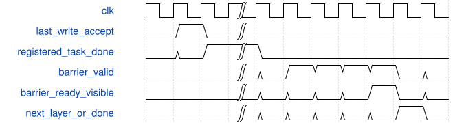

# tb_csp_complete_client 模块规范

> RTL: `tests/tb_csp_complete_client.v`

## 1. 模块目的

未提供模块目的。

## 2. 参数

| 参数 | 默认值 | 说明 |
| --- | --- | --- |
| — | — | 本模块没有可配置参数。 |

## 3. 时钟与复位

- 时钟：`{"name": "clk", "edge": "posedge", "frequency_mhz": 100}`
- 复位：`{"name": "rstn", "active": "low", "synchronous": false}`

## 4. 接口信号规范

| 信号 | 方向 | 位宽 | 时钟域 | 语义角色 | 描述 |
| --- | --- | --- | --- | --- | --- |
| `o_test_complete` | output | 1 | 未声明 | verification_completion | 所有当前场景检查完成后置位 |

## 5. 周期行为与延迟

- 五阶段固定图调度：DW0、PW0加残差、DW1、PW1加残差、PW融合
- 第一残差6x6真实邻域支持第二残差4x4输出；仅全幅图像外padding
- 无私有算术实例，valid/ready组与现算术核保持兼容
- 末次真实写、注册task_done、层可见性屏障是不同事件
- 共同复位取消所有参与服务；取消故障不释放存储，不能用于独立CNN取消

## 6. WaveDrom 时序图

### 末次真实写与阶段可见性

竖线省略其它任务和算术延迟；屏障等待没有固定拍数保证

- WaveJSON：[tb_csp_complete_client_barrier.json5](waveforms/tb_csp_complete_client_barrier.json5)

## 7. 边界、反压与错误

- 全幅四边及尾输入/输出lane
- 组间参数漂移、错地址/错tag/重复写拒绝
- 参数、读、写背压稳定
- 共同复位后重新装表
- 层屏障错身份拒绝

## 8. CDC 与综合约束

- 逻辑字节服务/参数端口为外围提案，未接真实DDR或ROM reader
- 未修改共享算术核接口、II、数值或生产工程；非部署交付

## 9. 验证与验收

- 同包acc/pre/SiLU/post/sum/output/address逐项比较
- 四角四边内部与连续不同tile
- 各阶段复位及协议负例
- 检查器故意错误期望负例

## 10. 可追溯性

- 规格模块：`tb_csp_complete_client`
- RTL 路径：`tests/tb_csp_complete_client.v`
- 交付要求：本文档、WaveJSON 和 SVG 必须与同一版本规格一同发布。
