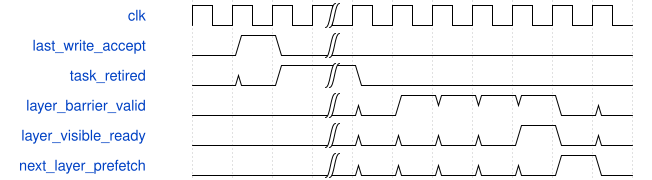
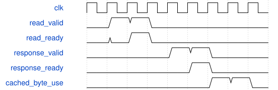

# tb_csp_layer_client 模块规范

> RTL: `tests/tb_csp_layer_client.v`

## 1. 模块目的

未提供模块目的。

## 2. 参数

| 参数 | 默认值 | 说明 |
| --- | --- | --- |
| — | — | 本模块没有可配置参数。 |

## 3. 时钟与复位

- 时钟：`{"name": "clk", "edge": "posedge", "frequency_mhz": 100}`
- 复位：`{"name": "rstn", "active": "low", "synchronous": false}`

## 4. 接口信号规范

| 信号 | 方向 | 位宽 | 时钟域 | 语义角色 | 描述 |
| --- | --- | --- | --- | --- | --- |
| `o_test_complete` | output | 1 | 未声明 | verification_completion | 完整当前场景检查成功后置位 |

## 5. 周期行为与延迟

- 一帧五阶段顺序全幅遍历，每个逻辑输出计算和写入一次
- 4x4输出tile，DW真实6x6输入；只有真实图像外补零
- 16B对齐逻辑读取与完整tile输入复用；当前输出组权重驻留
- 原核首末组、三路输出及signed9残差饱和完全保留
- 最后真实写、任务退休、整层写可见性屏障和done分别观察
- 共同复位取消所有端点并重新装表；不声称独立取消排空

## 6. WaveDrom 时序图

### 完整层可见性和下一层读取

中间省略所有tile；ready表示受控服务写可见，不是固定等待

- WaveJSON：[tb_csp_layer_client_barrier.json5](waveforms/tb_csp_layer_client_barrier.json5)

### 16B单一未完成读取

请求/返回独立反压；地址为逻辑字节且16B对齐

- WaveJSON：[tb_csp_layer_client_read.json5](waveforms/tb_csp_layer_client_read.json5)

## 7. 边界、反压与错误

- 四边padding、DW尾一路、PW12输入尾四lane
- 随机请求/返回/核授予/写反压及载荷稳定
- 未可见中间值禁止读取；最后阶段屏障确认前不完成
- 错误读/参数身份拒绝，故意黄金acc错误必须失败

## 8. CDC 与综合约束

- 无私有MAC；不更改真实PAXI；仅受控逻辑端点
- 缓存4ERAM只是容量目标，未综合/布局布线
- 8M首轮预算不是已达标结论；局部周期不证明整网1FPS或2FPS
- graph字节地址只在唯一外部DDR边界转换一次

## 9. 验证与验收

- 同真实图acc/pre/SiLU/post/sum/地址逐项检查663552值
- 正常全幅、随机反压全幅、共同复位再跑全幅
- 协议拒绝与检查器负例

## 10. 可追溯性

- 规格模块：`tb_csp_layer_client`
- RTL 路径：`tests/tb_csp_layer_client.v`
- 交付要求：本文档、WaveJSON 和 SVG 必须与同一版本规格一同发布。
