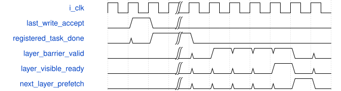

# road_csp_family_client 模块规范

> RTL: `rtl/road_csp_family_client.v`

## 1. 模块目的

未提供模块目的。

## 2. 参数

| 参数 | 默认值 | 说明 |
| --- | --- | --- |
| C_FAMILY | 3 | 合法常量3=CSP3，4=CSP4 |

## 3. 时钟与复位

- 时钟：`{"name": "i_clk", "edge": "posedge", "frequency_mhz": 100}`
- 复位：`{"name": "i_rstn", "active": "low", "synchronous": false}`

## 4. 接口信号规范

| 信号 | 方向 | 位宽 | 时钟域 | 语义角色 | 描述 |
| --- | --- | --- | --- | --- | --- |
| `i_clk` | input | 1 | 未声明 | native | 与算术owner同域100MHz |
| `i_rstn` | input | 1 | 未声明 | native | 共同异步复位，服务同时撤销旧响应 |
| `i_start` | input | 1 | 未声明 | native | ready时启动一次完整固定图任务 |
| `i_cancel` | input | 1 | 未声明 | native | 取消后故障占有至共同复位 |
| `i_table_loaded` | input | 1 | 未声明 | native | 外部owner已装入同包SiLU表 |
| `o_start_ready` | output | 1 | 未声明 | native | 空闲、无故障且表有效 |
| `o_busy` | output | 1 | 未声明 | native | 包含完成拍和故障占有 |
| `o_done` | output | 1 | 未声明 | native | 末阶段可见性确认后单拍完成 |
| `o_fault` | output | 1 | 未声明 | native | 信任边界错误粘滞指示 |
| `o_layer` | output | 3 | 未声明 | native | 当前七阶段编号 |
| `o_tile_y` | output | 7 | 未声明 | native | 当前四行块起点诊断 |
| `o_tile_x` | output | 8 | 未声明 | native | 当前四列块起点诊断 |
| `o_parameter_valid` | output | 1 | 未声明 | native | 当前参数分片请求有效 |
| `o_parameter_channel` | output | 7 | 未声明 | native | DW通道或PW输出三通道起点 |
| `o_parameter_group` | output | 4 | 未声明 | native | 八输入归约组编号 |
| `o_parameter_window` | output | 3 | 未声明 | native | DW窗口并集宽度，PW为零 |
| `i_parameter_ready` | input | 1 | 未声明 | native | 参数请求被服务接受 |
| `i_parameter_response_valid` | input | 1 | 未声明 | native | 参数响应保持至ready |
| `o_parameter_response_ready` | output | 1 | 未声明 | native | 只消费当前未完成请求 |
| `i_parameter_response_layer` | input | 3 | 未声明 | native | 参数响应阶段身份 |
| `i_parameter_response_channel` | input | 7 | 未声明 | native | 参数响应输出通道身份 |
| `i_parameter_response_group` | input | 4 | 未声明 | native | 参数响应归约组身份 |
| `i_parameter_response_window` | input | 3 | 未声明 | native | 参数响应DW窗口形态 |
| `i_parameter_weight` | input | 192 | 未声明 | native | 三路八输入权重 |
| `i_parameter_data` | input | 248 | 未声明 | native | bias及动态量化字段 |
| `i_parameter_error` | input | 1 | 未声明 | native | 参数服务显式错误 |
| `o_read_valid` | output | 1 | 未声明 | native | 单个16字节行请求有效 |
| `o_read_address` | output | 32 | 未声明 | native | 十六字节对齐逻辑地址 |
| `i_read_ready` | input | 1 | 未声明 | native | 行请求被内存服务接受 |
| `i_read_response_valid` | input | 1 | 未声明 | native | 行响应保持至ready |
| `o_read_response_ready` | output | 1 | 未声明 | native | 只消费当前未完成行请求 |
| `i_read_response_address` | input | 32 | 未声明 | native | 必须匹配请求的对齐地址 |
| `i_read_response_data` | input | 128 | 未声明 | native | 低字节对应地址偏移零 |
| `i_read_error` | input | 1 | 未声明 | native | 内存服务显式读错误 |
| `o_write_valid` | output | 1 | 未声明 | native | 合法核结果写请求 |
| `o_write_address` | output | 32 | 未声明 | native | 完整冻结图字节地址 |
| `o_write_data` | output | 8 | 未声明 | native | 最终饱和INT8结果 |
| `o_write_sum` | output | 9 | 未声明 | native | 饱和前signed9残差和 |
| `i_write_ready` | input | 1 | 未声明 | native | 外部写服务接受 |
| `o_barrier_valid` | output | 1 | 未声明 | native | 当前整层全部写接受后的屏障 |
| `i_barrier_ready` | input | 1 | 未声明 | native | 此层此前写已经可读 |
| `i_barrier_layer` | input | 3 | 未声明 | native | 屏障确认所属阶段 |
| `o_core_valid` | output | 1 | 未声明 | native | 原算术核输入组有效 |
| `i_core_ready` | input | 1 | 未声明 | native | 原算术核输入组接受 |
| `o_core_first` | output | 1 | 未声明 | native | 当前任务首归约组 |
| `o_core_last` | output | 1 | 未声明 | native | 当前任务末归约组 |
| `o_core_input_mask` | output | 8 | 未声明 | native | 当前八输入有效掩码 |
| `o_core_activation` | output | 64 | 未声明 | native | 串行拼装的八个INT8输入 |
| `o_core_weight` | output | 192 | 未声明 | native | 当前归约组驻留参数 |
| `o_core_bias` | output | 96 | 未声明 | native | 三路首组偏置 |
| `o_core_output_mask` | output | 3 | 未声明 | native | DW行尾任务只启用lane零 |
| `o_core_tags` | output | 48 | 未声明 | native | 固定三路任务身份 |
| `o_core_addresses` | output | 96 | 未声明 | native | 三路完整写地址 |
| `o_core_pre_multiplier` | output | 96 | 未声明 | native | 三路动态前乘数 |
| `o_core_pre_shift` | output | 18 | 未声明 | native | 三路六位前移位 |
| `o_core_post_multiplier` | output | 32 | 未声明 | native | 当前层共享后乘数 |
| `o_core_post_shift` | output | 6 | 未声明 | native | 当前层共享后移位 |
| `o_core_residual` | output | 1 | 未声明 | native | 三个PW残差阶段使能 |
| `o_core_bypass` | output | 24 | 未声明 | native | 三路真实旁路值 |
| `i_core_output_valid` | input | 1 | 未声明 | native | 原五级写回结果有效 |
| `o_core_output_ready` | output | 1 | 未声明 | native | 核结果和外部写原子接受 |
| `i_core_output_tag` | input | 16 | 未声明 | native | 原核返回任务lane |
| `i_core_output_address` | input | 32 | 未声明 | native | 原核返回完整地址 |
| `i_core_output_data` | input | 8 | 未声明 | native | 原核返回sat8数据 |
| `i_core_output_sum` | input | 9 | 未声明 | native | 原核返回signed9和 |
| `i_core_fault` | input | 1 | 未声明 | native | 原核错误保持原语义 |

## 5. 周期行为与延迟

- C_FAMILY仅取3或4，对应冻结CSP3或CSP4，不是运行时任意图
- 七阶段按层完整遍历：三个DW/PW残差单元及最终PW融合
- 只有真实图像外补零；CSP4最后tile仅两行有效输出，禁止写物理padding行
- 16B单在途行缓存、完整tile输入复用、当前三输出通道权重驻留
- 原核组接口/II/数值保留；末次真实写、注册退休、整层可见性分别观察
- 共同复位取消全部端点，重新装SiLU；未证明独立取消排空

## 6. WaveDrom 时序图

### 完整层退休与下一层预取

省略其它任务；ready由外部写可见服务提供，不是固定等待拍数

- WaveJSON：[road_csp_family_client_barrier.json5](waveforms/road_csp_family_client_barrier.json5)

## 7. 边界、反压与错误

- CSP3完整36行、CSP4完整18行与末两行tile
- DW三点/尾一点，PW24/48/96输入组，残差alias保持
- 随机反压稳定，错误参数/读地址/返回地址/屏障拒绝
- 共同复位强制装表、检查器真实acc错误负例

## 8. CDC 与综合约束

- 合法常量C_FAMILY为3或4；参数channel7/group4只是外围扩宽
- 同一套冻结算术、无私有MAC/SiLU/完整ROM
- 4ERAM为共同工作仓目标，容量不证明实际映射或端口时序
- 100M是整机1FPS预算，局部对拍不能证明整网FPS；过期500ms不改

## 9. 验证与验收

- CSP3每次442368、CSP4每次221184阶段输出/中间值逐项一致
- 正常、随机、复位重跑和协议负例
- padding不写、源读/参数次数及周期账独立核验

## 10. 可追溯性

- 规格模块：`road_csp_family_client`
- RTL 路径：`rtl/road_csp_family_client.v`
- 交付要求：本文档、WaveJSON 和 SVG 必须与同一版本规格一同发布。
