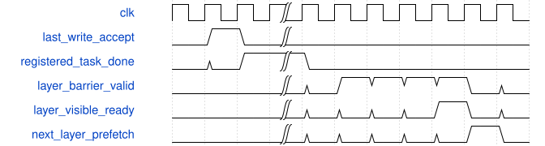

# tb_csp_family_client 模块规范

> RTL: `tests/tb_csp_family_client.v`

## 1. 模块目的

未提供模块目的。

## 2. 参数

| 参数 | 默认值 | 说明 |
| --- | --- | --- |
| C_FAMILY | 3 | 合法常量3=CSP3，4=CSP4 |

## 3. 时钟与复位

- 时钟：`{"name": "clk", "edge": "posedge", "frequency_mhz": 100}`
- 复位：`{"name": "rstn", "active": "low", "synchronous": false}`

## 4. 接口信号规范

| 信号 | 方向 | 位宽 | 时钟域 | 语义角色 | 描述 |
| --- | --- | --- | --- | --- | --- |
| `o_test_complete` | output | 1 | 未声明 | verification_completion | 当前完整场景全部检查成功后置位 |

## 5. 周期行为与延迟

- C_FAMILY仅取3或4，对应冻结CSP3或CSP4，不是运行时任意图
- 七阶段按层完整遍历：三个DW/PW残差单元及最终PW融合
- 只有真实图像外补零；CSP4最后tile仅两行有效输出，禁止写物理padding行
- 16B单在途行缓存、完整tile输入复用、当前三输出通道权重驻留
- 原核组接口/II/数值保留；末次真实写、注册退休、整层可见性分别观察
- 共同复位取消全部端点，重新装SiLU；未证明独立取消排空

## 6. WaveDrom 时序图

### 完整层退休与下一层预取

省略其它任务；ready由外部写可见服务提供，不是固定等待拍数

- WaveJSON：[tb_csp_family_client_barrier.json5](waveforms/tb_csp_family_client_barrier.json5)

## 7. 边界、反压与错误

- CSP3完整36行、CSP4完整18行与末两行tile
- DW三点/尾一点，PW24/48/96输入组，残差alias保持
- 随机反压稳定，错误参数/读地址/返回地址/屏障拒绝
- 共同复位强制装表、检查器真实acc错误负例

## 8. CDC 与综合约束

- 合法常量C_FAMILY为3或4；参数channel7/group4只是外围扩宽
- 同一套冻结算术、无私有MAC/SiLU/完整ROM
- 4ERAM为共同工作仓目标，容量不证明实际映射或端口时序
- 100M是整机1FPS预算，局部对拍不能证明整网FPS；过期500ms不改

## 9. 验证与验收

- CSP3每次442368、CSP4每次221184阶段输出/中间值逐项一致
- 正常、随机、复位重跑和协议负例
- padding不写、源读/参数次数及周期账独立核验

## 10. 可追溯性

- 规格模块：`tb_csp_family_client`
- RTL 路径：`tests/tb_csp_family_client.v`
- 交付要求：本文档、WaveJSON 和 SVG 必须与同一版本规格一同发布。
