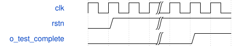

# tb_csp_first_probe 模块规范

> RTL: `tests/tb_csp_first_probe.v`

## 1. 模块目的

未提供模块目的。

## 2. 参数

| 参数 | 默认值 | 说明 |
| --- | --- | --- |
| — | — | 本模块没有可配置参数。 |

## 3. 时钟与复位

- 时钟：`{"name": "clk", "edge": "posedge", "frequency_mhz": 100}`
- 复位：`{"name": "rstn", "active": "low", "synchronous": false}`

## 4. 接口信号规范

| 信号 | 方向 | 位宽 | 时钟域 | 语义角色 | 描述 |
| --- | --- | --- | --- | --- | --- |
| `o_test_complete` | output | 1 | 未声明 | verification_completion | 仅全部相应检查通过后置1 |

## 5. 周期行为与延迟

- 内部产生时钟、装表和有限任务，逐项scoreboard
- 存储和任务由测试台驱动，不冒充可综合调度器

## 6. WaveDrom 时序图

### 检查完成

终止前置完成位，非实测耗时

- WaveJSON：[tb_csp_first_probe_completion.json5](waveforms/tb_csp_first_probe_completion.json5)

## 7. 边界、反压与错误

- 未装表禁止计算
- 元数据保持到最后有效写端接受
- 复位取消旧token并重新装表
- 故障不自动恢复

## 8. CDC 与综合约束

- 仅验证模块，不进入生产综合源清单

## 9. 验证与验收

- 真实QAT阶段逐项对拍与DW实际输出驱动PW
- 输入气泡、输出长背压及三处复位重跑
- 任务错误、INT32末组溢出、非法移位
- 合成正负饱和贯穿完整写beat

## 10. 可追溯性

- 规格模块：`tb_csp_first_probe`
- RTL 路径：`tests/tb_csp_first_probe.v`
- 交付要求：本文档、WaveJSON 和 SVG 必须与同一版本规格一同发布。
