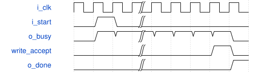

# road_csp_tile_integrated 模块规范

> RTL: `rtl/road_csp_tile_integrated.v`

## 1. 模块目的

未提供模块目的。

## 2. 参数

| 参数 | 默认值 | 说明 |
| --- | --- | --- |
| — | — | 本模块没有可配置参数。 |

## 3. 时钟与复位

- 时钟：`{"name": "i_clk", "edge": "posedge", "frequency_mhz": 100}`
- 复位：`{"name": "i_rstn", "active": "low", "synchronous": false}`

## 4. 接口信号规范

| 信号 | 方向 | 位宽 | 时钟域 | 语义角色 | 描述 |
| --- | --- | --- | --- | --- | --- |
| `i_clk` | input | 1 | i_clk | clock | 100MHz同域时钟 |
| `i_rstn` | input | 1 | i_clk | reset | 共同异步低有效复位 |
| `i_table_valid` | input | 1 | i_clk | native | 空闲时表valid |
| `i_table_addr` | input | 10 | i_clk | native | 顺序表地址 |
| `i_table_data` | input | 16 | i_clk | native | Q7.8表项 |
| `o_table_ready` | output | 1 | i_clk | native | 真实表握手许可 |
| `o_table_loaded` | output | 1 | i_clk | native | 完整表激活状态 |
| `i_source_begin` | input | 1 | i_clk | native | 清理源有效状态 |
| `o_source_begin_ready` | output | 1 | i_clk | native | 完整退休后才允许替换源 |
| `i_source_valid` | input | 1 | i_clk | native | 源字节valid |
| `i_source_address` | input | 10 | i_clk | native | 624字节逻辑源索引 |
| `i_source_data` | input | 8 | i_clk | native | 源INT8字节 |
| `o_source_ready` | output | 1 | i_clk | native | 源字节接受许可 |
| `o_source_loaded` | output | 1 | i_clk | native | 624个不同源字节齐全 |
| `i_start` | input | 1 | i_clk | native | 单tile启动请求 |
| `o_start_ready` | output | 1 | i_clk | native | 源与表完整且空闲 |
| `i_cancel` | input | 1 | i_clk | native | 边沿前取消且粘滞 |
| `i_output_ready` | input | 1 | i_clk | native | 真实外部写许可 |
| `o_output_valid` | output | 1 | i_clk | native | 完整外部写载荷valid |
| `o_output_data` | output | 8 | i_clk | native | 真实INT8输出 |
| `o_output_tag` | output | 16 | i_clk | native | DW或PW输出身份 |
| `o_output_address` | output | 32 | i_clk | native | 冻结图逻辑字节地址 |
| `o_output_sum` | output | 9 | i_clk | native | signed9残差和 |
| `o_busy` | output | 1 | i_clk | native | 任务或适配占有 |
| `o_done` | output | 1 | i_clk | native | 末次实际写后的单拍完成 |
| `o_fault` | output | 1 | i_clk | native | 粘滞故障 |

## 5. 周期行为与延迟

- 624唯一源字节及1024表项完整后单start启动，硬件产生全部描述符和操作数
- DW单端口源RAM拼装；PW只消费192个实际DW写齐后的缓存响应
- 最后有效外部写握手注册为下一拍退休脉冲再推进任务；DW写入缓存与外部观察同步接受
- source_begin只清源有效性，start只清缓存有效性，跨tile保留SiLU表

## 6. WaveDrom 时序图

### 固定tile边界与完成

省略实际算术延迟；done严格来自最后实际写

- WaveJSON：[road_csp_tile_integrated_sequence.json5](waveforms/road_csp_tile_integrated_sequence.json5)

## 7. 边界、反压与错误

- 完整源与表之前禁止启动
- 源重复和越界写粘滞错误
- 复位取消全部在途有效位
- 输出反压保持

## 8. CDC 与综合约束

- 仅首残差tile，不代表完整CSP2、整网、真实DDR或物理实现
- 保留冻结算术端口、II和数值

## 9. 验证与验收

- 320组、160任务、384输出和各中间值逐项一致
- 192实际DW写驱动128次PW缓存读
- 随机与长反压
- 三阶段复位
- 两次不同输入tile不复位核心或重装表
- 外部取消阻止同拍写

## 10. 可追溯性

- 规格模块：`road_csp_tile_integrated`
- RTL 路径：`rtl/road_csp_tile_integrated.v`
- 交付要求：本文档、WaveJSON 和 SVG 必须与同一版本规格一同发布。
