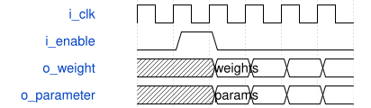

# road_csp_tile_program 模块规范

> RTL: `rtl/road_csp_tile_program.v`

## 1. 模块目的

未提供模块目的。

## 2. 参数

| 参数 | 默认值 | 说明 |
| --- | --- | --- |
| — | — | 本模块没有可配置参数。 |

## 3. 时钟与复位

- 时钟：`{"name": "i_clk", "edge": "posedge", "frequency_mhz": 100}`
- 复位：`{"name": "i_rstn", "active": "low", "synchronous": false}`

## 4. 接口信号规范

| 信号 | 方向 | 位宽 | 时钟域 | 语义角色 | 描述 |
| --- | --- | --- | --- | --- | --- |
| `i_clk` | input | 1 | i_clk | clock | 同域时钟 |
| `i_rstn` | input | 1 | i_clk | reset | 注册响应复位 |
| `i_enable` | input | 1 | i_clk | native | IDLE捕获描述符时读取 |
| `i_weight_index` | input | 6 | i_clk | native | 56词紧凑权重地址 |
| `i_parameter_index` | input | 4 | i_clk | native | 16词参数地址 |
| `o_weight` | output | 192 | i_clk | native | 注册权重词 |
| `o_parameter` | output | 248 | i_clk | native | 注册参数词 |

## 5. 周期行为与延迟

- 显式常量case，不使用数组readmemh，全部值由同一冻结整数包生成
- 真实描述符捕获沿读取，下一拍PREPARE消费；reset清响应，无使能时保持

## 6. WaveDrom 时序图

### 固定tile边界与完成

省略实际算术延迟；done严格来自最后实际写

- WaveJSON：[road_csp_tile_program_sequence.json5](waveforms/road_csp_tile_program_sequence.json5)

## 7. 边界、反压与错误

- 完整源与表之前禁止启动
- 源重复和越界写粘滞错误
- 复位取消全部在途有效位
- 输出反压保持

## 8. CDC 与综合约束

- 仅首残差tile，不代表完整CSP2、整网、真实DDR或物理实现
- 保留冻结算术端口、II和数值

## 9. 验证与验收

- 320组、160任务、384输出和各中间值逐项一致
- 192实际DW写驱动128次PW缓存读
- 随机与长反压
- 三阶段复位
- 两次不同输入tile不复位核心或重装表
- 外部取消阻止同拍写

## 10. 可追溯性

- 规格模块：`road_csp_tile_program`
- RTL 路径：`rtl/road_csp_tile_program.v`
- 交付要求：本文档、WaveJSON 和 SVG 必须与同一版本规格一同发布。
