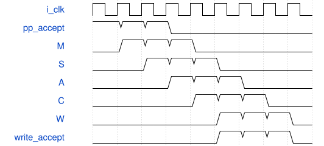

# road_csp_first_probe 模块规范

> RTL: `rtl/road_csp_first_probe.v`

## 1. 模块目的

首残差独立数据通路与有界对抗回归；不代表完整CNN或可部署实现。

## 2. 参数

| 参数 | 默认值 | 说明 |
| --- | --- | --- |
| — | — | 本模块没有可配置参数。 |

## 3. 时钟与复位

- 时钟：`{"name": "i_clk", "edge": "posedge", "frequency_mhz": 100}`
- 复位：`{"name": "i_rstn", "active": "low", "synchronous": false}`

## 4. 接口信号规范

| 信号 | 方向 | 位宽 | 时钟域 | 语义角色 | 描述 |
| --- | --- | --- | --- | --- | --- |
| `i_clk` | input | 1 | i_clk | clock | 100MHz同域时钟 |
| `i_rstn` | input | 1 | i_clk | reset | 全部核心共同低有效异步复位，重新装表后计算 |
| `i_table_valid` | input | 1 | i_clk | native | 空闲表项valid |
| `i_table_addr` | input | 10 | i_clk | native | 顺序1024项SiLU地址 |
| `i_table_data` | input | 16 | i_clk | native | 原包signed16表项 |
| `o_table_ready` | output | 1 | i_clk | native | 真实表项接受许可 |
| `o_table_loaded` | output | 1 | i_clk | native | 完整表重载完成 |
| `i_input_valid` | input | 1 | i_clk | native | 组valid，等待ready时载荷保持 |
| `i_first` | input | 1 | i_clk | native | 首组锁存任务元数据 |
| `i_last` | input | 1 | i_clk | native | 末组关闭归约 |
| `i_lane_mask` | input | 8 | i_clk | native | 八输入槽mask |
| `i_activation_data` | input | 64 | i_clk | native | 八signed8低字节优先激活 |
| `i_weight_data` | input | 192 | i_clk | native | 三路各八signed8权重 |
| `i_bias_data` | input | 96 | i_clk | native | 三signed32偏置，仅first加入 |
| `o_input_ready` | output | 1 | i_clk | native | 单任务组准入 |
| `i_output_mask` | input | 3 | i_clk | native | 首组锁存的三输出mask |
| `i_tags` | input | 48 | i_clk | native | 三外部标识，各16位 |
| `i_addresses` | input | 96 | i_clk | native | 三逻辑字节地址，各32位 |
| `i_pre_multipliers` | input | 96 | i_clk | native | 三非负signed32前乘数 |
| `i_pre_shifts` | input | 18 | i_clk | native | 三六位前移位，范围0到62 |
| `i_post_multiplier` | input | 32 | i_clk | native | 共享非负signed32后乘数 |
| `i_post_shift` | input | 6 | i_clk | native | 共享后移位0到62 |
| `i_residual` | input | 1 | i_clk | native | 融合旁路模式 |
| `i_bypass_data` | input | 24 | i_clk | native | 三signed8旁路值 |
| `i_input_fault` | input | 1 | i_clk | native | 任务故障输入 |
| `i_output_ready` | input | 1 | i_clk | native | 最终写端接受 |
| `o_output_valid` | output | 1 | i_clk | native | 完整写回载荷有效并保持 |
| `o_output_data` | output | 8 | i_clk | native | sat8结果 |
| `o_output_tag` | output | 16 | i_clk | native | 写回标识 |
| `o_output_address` | output | 32 | i_clk | native | 写回逻辑字节地址 |
| `o_output_sum` | output | 9 | i_clk | native | 饱和前signed9观察值 |
| `o_fault` | output | 1 | i_clk | native | 故障粘滞，共同复位清除 |

## 5. 周期行为与延迟

- first实际接受锁存任务，M/S/A/C/W五级写回，每路预留一个槽
- M接受后第5拍最早外部提交，连续输入可连续写出，所有权保持至最终有效写握手
- seen收齐即关闭PP ready，额外valid零接受并粘滞fault；同步检错不追回同拍旧合法写
- 未知tag、重复tag、非INT8符号扩展及rawmode取消未提交结果，共同复位后完整重装表

## 6. WaveDrom 时序图

### 五级写回与三槽保持

PP在边沿0/1/2接受，持续写ready时在5/6/7提交；阶段与槽数据有效独立

- WaveJSON：[road_csp_first_probe_pipeline.json5](waveforms/road_csp_first_probe_pipeline.json5)

## 7. 边界、反压与错误

- 未装表禁止计算
- 元数据保持到最后有效写端接受
- 复位取消旧token并重新装表
- 故障不自动恢复

## 8. CDC 与综合约束

- 只验证独立数据通路，不宣称整网、真实DDR或物理实现通过
- 不得修改冻结算术核、II或外设协议
- first/last必须由上游按任务顺序驱动；错序持续背压，没有自动重试或本地超时

## 9. 验证与验收

- 真实QAT阶段逐项对拍与DW实际输出驱动PW
- 输入气泡、输出长背压及三处复位重跑
- 任务错误、INT32末组溢出、非法移位
- 合成正负饱和贯穿完整写beat
- 首组后元数据毒化仍保持黄金结果
- 未装表、非法first顺序和占有时改表均不接受
- 零mask、重复tag故障且不发布输出
- 部分装表复位必须完整重载
- 127/128/-129/-128残差临界点
- 空闲装表与首组同拍时只收装表；已有归约不被未获准的装表请求阻断
- 65536组INT8残差输入对逐拍检查
- 三路乱序接收及长背压
- M/S/A/C/W各级取消
- 额外valid零准入与同步检错合法旧写边界

## 10. 可追溯性

- 规格模块：`road_csp_first_probe`
- RTL 路径：`rtl/road_csp_first_probe.v`
- 交付要求：本文档、WaveJSON 和 SVG 必须与同一版本规格一同发布。
