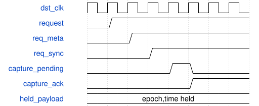

# road_time_snapshot 模块规范

> RTL: `road_time_snapshot.v`

## 1. 模块目的

独立同源时间冻结快照

## 2. 参数

| 参数 | 默认值 | 说明 |
| --- | --- | --- |
| — | — | 本模块没有可配置参数。 |

## 3. 时钟与复位

- 时钟：`{"domains": "source100MHz, HDMI75MHz; actual template PLL.v C0/C4"}`
- 复位：`{"assertion": "common i_rstn low asynchronously cancels both domains", "release": "two locally clocked release registers per domain; no single-domain hot reset proof"}`

## 4. 接口信号规范

| 信号 | 方向 | 位宽 | 时钟域 | 语义角色 | 描述 |
| --- | --- | --- | --- | --- | --- |
| `i_src_clk` | input | 1 | 未声明 | i_src_clk | i_src_clk |
| `i_dst_clk` | input | 1 | 未声明 | i_dst_clk | i_dst_clk |
| `i_rstn` | input | 1 | 未声明 | i_rstn | i_rstn |
| `i_src_epoch` | input | 32 | 未声明 | i_src_epoch | i_src_epoch |
| `o_src_now_ms` | output | 64 | 未声明 | o_src_now_ms | o_src_now_ms |
| `o_src_tick` | output | 1 | 未声明 | o_src_tick | o_src_tick |
| `o_src_busy` | output | 1 | 未声明 | o_src_busy | o_src_busy |
| `o_dst_now_ms` | output | 64 | 未声明 | o_dst_now_ms | o_dst_now_ms |
| `o_dst_epoch` | output | 32 | 未声明 | o_dst_epoch | o_dst_epoch |
| `o_dst_time_valid` | output | 1 | 未声明 | o_dst_time_valid | o_dst_time_valid |
| `o_dst_update` | output | 1 | 未声明 | o_dst_update | o_dst_update |

## 5. 周期行为与延迟

- 100000 source clocks per ms; epoch/time frozen before request toggle until synchronized ack.
- Two destination request synchronizers, one stable capture wait; capture then ack.
- Time channel independent of table pending/copy backpressure.
- No time_valid before first new snapshot; >150000 destination clocks without update invalidates.
- Physical CDC/bundled-data checks pending; clocks must be active for digital latency bound.

## 6. WaveDrom 时序图

### 冻结载荷与完整复制发布

Rising-edge digital illustration; source payload must remain physically stable until ack.

- WaveJSON：[road_time_snapshot_normal.json5](waveforms/road_time_snapshot_normal.json5)

## 7. 边界、反压与错误

- zero/full count, pending full, reset, stale identity, future time, time loss

## 8. CDC 与综合约束

- No production, arithmetic, TD, timing exceptions, bitstream, board or Flash changes.
- RAM and metadata/time bundled-data physical constraints remain unsigned-off.

## 9. 验证与验收

- dual clocks; all copy positions reset; backpressure; counts0/1/32/33/64; age500/2000; time watchdog

## 10. 可追溯性

- 规格模块：`road_time_snapshot`
- RTL 路径：`road_time_snapshot.v`
- 交付要求：本文档、WaveJSON 和 SVG 必须与同一版本规格一同发布。
