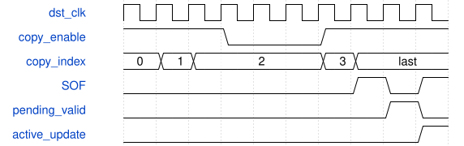

# road_detection_table_cdc 模块规范

> RTL: `road_detection_table_cdc.v`

## 1. 模块目的

三表完整64框跨域与SOF发布

## 2. 参数

| 参数 | 默认值 | 说明 |
| --- | --- | --- |
| AGE_LIMIT_MS | 500 | 冻结模型标识或默认年龄门限 |
| EXPECTED_MODEL_ID | 3009235558 | 冻结模型标识或默认年龄门限 |

## 3. 时钟与复位

- 时钟：`{"domains": "source100MHz, HDMI75MHz; actual template PLL.v C0/C4"}`
- 复位：`{"assertion": "common i_rstn low asynchronously cancels both domains", "release": "two locally clocked release registers per domain; no single-domain hot reset proof"}`

## 4. 接口信号规范

| 信号 | 方向 | 位宽 | 时钟域 | 语义角色 | 描述 |
| --- | --- | --- | --- | --- | --- |
| `i_src_clk` | input | 1 | 未声明 | i_src_clk | i_src_clk |
| `i_dst_clk` | input | 1 | 未声明 | i_dst_clk | i_dst_clk |
| `i_rstn` | input | 1 | 未声明 | i_rstn | i_rstn |
| `i_src_entry_valid` | input | 1 | 未声明 | i_src_entry_valid | i_src_entry_valid |
| `i_src_entry` | input | 97 | 未声明 | i_src_entry | i_src_entry |
| `o_src_entry_ready` | output | 1 | 未声明 | o_src_entry_ready | o_src_entry_ready |
| `i_src_meta_valid` | input | 1 | 未声明 | i_src_meta_valid | i_src_meta_valid |
| `i_src_metadata` | input | 265 | 未声明 | i_src_metadata | i_src_metadata |
| `o_src_meta_ready` | output | 1 | 未声明 | o_src_meta_ready | o_src_meta_ready |
| `i_src_abort` | input | 1 | 未声明 | i_src_abort | i_src_abort |
| `o_src_copy_ack` | output | 1 | 未声明 | o_src_copy_ack | o_src_copy_ack |
| `o_src_busy` | output | 1 | 未声明 | o_src_busy | o_src_busy |
| `o_src_error` | output | 1 | 未声明 | o_src_error | o_src_error |
| `i_dst_copy_enable` | input | 1 | 未声明 | i_dst_copy_enable | i_dst_copy_enable |
| `i_dst_sof` | input | 1 | 未声明 | i_dst_sof | i_dst_sof |
| `i_dst_now_ms` | input | 64 | 未声明 | i_dst_now_ms | i_dst_now_ms |
| `i_dst_time_epoch` | input | 32 | 未声明 | i_dst_time_epoch | i_dst_time_epoch |
| `i_dst_time_valid` | input | 1 | 未声明 | i_dst_time_valid | i_dst_time_valid |
| `i_dst_read_index` | input | 6 | 未声明 | i_dst_read_index | i_dst_read_index |
| `o_dst_entry` | output | 97 | 未声明 | o_dst_entry | o_dst_entry |
| `o_dst_metadata` | output | 265 | 未声明 | o_dst_metadata | o_dst_metadata |
| `o_dst_active_valid` | output | 1 | 未声明 | o_dst_active_valid | o_dst_active_valid |
| `o_dst_draw_valid` | output | 1 | 未声明 | o_dst_draw_valid | o_dst_draw_valid |
| `o_dst_pending_valid` | output | 1 | 未声明 | o_dst_pending_valid | o_dst_pending_valid |
| `o_dst_copy_busy` | output | 1 | 未声明 | o_dst_copy_busy | o_dst_copy_busy |
| `o_dst_update` | output | 1 | 未声明 | o_dst_update | o_dst_update |
| `o_dst_age_upper_ms` | output | 64 | 未声明 | o_dst_age_upper_ms | o_dst_age_upper_ms |
| `o_dst_error` | output | 1 | 未声明 | o_dst_error | o_dst_error |

## 5. 周期行为与延迟

- Sequential entry valid/ready loads sole source table; seal count equals accepted entry count.
- Source metadata265 and source97x64 remain frozen until last copy acknowledgement.
- Two destination97x64 banks rotate pending/active at SOF; no fourth table.
- copy_enable backpressure holds cursor; count0 becomes a complete empty pending table.
- Final copy concurrent SOF never bypasses pending completeness; active entries immutable within display frame.
- Draw only valid time, matching epoch/model, status0, legal count and capture<=completion<=now.
- Age upper bound now-capture+4ms; default500; independent2000 instance is not deployment approval.
- No active table, invalid/lost time, epoch mismatch or illegal timestamp order reports UINT64_MAX unknown age, never zero freshness; overflow saturates.
- Local source abort discards only unsealed load; published transaction waits for ack or common reset.

## 6. WaveDrom 时序图

### 冻结载荷与完整复制发布

Rising-edge digital illustration; source payload must remain physically stable until ack.

- WaveJSON：[road_detection_table_cdc_normal.json5](waveforms/road_detection_table_cdc_normal.json5)

## 7. 边界、反压与错误

- zero/full count, pending full, reset, stale identity, future time, time loss

## 8. CDC 与综合约束

- No production, arithmetic, TD, timing exceptions, bitstream, board or Flash changes.
- RAM and metadata/time bundled-data physical constraints remain unsigned-off.

## 9. 验证与验收

- dual clocks; all copy positions reset; backpressure; counts0/1/32/33/64; age500/2000; time watchdog

## 10. 可追溯性

- 规格模块：`road_detection_table_cdc`
- RTL 路径：`road_detection_table_cdc.v`
- 交付要求：本文档、WaveJSON 和 SVG 必须与同一版本规格一同发布。
