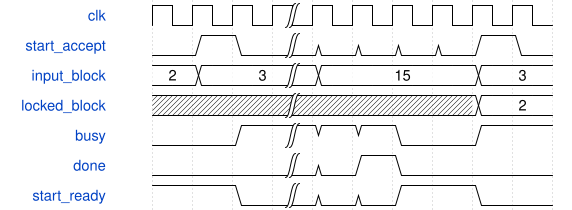

# tb_feature_sppf_client 模块规范

> RTL: `tests/tb_feature_sppf_client.v`

## 1. 模块目的

未提供模块目的。

## 2. 参数

| 参数 | 默认值 | 说明 |
| --- | --- | --- |
| — | — | 本模块没有可配置参数。 |

## 3. 时钟与复位

- 时钟：`{"name": "clk", "edge": "posedge", "frequency_mhz": 100}`
- 复位：`{"name": "rstn", "active": "low", "synchronous": false}`

## 4. 接口信号规范

| 信号 | 方向 | 位宽 | 时钟域 | 语义角色 | 描述 |
| --- | --- | --- | --- | --- | --- |
| `o_test_complete` | output | 1 | 未声明 | verification_completion | 所有当前场景检查完成 |

## 5. 周期行为与延迟

- 一个客户及唯一旧算术owner，顺序执行CSP4再SPPF，跨块保留真实写回内存
- 只注入CSP4初始CPU源，SPPF从真实CSP4输出读取，不预填SPPF中间值
- 卷积acc/pre/SiLU/post和池化signed max逐项核对，四路concat逐字节核验
- 实际参数/读/核/写/屏障反压、pool中共同复位重跑及检查器负例分列

## 6. WaveDrom 时序图

### 固定块只在启动握手锁存

中间省略全幅计算；done仍busy，返回idle后才接受下一块

- WaveJSON：[tb_feature_sppf_client_selection.json5](waveforms/tb_feature_sppf_client_selection.json5)

## 7. 边界、反压与错误

- 忙时block/start扰动，跨块缓存完全覆盖，随机背压保持payload
- 非法块、错误参数block、错误屏障block与真实acc负例
- 共同复位、SiLU重装、CSP4尾行与CSP2尾通道
- 池化负数/极值及逻辑pad=-128区别于物理尾padding0
- 池化长写背压及共同复位

## 8. CDC 与综合约束

- 固定图非任意引擎，核心端口/II/数值/复位不改
- CSP2 Cin12尾mask0f，CSP4物理尾tile仅两行有效，禁止y18/y19写
- 同实例顺序运行不等于down3/down4已接入或连续CNN
- 4ERAM为容量组织目标，未实际映射/综合/物理时序
- 100M是整机1FPS目标，不是本组件已证明整机帧率

## 9. 验证与验收

- 同实例真实CSP4写回结果供SPPF读取，全部conv和pool逐项对拍
- 正常、随机、pool中共同复位后完整重跑、长写反压、实际pool检查器负例

## 10. 可追溯性

- 规格模块：`tb_feature_sppf_client`
- RTL 路径：`tests/tb_feature_sppf_client.v`
- 交付要求：本文档、WaveJSON 和 SVG 必须与同一版本规格一同发布。
