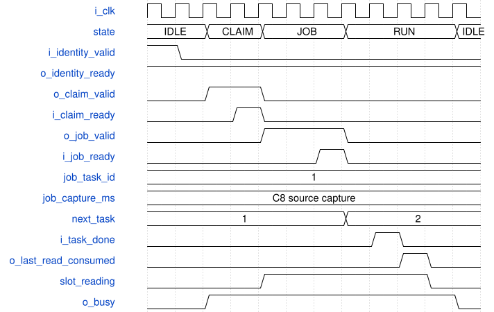
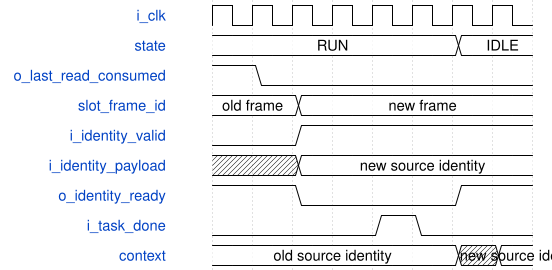
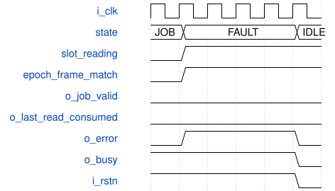

# road_frame_ready_dispatch 模块规范

> RTL: `rtl/road_frame_ready_dispatch.v`

## 1. 模块目的

将两个实际输入slot的READY与C8源身份结合，先claim后job，真实最后输入读才FREE；任务完成与输入释放独立。仅两128bit上下文，无第三条身份/图像/DMA队列。

## 2. 参数

| 参数 | 默认值 | 说明 |
| --- | --- | --- |
| — | — | 本模块没有可配置参数。 |

## 3. 时钟与复位

- 时钟：`{"name": "i_clk", "edge": "posedge", "frequency_hz": 100000000, "domain": "all ports and frozen road_capture_slots use the same source clock"}`
- 复位：`{"name": "i_rstn", "active": "low", "synchronous": false, "release": "calling system provides synchronous release in this domain", "values": "IDLE; two context-valid bits=0; contexts=0; next_task=1; active task/model/slot/mismatch/round-robin=0; done/released/error/wrap=0. Control valid/ready/release suppressed while reset low.", "assumption": "common reset of slots and dispatcher; actual DDR outstanding requests require upstream drain before epoch/slot reuse"}`

## 4. 接口信号规范

| 信号 | 方向 | 位宽 | 时钟域 | 语义角色 | 描述 |
| --- | --- | --- | --- | --- | --- |
| `i_clk` | input | 1 | i_clk | clock | 100MHz上升沿；所有接口同域 |
| `i_rstn` | input | 1 | i_clk | reset | 共同低有效异步断言；调用方提供本域同步释放 |
| `i_epoch` | input | 32 | i_clk | epoch | 共同reset期间冻结epoch，不支持热换 |
| `i_model_id` | input | 32 | i_clk | model identity | 共同reset期间冻结model，IDLE选择任务时锁存 |
| `i_identity_valid` | input | 1 | i_clk | identity valid | C8安全跨域的完整源身份有效，等待ready保持 |
| `i_identity_payload` | input | 128 | i_clk | source identity | {epoch[127:96],frame[95:64],capture_ms[63:0]} |
| `i_slot_free_mask` | input | 2 | i_clk | slot ownership | 旧slots FREE状态，slot0低位 |
| `i_slot_ready_mask` | input | 2 | i_clk | slot visibility | 旧slots实际完整且write_visible后的READY，非TB推测完成 |
| `i_slot_reading_mask` | input | 2 | i_clk | read ownership | 旧slots已接受claim后的READING |
| `i_slot_quarantine_mask` | input | 2 | i_clk | quarantine | 隔离槽不可匹配身份、选择或释放 |
| `i_slot_epochs` | input | 64 | i_clk | slot epochs | slot0低32位、slot1高32位 |
| `i_slot_frame_ids` | input | 64 | i_clk | slot identities | slot0低32位、slot1高32位 |
| `i_slot_timestamps` | input | 128 | i_clk | diagnostic timestamps | slot0低64位、slot1高64位；不代替源capture |
| `i_claim_ready` | input | 1 | i_clk | claim ready | 旧slots接受当前slot/epoch/frame的读claim |
| `i_job_ready` | input | 1 | i_clk | job ready | 实际共享计算owner及publisher启动许可汇总 |
| `i_task_done` | input | 1 | i_clk | compute done | 计算完成事件，仅RUN且匹配task才锁存 |
| `i_task_done_id` | input | 32 | i_clk | compute identity | 完成任务ID，独立于source_frame_id |
| `i_last_read_valid` | input | 1 | i_clk | last read fact | 真实最后输入返回已消费、无在途/未来读且服务允许重用 |
| `i_last_read_slot` | input | 1 | i_clk | last read slot | 实际最后读对应物理槽 |
| `i_last_read_epoch` | input | 32 | i_clk | last read epoch | 实际最后读对应epoch |
| `i_last_read_frame_id` | input | 32 | i_clk | last read source | 实际最后读对应源帧，非task_id |
| `o_identity_ready` | output | 1 | i_clk | identity ready | FAULT时为0；其余状态错/歧义/重复身份消费诊断，唯一匹配空context接收，新身份遇仍被旧任务占用context则反压 |
| `o_claim_valid` | output | 1 | i_clk | claim valid | 仅CLAIM且选中槽仍READY/epoch/frame匹配、双槽native key不歧义；不依赖claim_ready |
| `o_claim_slot` | output | 1 | i_clk | claim slot | IDLE选择后锁存物理槽 |
| `o_claim_epoch` | output | 32 | i_clk | claim epoch | 选中context的源epoch |
| `o_claim_frame_id` | output | 32 | i_clk | claim frame | 选中context的源frame |
| `o_job_valid` | output | 1 | i_clk | job valid | 真实claim接受后JOB且READING/身份/双槽唯一性guard正常；独立于job_ready |
| `o_job_descriptor` | output | 225 | i_clk | job descriptor | slot0/base32/epoch32/task32/frame32/model32/capture64固定布局；有效等待期间保持 |
| `o_job_timestamp_mismatch` | output | 1 | i_clk | diagnostic mismatch | 选择任务时锁slot诊断时间与C8源capture差异，不改变capture |
| `o_last_read_consumed` | output | 1 | i_clk | release event | 仅RUN，未释放、预边沿READING、slot/epoch/frame正确的last_read事件转发 |
| `o_release_slot` | output | 1 | i_clk | release slot | 当前任务的物理slot |
| `o_release_epoch` | output | 32 | i_clk | release epoch | 当前任务context的源epoch |
| `o_release_frame_id` | output | 32 | i_clk | release frame | 当前任务context的源frame |
| `o_busy` | output | 1 | i_clk | task busy | state!=IDLE；FAULT继续保持busy |
| `o_error` | output | 1 | i_clk | sticky diagnostic | 共同reset清零；错误身份/早错重复事件/ownership违约置位；不伪造FREE |
| `o_task_wrap_fault` | output | 1 | i_clk | task saturation | FFFFFFFF最后job接受后锁住新选择/claim/job，直到共同reset |

## 5. 周期行为与延迟

- 两个context各128位并按物理slot0/1索引；有效位独立。输入身份epoch还必须等于i_epoch；仅非FREE且非QUARANTINE槽的epoch/frame匹配参与计数。恰一槽匹配才可存入对应空context，READY可先于身份或晚于身份。
- 错误epoch、无匹配、双槽同身份歧义、同epoch/frame重复身份（即使capture不同）均ready=1消费并置粘滞error，不覆盖已有context，不由此claim/job。唯一匹配槽context存着旧epoch/frame时identity_ready=0，直到旧任务退休清context；不得增加第三context。
- 运行时slot_ambiguous = 两槽均非FREE/非QUARANTINE且两半epoch/frame相等；每拍独立检查，不依赖incoming identity事件。即使已缓存context后另一槽才变成重复native key，也置error并禁止新选择/claim/job或错误release。
- 仅已有context与实际slot epoch/frame匹配、READY=1、FREE/READING/QUARANTINE=0且slot_ambiguous=0时可调度；CAPTURING/WAIT_VISIBLE不得job。IDLE按交替优先选择，初始优先slot0，另一槽READY可绕过尚未READY者；选中后翻转下次优先。
- IDLE选择时锁selected slot、active task=next_task、model和timestamp mismatch；context不复制第三份。新身份在接收当拍尚不参与选择；下一边沿才可使用。wrap_fault=1时IDLE禁止选择/claim，不能预占永远无法启动的槽。
- CLAIM valid保持至旧slots claim_ready，与ready无组合依赖；仅真实claim握手进入JOB。claim前选中槽失去READY/身份匹配、变FREE/QUARANTINE或出现slot_ambiguous，立即压claim_valid，清选中context、诊断并回IDLE，不能伪造释放。
- JOB必须观察claim后的实际READING且epoch/frame仍匹配，不能同拍穿透claim和job。job_valid不依赖job_ready，完整225位和mismatch反压保持；只有job_valid&&job_ready实际接受才进RUN且递增next_task。
- task_id从1开始，只随真实job握手增加，不随identity/claim/等待/帧号增加。FFFFFFFF合法job允许一次，接受后next_task保持FFFFFFFF并置wrap_fault；无静默回卷。最后合法task继续等done与last_read退休，reset清wrap。
- JOB/RUN且尚未接受last_read时，选中slot失去READING、epoch/frame失配、FREE/QUARANTINE或slot_ambiguous，当拍禁止job和release并进入FAULT，保留context/所有权至共同reset；FAULT禁止identity接受，不能恢复后继续当正常FREE处理。
- RUN才接受task_done及last_read。done必须匹配active task且未曾接受，last_read必须匹配slot/epoch/frame、预边沿READING且未释放。早/错/重复事件仅置error，不锁错误flag、不FREE。JOB真实握手同拍done或last_read仍算早到。
- done_seen与released独立。done先到仍保持READING；last_read先到可FREE/重捕获，但旧任务context保持至done。两个flag在边沿前都已经为1时，下一边沿清选中context并回IDLE；同拍两个事件不提前退休。
- last_read已接受后slot FREE/重捕获/metadata变化合法，不再触发owned guard；若两槽此后出现重复native key，仍独立诊断并禁止新调度，但不得撤销已确认释放或伪造额外FREE。新源身份仍因旧context占用反压，退休当拍以旧context计算ready仍0，下拍才可接收。
- 未拥有且被隔离的context可以在IDLE清除并诊断，不释放隔离槽。粘滞error不阻止其他合法context继续；FAULT及wrap分别阻止不安全的新调度。
- descriptor布局：slot[0],base[32:1],epoch[64:33],task[96:65],frame[128:97],model[160:129],capture[224:161]；base slot0=03400000，slot1=03480000。capture始终源C8身份，slot timestamp只用于选择时mismatch。
- o_busy仅state!=IDLE，待READY的context可存在于IDLE；输出payload在对应valid=0时无消费语义。copy_ack不是输入且绝不触发输入槽释放。

## 6. WaveDrom 时序图

### 先claim后job，独立完成与输入释放

每格为上升沿前值，示意已READY的slot0。identity接收后下一拍选择；CLAIM与JOB分拍。job停顿不增task；done先到不FREE，last_read接受后两个预存flag下一边沿才退休。

- WaveJSON：[road_frame_ready_dispatch_claim-job-retire.json5](waveforms/road_frame_ready_dispatch_claim-job-retire.json5)

### 输入读完可重捕获，旧task上下文仍占用

last_read先到使slot可以FREE/重捕获；旧任务未done时不覆盖context，新身份反压。done确认后专门退休边沿，下一拍identity才可接收。

- WaveJSON：[road_frame_ready_dispatch_recapture-context-hold.json5](waveforms/road_frame_ready_dispatch_recapture-context-hold.json5)

### 已claim所有权违约进入FAULT

JOB遭READING/epoch/frame guard失配当拍job和release压低；FAULT保持busy和原context，恢复槽标志不能解除，只有共同reset清除。

- WaveJSON：[road_frame_ready_dispatch_owned-guard-fault.json5](waveforms/road_frame_ready_dispatch_owned-guard-fault.json5)

## 7. 边界、反压与错误

- 身份先于READY、READY先于身份、乱序双槽READY、另一槽绕过未READY槽、交替优先及满槽跳帧。
- 身份错epoch/frame、两槽同身份歧义、重复epoch/frame但capture变化、不覆盖旧context；无incoming时缓存后才出现native key重复，IDLE/CLAIM/JOB/RUN均检查。
- CAPTURING/WAIT_VISIBLE/半帧/无write_visible不发job；claim/job长反压保持；claim与job分拍。
- done早/错/重复、last_read早/错/重复；JOB握手同拍早事件只诊断。
- NNdone不释放、publisher copy_ack不释放；done先/last先/同拍done+last均需两个独立事实。
- lastread后FREE重捕获新frame，identity一直反压到旧task退休，退休边沿不穿透旧context占用。
- claim前QUARANTINE/失配撤销但不释放；claim后READING/身份丢失立即抑制并FAULT锁至共同reset。
- task_id FFFFFFFF明确注入且只接受一次、wrap饱和禁止新claim；各FSM状态共同reset。

## 8. CDC 与综合约束

- Verilog-2001，三段FSM；IDLE0/CLAIM1/JOB2/RUN3/FAULT4；单100MHz同域，不新增CDC、DMA、图像/权重存储、第四框表或任意任务队列。
- 只有两个128bit身份存储；active task/model/slot/mismatch、next_task、done/released/error/wrap/优先级为有界控制寄存。内部next-task计数RTL命名cnt_next_task，active task命名reg_task_id供明确极值注入。
- 冻结旧road_capture_slots实际负责FREE/CAPTURING/WAIT_VISIBLE/READY/READING/QUARANTINE；本模块只claim及传递真实last_read，不重写核。
- i_epoch/i_model_id在同一共同reset代次保持；不支持热换epoch/model；所有ready-valid生产者等待接受期间保持payload。
- 两个512KiB槽仅有效442368B；base地址为应用约定，不证明真实DDR完整字节可见、最后返回消费或外部排空。
- 实际共享计算owner/publisher通过i_job_ready汇总许可，publisher copy_ack只释放结果source表；不在本模块复制publisher或计算核。
- 不启动训练/TD/位流/上板/Flash/时序例外/commit/push/外部消息；旧C2/C8/publisher/slots/ROM源字节冻结。
- Python/脚本专用严格技能未安装，不宣称专用严格门通过；Python可运行断言、真实ModelSim与严格Verilog八门分别报告。

## 9. 验证与验收

- reference.py stdlib断言及逐周期inputs/outputs/context/task/done/released记录；self_check_receipt绑定源码SHA；明确的task极值/状态注入仅测试边界，不冒充实际状态路径。check_late_ambiguity.py对保留旧模型和当前模型运行相同四态晚到重复native key负例，保存真实旧失败/新通过，不改原收据。
- 真实road_capture_slots实例化，观测READY/READING/FREE/QUARANTINE及claim/release，而非TB虚构ready作为唯一证据。
- 同一job225中task/frame/model/capture到既有后处理/publisher/三表完整上下文；head输入、NNdone、lastread、write_visible服务受控，不宣称摄像头闭环。
- 严格compile/ast/readability/comment/naming/profile/testbench/toolchain八门与实际ModelSim分别保留失败及收据；不格式修复冻结核追求门禁通过。
- 逐拍核对context归属、实际job握手、task计数、正确release及FAULT路径；资源/实际DDR/CDC/67层CNN/板卡仍单列缺口。

## 10. 可追溯性

- 规格模块：`road_frame_ready_dispatch`
- RTL 路径：`rtl/road_frame_ready_dispatch.v`
- 交付要求：本文档、WaveJSON 和 SVG 必须与同一版本规格一同发布。
