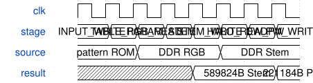

# road_frontend_layer_sequence 模块规范

> RTL: `road_frontend_layer_sequence.v`

## 1. 模块目的

固定完整前三层宏调度与真实DDR读写，TEST_ONLY参数。

## 2. 参数

| 参数 | 默认值 | 说明 |
| --- | --- | --- |
| — | — | 本模块没有可配置参数。 |

## 3. 时钟与复位

- 时钟：`{"domains": "CNN100MHz"}`
- 复位：`{"assertion": "异步低有效复位清零阶段、计数和命令输出", "release": "上游同步释放；重新从1024项装表开始"}`

## 4. 接口信号规范

| 信号 | 方向 | 位宽 | 时钟域 | 语义角色 | 描述 |
| --- | --- | --- | --- | --- | --- |
| `i_clk` | input | 1 | 未声明 | 100MHz计算时钟 | 100MHz计算时钟 |
| `i_rstn` | input | 1 | 未声明 | 低有效异步复位 | 低有效异步复位 |
| `i_fetch` | input | 1 | 未声明 | 锁存当前命令 | 锁存当前命令 |
| `i_advance` | input | 1 | 未声明 | 已完成命令推进 | 已完成命令推进 |
| `o_command` | output | 64 | 未声明 | 稳定命令返回 | 稳定命令返回 |

## 5. 周期行为与延迟

- FETCH沿返回稳定64位宏命令，ADVANCE沿才推进；停顿期间保持。
- 1024表项、482首层参数、2304次HALO/START/EXPORT、选择、652下采样参数、576次HALO/START/EXPORT及END，共10800条。
- RGB宏命令opcode8，由外层执行完整halo读取；本模块只保存参数和SiLU表。
- 复位清零阶段与局部计数，下一轮重新从表项零开始。

## 6. WaveDrom 时序图

### 完整张量交接

阶段顺序图；每个真实DDR请求均等待接受和响应，不规定返回固定拍数。

- WaveJSON：[road_frontend_layer_sequence_tensor-handoff.json5](waveforms/road_frontend_layer_sequence_tensor-handoff.json5)

## 7. 边界、反压与错误

- 顶左padding、右下末tile、行列进位、cache跨字节边界、请求背压、读延迟、复位与故障

## 8. CDC 与综合约束

- Read-only ROM initialization is checked separately from board readback.
- No new timing exceptions for mailbox; existing bounded display CDC retained.
- TEST_ONLY coefficients, no deployed-model precision or full CNN FPS claim.

## 9. 验证与验收

- 全帧逐项数值与地址、真实中间值、正常及随机背压、共同复位、实际TD资源时序

## 10. 可追溯性

- 规格模块：`road_frontend_layer_sequence`
- RTL 路径：`road_frontend_layer_sequence.v`
- 交付要求：本文档、WaveJSON 和 SVG 必须与同一版本规格一同发布。
