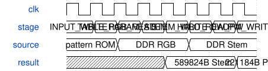

# road_stem_ddr_board_top 模块规范

> RTL: `road_stem_ddr_board_top.v`

## 1. 模块目的

固定完整前三层宏调度与真实DDR读写，TEST_ONLY参数。

## 2. 参数

| 参数 | 默认值 | 说明 |
| --- | --- | --- |
| — | — | 本模块没有可配置参数。 |

## 3. 时钟与复位

- 时钟：`{"domains": "CNN100MHz; DDR133.33MHz; HDMI75/375MHz"}`
- 复位：`{"assertion": "Entire DDR and arithmetic jointly asserted asynchronously", "release": "Two-flop release in each domain, reload all 1024 SiLU entries before start"}`

## 4. 接口信号规范

| 信号 | 方向 | 位宽 | 时钟域 | 语义角色 | 描述 |
| --- | --- | --- | --- | --- | --- |
| `i_sys_clk` | input | 1 | 未声明 | C4板载50MHz | C4板载50MHz |
| `i_rstn` | input | 1 | 未声明 | C7共同复位 | C7共同复位 |
| `o_tmds_blue_p` | output | 1 | 未声明 | 原HDMI差分正端 | 原HDMI差分正端 |
| `o_tmds_green_p` | output | 1 | 未声明 | 原HDMI差分正端 | 原HDMI差分正端 |
| `o_tmds_red_p` | output | 1 | 未声明 | 原HDMI差分正端 | 原HDMI差分正端 |
| `o_tmds_clock_p` | output | 1 | 未声明 | 原HDMI差分正端 | 原HDMI差分正端 |
| `ddr_ck_p` | output | 1 | 未声明 | 原厂DDR专用命令端 | 原厂DDR专用命令端 |
| `ddr_ck_n` | output | 1 | 未声明 | 原厂DDR专用命令端 | 原厂DDR专用命令端 |
| `ddr_cke` | output | 1 | 未声明 | 原厂DDR专用命令端 | 原厂DDR专用命令端 |
| `ddr_odt` | output | 1 | 未声明 | 原厂DDR专用命令端 | 原厂DDR专用命令端 |
| `ddr_cs_n` | output | 1 | 未声明 | 原厂DDR专用命令端 | 原厂DDR专用命令端 |
| `ddr_ras_n` | output | 1 | 未声明 | 原厂DDR专用命令端 | 原厂DDR专用命令端 |
| `ddr_cas_n` | output | 1 | 未声明 | 原厂DDR专用命令端 | 原厂DDR专用命令端 |
| `ddr_we_n` | output | 1 | 未声明 | 原厂DDR专用命令端 | 原厂DDR专用命令端 |
| `ddr_ba` | output | 2 | 未声明 | DDR bank地址 | DDR bank地址 |
| `ddr_addr` | output | 13 | 未声明 | DDR行列地址 | DDR行列地址 |
| `ddr_dqs_p` | inout | 2 | 未声明 | DDR差分选通正端 | DDR差分选通正端 |
| `ddr_dqs_n` | inout | 2 | 未声明 | DDR差分选通负端 | DDR差分选通负端 |
| `ddr_dq` | inout | 16 | 未声明 | DDR数据 | DDR数据 |
| `ddr_dm` | inout | 2 | 未声明 | DDR掩码 | DDR掩码 |

## 5. 周期行为与延迟

- 原PLL/DDR IP/HDMI和mailbox连接完整前三层序列器。
- 诊断计数加宽32位；原状态字段显示低位，第二数据页显示完整写/读/输出/周期计数。
- 各域异步断言、同步释放；加载器和DDR共同复位；不增加时序例外或真实外设协议。
- 顶层物理I/O沿原约束，51位外部I/O，不增加UART/AXI控制端口。

## 6. WaveDrom 时序图

### 完整张量交接

阶段顺序图；每个真实DDR请求均等待接受和响应，不规定返回固定拍数。

- WaveJSON：[road_stem_ddr_board_top_tensor-handoff.json5](waveforms/road_stem_ddr_board_top_tensor-handoff.json5)

## 7. 边界、反压与错误

- 顶左padding、右下末tile、行列进位、cache跨字节边界、请求背压、读延迟、复位与故障

## 8. CDC 与综合约束

- Read-only ROM initialization is checked separately from board readback.
- No new timing exceptions for mailbox; existing bounded display CDC retained.
- TEST_ONLY coefficients, no deployed-model precision or full CNN FPS claim.

## 9. 验证与验收

- 全帧逐项数值与地址、真实中间值、正常及随机背压、共同复位、实际TD资源时序

## 10. 可追溯性

- 规格模块：`road_stem_ddr_board_top`
- RTL 路径：`road_stem_ddr_board_top.v`
- 交付要求：本文档、WaveJSON 和 SVG 必须与同一版本规格一同发布。
