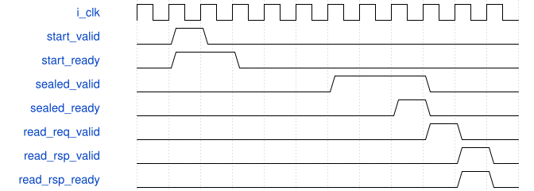

# road_head_decode_topk 模块规范

> RTL: `rtl/road_head_decode_topk.v`

## 1. 模块目的

未提供模块目的。

## 2. 参数

| 参数 | 默认值 | 说明 |
| --- | --- | --- |
| — | — | 本模块没有可配置参数。 |

## 3. 时钟与复位

- 时钟：`{"name": "i_clk", "frequency_hz": 100000000}`
- 复位：`{"name": "i_rstn", "assert": "async_low", "release": "local_sync_two_flops_or_owner_gating"}`

## 4. 接口信号规范

| 信号 | 方向 | 位宽 | 时钟域 | 语义角色 | 描述 |
| --- | --- | --- | --- | --- | --- |
| `i_clk` | input | 1 | i_clk | clk | 统一100MHz上升沿时钟 |
| `i_rstn` | input | 1 | i_clk | rstn | 共同低有效异步复位，本地两级同步释放 |
| `i_abort` | input | 1 | i_clk | abort | 共同取消本地候选及LUT事务，不代表DDR排空 |
| `i_start_valid` | input | 1 | i_clk | start_valid | start_valid：按requirements中对应事务/计数合同使用 |
| `i_start_frame_token` | input | 32 | i_clk | start_frame_token | start_frame_token：按requirements中对应事务/计数合同使用 |
| `i_start_model_id` | input | 32 | i_clk | start_model_id | start_model_id：按requirements中对应事务/计数合同使用 |
| `i_cell_valid` | input | 1 | i_clk | cell_valid | cell_valid：按requirements中对应事务/计数合同使用 |
| `i_cell_data` | input | 112 | i_clk | cell_data | cell_data：按requirements中对应事务/计数合同使用 |
| `i_cell_id` | input | 14 | i_clk | cell_id | cell_id：按requirements中对应事务/计数合同使用 |
| `i_cell_frame_token` | input | 32 | i_clk | cell_frame_token | cell_frame_token：按requirements中对应事务/计数合同使用 |
| `i_lut_req_ready` | input | 1 | i_clk | lut_req_ready | 空闲且无旧ROM在途时允许一次查表传输 |
| `i_lut_rsp_valid` | input | 1 | i_clk | lut_rsp_valid | 查表完整响应有效，等ready时身份与数据保持 |
| `i_lut_rsp_kind` | input | 1 | i_clk | lut_rsp_kind | 回显已接受请求的表类别 |
| `i_lut_rsp_address` | input | 10 | i_clk | lut_rsp_address | 回显已接受请求的原索引 |
| `i_lut_rsp_tag` | input | 16 | i_clk | lut_rsp_tag | 回显已接受请求的16位标签 |
| `i_lut_rsp_frame_token` | input | 32 | i_clk | lut_rsp_frame_token | 回显源帧标识，禁止旧响应串入新任务 |
| `i_lut_rsp_model_id` | input | 32 | i_clk | lut_rsp_model_id | 回显请求模型标识 |
| `i_lut_rsp_data` | input | 16 | i_clk | lut_rsp_data | 从冻结小端ROM字节提取的UINT16值 |
| `i_lut_rsp_error` | input | 1 | i_clk | lut_rsp_error | 范围/模型/ROM错误，错误数据为零 |
| `i_sealed_ready` | input | 1 | i_clk | sealed_ready | NMS同时接收源token和两类计数并获得只读所有权 |
| `i_read_req_valid` | input | 1 | i_clk | read_req_valid | NMS单条候选读取请求有效 |
| `i_read_req_class` | input | 1 | i_clk | read_req_class | NMS请求的类别地址位 |
| `i_read_req_index` | input | 7 | i_clk | read_req_index | 类内排序后的0至127槽号 |
| `i_read_rsp_ready` | input | 1 | i_clk | read_rsp_ready | NMS消费完整候选响应 |
| `i_finish_valid` | input | 1 | i_clk | finish_valid | NMS结束并准备释放候选表 |
| `i_finish_frame_token` | input | 32 | i_clk | finish_frame_token | 必须匹配候选表源token的释放标识 |
| `o_start_ready` | output | 1 | i_clk | start_ready | start_ready：按requirements中对应事务/计数合同使用 |
| `o_cell_ready` | output | 1 | i_clk | cell_ready | cell_ready：按requirements中对应事务/计数合同使用 |
| `o_lut_req_valid` | output | 1 | i_clk | lut_req_valid | 查表请求有效，等待ready时所有请求字段保持 |
| `o_lut_req_kind` | output | 1 | i_clk | lut_req_kind | 0为sigmoid，1为exp |
| `o_lut_req_address` | output | 10 | i_clk | lut_req_address | 表内索引；exp只允许0至255 |
| `o_lut_req_tag` | output | 16 | i_clk | lut_req_tag | 16位请求标签，响应原样回显 |
| `o_lut_req_frame_token` | output | 32 | i_clk | lut_req_frame_token | 请求源帧任务标识，响应回显 |
| `o_lut_req_model_id` | output | 32 | i_clk | lut_req_model_id | 绑定完整模型payload的32位模型标识 |
| `o_lut_rsp_ready` | output | 1 | i_clk | lut_rsp_ready | 本拍允许消费一次完整查表响应 |
| `o_lut_cancel` | output | 1 | i_clk | lut_cancel | lut_cancel：按requirements中对应事务/计数合同使用 |
| `o_sealed_valid` | output | 1 | i_clk | sealed_valid | 所有排序/解码写回完成后封存有效，反压期间保持 |
| `o_sealed_frame_token` | output | 32 | i_clk | sealed_frame_token | 候选表归属的已锁定任务标识 |
| `o_count_person` | output | 8 | i_clk | count_person | 封存的person TopK条数，0至128，包含无效几何条目 |
| `o_count_vehicle` | output | 8 | i_clk | count_vehicle | 封存的vehicle TopK条数，0至128，包含无效几何条目 |
| `o_read_req_ready` | output | 1 | i_clk | read_req_ready | NMS读取槽空闲时接收请求 |
| `o_read_rsp_valid` | output | 1 | i_clk | read_rsp_valid | 完整DECODED160记录有效并保持至消费 |
| `o_read_rsp_class` | output | 1 | i_clk | read_rsp_class | 回显读请求类别 |
| `o_read_rsp_index` | output | 7 | i_clk | read_rsp_index | 回显读请求槽号 |
| `o_read_rsp_data` | output | 160 | i_clk | read_rsp_data | PIF1固定DECODED160记录 |
| `o_read_rsp_error` | output | 1 | i_clk | read_rsp_error | 读越界等错误，不发布部分成功结果 |
| `o_finish_ready` | output | 1 | i_clk | finish_ready | 无未决读时允许释放所有权 |
| `o_fault` | output | 1 | i_clk | fault | 本组件故障状态，不得发布为成功表 |
| `o_error_code` | output | 4 | i_clk | error_code | error_code：按requirements中对应事务/计数合同使用 |
| `o_phase` | output | 3 | i_clk | phase | phase：按requirements中对应事务/计数合同使用 |
| `o_scan_cycles` | output | 32 | i_clk | scan_cycles | scan_cycles：按requirements中对应事务/计数合同使用 |
| `o_sort_cycles` | output | 32 | i_clk | sort_cycles | sort_cycles：按requirements中对应事务/计数合同使用 |
| `o_decode_cycles` | output | 32 | i_clk | decode_cycles | decode_cycles：按requirements中对应事务/计数合同使用 |
| `o_input_wait_cycles` | output | 32 | i_clk | input_wait_cycles | input_wait_cycles：按requirements中对应事务/计数合同使用 |
| `o_lut_wait_cycles` | output | 32 | i_clk | lut_wait_cycles | lut_wait_cycles：按requirements中对应事务/计数合同使用 |
| `o_ram_wait_cycles` | output | 32 | i_clk | ram_wait_cycles | ram_wait_cycles：按requirements中对应事务/计数合同使用 |
| `o_ram_read_words` | output | 32 | i_clk | ram_read_words | ram_read_words：按requirements中对应事务/计数合同使用 |
| `o_ram_write_words` | output | 32 | i_clk | ram_write_words | ram_write_words：按requirements中对应事务/计数合同使用 |

## 5. 周期行为与延迟

- start锁定token/model；12096个cell严格递增。共享sigmoid、精确RNE分数、每类最小堆Top128。
- SCAN/SORT/DECODE互斥占同一候选RAM，堆排序原地，decode写回可见后才SEALED。
- seal同时交token与两类count；NMS只能单未决读取DECODED160，finish匹配token才释放。
- 复位共同取消本地事务；写回完成和读响应消费分别可观察。真实对拍和格式门失败分别记录。

## 6. WaveDrom 时序图

### 请求所有权与停顿

协议示意：省略内部变长计算，用空白间隔表示；不是固定总时延。仅valid与ready同拍消费。

- WaveJSON：[road_head_decode_topk_request-hold-response.json5](waveforms/road_head_decode_topk_request-hold-response.json5)

## 7. 边界、反压与错误

- 复位、取消、背压、非法身份和边界地址；取消不能当成无标签外设已排空

## 8. CDC 与综合约束

- Verilog-2001；一个未决事务；ready/valid握手；无TD/物理时序签核
- 不改变冻结算术核/数值，不复制公共存储

## 9. 验证与验收

- 11数值向量、protocol、phase_reset，逐项DECODED160对拍

## 10. 可追溯性

- 规格模块：`road_head_decode_topk`
- RTL 路径：`rtl/road_head_decode_topk.v`
- 交付要求：本文档、WaveJSON 和 SVG 必须与同一版本规格一同发布。
