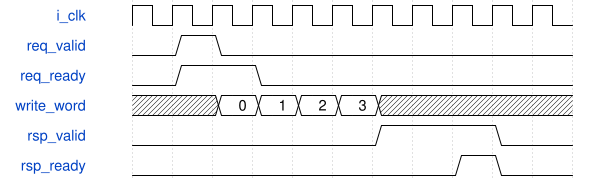

# road_candidate_ram 模块规范

> RTL: `rtl/road_candidate_ram.v`

## 1. 模块目的

未提供模块目的。

## 2. 参数

| 参数 | 默认值 | 说明 |
| --- | --- | --- |
| — | — | 本模块没有可配置参数。 |

## 3. 时钟与复位

- 时钟：`{"name": "i_clk", "frequency_hz": 100000000}`
- 复位：`{"name": "i_rstn", "assert": "async_low", "release": "local_sync_two_flops_or_owner_gating"}`

## 4. 接口信号规范

| 信号 | 方向 | 位宽 | 时钟域 | 语义角色 | 描述 |
| --- | --- | --- | --- | --- | --- |
| `i_clk` | input | 1 | i_clk | clk | 统一100MHz上升沿时钟 |
| `i_rstn` | input | 1 | i_clk | rstn | 共同低有效异步复位，本地两级同步释放 |
| `i_cancel` | input | 1 | i_clk | cancel | 取消当前查表，已接受的ROM读必须排空后再接新任务 |
| `i_clear_counters` | input | 1 | i_clk | clear_counters | clear_counters：按requirements中对应事务/计数合同使用 |
| `i_req_valid` | input | 1 | i_clk | req_valid | req_valid：按requirements中对应事务/计数合同使用 |
| `i_req_write` | input | 1 | i_clk | req_write | req_write：按requirements中对应事务/计数合同使用 |
| `i_req_class` | input | 1 | i_clk | req_class | req_class：按requirements中对应事务/计数合同使用 |
| `i_req_index` | input | 7 | i_clk | req_index | req_index：按requirements中对应事务/计数合同使用 |
| `i_req_data` | input | 160 | i_clk | req_data | req_data：按requirements中对应事务/计数合同使用 |
| `i_rsp_ready` | input | 1 | i_clk | rsp_ready | rsp_ready：按requirements中对应事务/计数合同使用 |
| `o_req_ready` | output | 1 | i_clk | req_ready | req_ready：按requirements中对应事务/计数合同使用 |
| `o_rsp_valid` | output | 1 | i_clk | rsp_valid | rsp_valid：按requirements中对应事务/计数合同使用 |
| `o_rsp_class` | output | 1 | i_clk | rsp_class | rsp_class：按requirements中对应事务/计数合同使用 |
| `o_rsp_index` | output | 7 | i_clk | rsp_index | rsp_index：按requirements中对应事务/计数合同使用 |
| `o_rsp_data` | output | 160 | i_clk | rsp_data | rsp_data：按requirements中对应事务/计数合同使用 |
| `o_rsp_error` | output | 1 | i_clk | rsp_error | rsp_error：按requirements中对应事务/计数合同使用 |
| `o_read_words` | output | 32 | i_clk | read_words | read_words：按requirements中对应事务/计数合同使用 |
| `o_write_words` | output | 32 | i_clk | write_words | write_words：按requirements中对应事务/计数合同使用 |

## 5. 周期行为与延迟

- 1024×40bit唯一数组；地址class/index/word，不清数组；单次160bit记录写四拍、同步读八拍。
- 整条响应回显类别和index，反压保持；消费后才接受下一请求；取消仅控制事务不声称DDR排空。

## 6. WaveDrom 时序图

### 请求所有权与停顿

协议示意：省略内部变长计算，用空白间隔表示；不是固定总时延。仅valid与ready同拍消费。

- WaveJSON：[road_candidate_ram_request-hold-response.json5](waveforms/road_candidate_ram_request-hold-response.json5)

## 7. 边界、反压与错误

- 复位、取消、背压、非法身份和边界地址；取消不能当成无标签外设已排空

## 8. CDC 与综合约束

- Verilog-2001；一个未决事务；ready/valid握手；无TD/物理时序签核
- 不改变冻结算术核/数值，不复制公共存储

## 9. 验证与验收

- 11数值向量、protocol、phase_reset，逐项DECODED160对拍

## 10. 可追溯性

- 规格模块：`road_candidate_ram`
- RTL 路径：`rtl/road_candidate_ram.v`
- 交付要求：本文档、WaveJSON 和 SVG 必须与同一版本规格一同发布。
