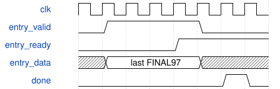

# road_nms_serial 模块规范

> RTL: `road_nms_serial.v`

## 1. 模块目的

读取唯一候选RAM的整数串行NMS。面积移位加法，无第二份候选RAM。

## 2. 参数

| 参数 | 默认值 | 说明 |
| --- | --- | --- |
| — | — | 本模块没有可配置参数。 |

## 3. 时钟与复位

- 时钟：`{"name": "i_clk", "edge": "posedge", "frequency_hz": 100000000}`
- 复位：`{"name": "i_rstn", "active": "low", "synchronous": false, "values": "状态空闲、计数/token/输出零。已保留索引存储不复位，由零计数使旧内容不可读。共同复位/取消清服务在途；释放后才能接受封存。"}`

## 4. 接口信号规范

| 信号 | 方向 | 位宽 | 时钟域 | 语义角色 | 描述 |
| --- | --- | --- | --- | --- | --- |
| `i_clk` | input | 1 | 未声明 | clock | 单一100MHz上升沿时钟 |
| `i_rstn` | input | 1 | 未声明 | reset | 低有效异步取消，调用方共同同步释放 |
| `i_cancel` | input | 1 | 未声明 | abort | 同域取消；必须同时清候选读服务与未发布结果表 |
| `i_sealed_valid` | input | 1 | 未声明 | metadata valid | 排序解码已可读的完整帧元数据有效 |
| `i_frame_token` | input | 32 | 未声明 | frame identity | 封存握手时锁存，保持到done或fault |
| `i_count_person` | input | 8 | 未声明 | person count | 行人候选数0..128；大于128置故障 |
| `i_count_vehicle` | input | 8 | 未声明 | vehicle count | 车辆候选数0..128；可为零 |
| `i_read_ready` | input | 1 | 未声明 | read accept | 接纳当前class/index请求；只有valid且ready才发出 |
| `i_response_valid` | input | 1 | 未声明 | response valid | 带身份的完整160bit记录有效，未接受保持 |
| `i_response_class` | input | 1 | 未声明 | response identity | 必须等于未决请求类别 |
| `i_response_index` | input | 7 | 未声明 | response index | 必须等于未决请求槽号且小于该类数量 |
| `i_response_data` | input | 160 | 未声明 | decoded record | PIF1 DECODED160；geometry_valid=0跳过 |
| `i_response_error` | input | 1 | 未声明 | read error | 响应失败，本帧已接收临时结果也全部作废 |
| `i_entry_ready` | input | 1 | 未声明 | entry accept | 接收一条FINAL97；不等于整表发布 |
| `o_sealed_ready` | output | 1 | 未声明 | metadata accept | 仅空闲、非复位非取消可接受新表 |
| `o_read_valid` | output | 1 | 未声明 | read request | 仅一个未决读，背压保持请求 |
| `o_read_class` | output | 1 | 未声明 | read class | 先行人0后车辆1 |
| `o_read_index` | output | 7 | 未声明 | read slot | 当前或已保留记录的索引 |
| `o_response_ready` | output | 1 | 未声明 | read consume | 仅等待响应状态接受；不依赖固定返回延迟 |
| `o_entry_valid` | output | 1 | 未声明 | entry valid | FINAL97在握手前保持；reset/cancel立即撤销 |
| `o_entry_data` | output | 97 | 未声明 | final entry | class/score及四个20bit源图Q8坐标 |
| `o_frame_token` | output | 32 | 未声明 | result identity | 当前任务token；reset/cancel清零 |
| `o_output_count` | output | 7 | 未声明 | accepted count | 已接受条目数0..64，fault清零，done时为完整数目 |
| `o_done` | output | 1 | 未声明 | complete table | 所有输出接受后的一拍完成；零框同样产生 |
| `o_fault` | output | 1 | 未声明 | sticky failure | 协议或几何合同错误锁定，直至reset/cancel |

## 5. 周期行为与延迟

- 每类按既有score降序/cell升序处理128项以内，geometry_valid=0直接略过；保留32项即结束该类。
- 当前面积每候选一次；旧框面积和交集每比较各一次。唯一20拍20x20移位加法器、40bit面积、42bit比较。
- 严格3*intersection>area_current+area_previous才抑制，IoU=0.5保留。类间不比较。
- 四坐标各用一次RNE(network_q8*5/512)再左移8；源图舍入塌缩不删除。
- 读取错误或身份错误进入粘滞fault，不产生done。C7必须丢弃已接收前缀。

## 6. WaveDrom 时序图

### 输出保持与完成事件

示意最后一项导出窗口；中间计算省略。done仅在最终握手后的完成状态置位。

- WaveJSON：[road_nms_serial_result-hold.json5](waveforms/road_nms_serial_result-hold.json5)

## 7. 边界、反压与错误

- 空表、每类128、总64输出、6944比较、相等分数、无效几何、IoU等号、RNE中点、反压、部分表取消和错身份

## 8. CDC 与综合约束

- 封存候选只读且已经排序；C2拥有唯一整表。该模块仅存两个记录、32个索引和算术状态。
- 共同reset/cancel才能保证没有旧响应；不能将片上协议结论推广到DDR排空。
- 外部任意背压可无限延迟。0新增DSP/ERAM为目标，尚无综合测量。
- 2M周期是全后处理共有额度；整流程50M/备选100M，500ms过期不变。

## 9. 验证与验收

- ModelSim逐条FINAL97、每次面积/交集/抑制决定对拍；互斥周期计数；reset/cancel后重新运行

## 10. 可追溯性

- 规格模块：`road_nms_serial`
- RTL 路径：`road_nms_serial.v`
- 交付要求：本文档、WaveJSON 和 SVG 必须与同一版本规格一同发布。
