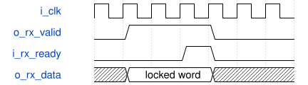

# road_board_selftest_player 模块规范

> RTL: `rtl/road_board_selftest_player.v`

## 1. 模块目的

独立首板计算自检，不是完整CNN或识别验收。

## 2. 参数

| 参数 | 默认值 | 说明 |
| --- | --- | --- |
| — | — | 本模块没有可配置参数。 |

## 3. 时钟与复位

- 时钟：`{"domains": "100MHz计算；75MHz像素；375MHz串行，官方PLL相关时钟"}`
- 复位：`{"assertion": "异步立即取消", "release": "每域两拍；计算壳原协议保留"}`

## 4. 接口信号规范

| 信号 | 方向 | 位宽 | 时钟域 | 语义角色 | 描述 |
| --- | --- | --- | --- | --- | --- |
| `i_clk` | input | 1 | 未声明 | 计算100MHz | 计算100MHz |
| `i_rstn` | input | 1 | 未声明 | 源域已同步释放复位 | 源域已同步释放复位 |
| `i_rx_ready` | input | 1 | 未声明 | 原壳命令接收许可 | 原壳命令接收许可 |
| `i_tx_valid` | input | 1 | 未声明 | 原壳响应有效 | 原壳响应有效 |
| `i_tx_data` | input | 16 | 未声明 | 原壳响应字 | 原壳响应字 |
| `o_rx_valid` | output | 1 | 未声明 | 发送有效保持至ready | 发送有效保持至ready |
| `o_rx_data` | output | 16 | 未声明 | 锁存的命令或负载字 | 锁存的命令或负载字 |
| `o_tx_ready` | output | 1 | 未声明 | 仅比较/状态阶段开放 | 仅比较/状态阶段开放 |
| `o_core_rstn` | output | 1 | 未声明 | 套间断言8拍释放后等8拍 | 套间断言8拍释放后等8拍 |
| `o_payload` | output | 256 | 未声明 | 诊断包，只经冻结快照跨域 | 诊断包，只经冻结快照跨域 |

## 5. 周期行为与延迟

- 固定28774条19位脚本指令，32768词ROM；无板外脚本接口。地址等待一拍，下一拍锁存ROM，随后解码，握手后才推进PC。
- 每套复位原壳并重装1024表项；1948项装载、允许提交、启动、31字轮询、384索引/字节对及C000。三套1152项才能PASS。
- 状态首字检查table_loaded和三类fault，done且非busy后才检1687核心周期并导出。错误/500000周期超时优先FAIL并保存首错。
- payload从高到低：status2/state5/cases2/compared11/core32/preload32/export32/total32/first_pc15/expected16/actual16/error4/sent32/run_elapsed25。
- total=preload+run_elapsed+export，三者互斥；run_elapsed含启动命令握手后至完整完成状态响应，非纯核心周期。

## 6. WaveDrom 时序图

### road_board_selftest_player接口周期

有效后等待ready期间字和PC保持；消费边沿后回到地址等待/读ROM/解码，不能把脚本装载II当成核II。

- WaveJSON：[road_board_selftest_player_send-backpressure.json5](waveforms/road_board_selftest_player_send-backpressure.json5)

## 7. 边界、反压与错误

- 发送反压、缺表、错字、超时、全局复位、套间局部复位、快照忙时终态。

## 8. CDC 与综合约束

- PH1P35MDG324/-3，不增加时序例外。真实资源/时序待当前顶层验证。

## 9. 验证与验收

- tb_board_selftest正常/停顿/错误/缺表/超时/复位；tb_selftest_display。

## 10. 可追溯性

- 规格模块：`road_board_selftest_player`
- RTL 路径：`rtl/road_board_selftest_player.v`
- 交付要求：本文档、WaveJSON 和 SVG 必须与同一版本规格一同发布。
