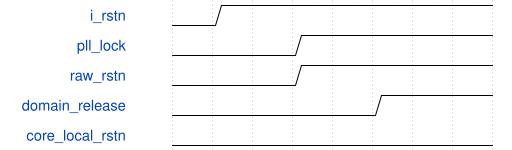

# road_board_selftest_top 模块规范

> RTL: `rtl/road_board_selftest_top.v`

## 1. 模块目的

独立首板计算自检，不是完整CNN或识别验收。

## 2. 参数

| 参数 | 默认值 | 说明 |
| --- | --- | --- |
| — | — | 本模块没有可配置参数。 |

## 3. 时钟与复位

- 时钟：`{"domains": "100MHz计算；75MHz像素；375MHz串行，官方PLL相关时钟"}`
- 复位：`{"assertion": "异步立即取消", "release": "每域两拍；计算壳原协议保留"}`

## 4. 接口信号规范

| 信号 | 方向 | 位宽 | 时钟域 | 语义角色 | 描述 |
| --- | --- | --- | --- | --- | --- |
| `i_sys_clk` | input | 1 | 未声明 | 项目声明C4板载50MHz，实物待确认 | 项目声明C4板载50MHz，实物待确认 |
| `i_rstn` | input | 1 | 未声明 | 项目声明R10外部低有效复位，立即取消 | 项目声明R10外部低有效复位，立即取消 |
| `o_tmds_blue_p` | output | 1 | 未声明 | 官方通道0/G16，差分配对待核实 | 官方通道0/G16，差分配对待核实 |
| `o_tmds_green_p` | output | 1 | 未声明 | 官方通道1/F17，差分配对待核实 | 官方通道1/F17，差分配对待核实 |
| `o_tmds_red_p` | output | 1 | 未声明 | 官方通道2/H14，差分配对待核实 | 官方通道2/H14，差分配对待核实 |
| `o_tmds_clock_p` | output | 1 | 未声明 | 官方TMDS时钟/C17 | 官方TMDS时钟/C17 |

## 5. 周期行为与延迟

- 外部仅6位逻辑接口，不引出诊断命令总线。实例化原8份计算RTL、固定播放器/显示、官方PLL/VTC/HDMI。
- raw_rstn=i_rstn AND PLL lock，立即取消；100MHz/75MHz各两拍同步释放。原计算壳自己的两级释放保持。
- PLL为100/75/375MHz相关时钟；VTC1280x720/1650x750约60.606Hz。HDMI跨像素/串行复位必须由真实STA确认。

## 6. WaveDrom 时序图

### road_board_selftest_top接口周期

PLL锁定后各域两级释放；播放器仍执行本地8拍复位和8拍等待，然后重新装表，不依赖SiLU初始化。

- WaveJSON：[road_board_selftest_top_startup-release.json5](waveforms/road_board_selftest_top_startup-release.json5)

## 7. 边界、反压与错误

- 发送反压、缺表、错字、超时、全局复位、套间局部复位、快照忙时终态。

## 8. CDC 与综合约束

- PH1P35MDG324/-3，不增加时序例外。真实资源/时序待当前顶层验证。

## 9. 验证与验收

- tb_board_selftest正常/停顿/错误/缺表/超时/复位；tb_selftest_display。

## 10. 可追溯性

- 规格模块：`road_board_selftest_top`
- RTL 路径：`rtl/road_board_selftest_top.v`
- 交付要求：本文档、WaveJSON 和 SVG 必须与同一版本规格一同发布。
