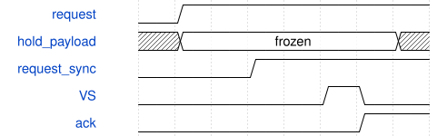

# road_selftest_display 模块规范

> RTL: `rtl/road_selftest_display.v`

## 1. 模块目的

独立首板计算自检，不是完整CNN或识别验收。

## 2. 参数

| 参数 | 默认值 | 说明 |
| --- | --- | --- |
| — | — | 本模块没有可配置参数。 |

## 3. 时钟与复位

- 时钟：`{"domains": "100MHz计算；75MHz像素；375MHz串行，官方PLL相关时钟"}`
- 复位：`{"assertion": "异步立即取消", "release": "每域两拍；计算壳原协议保留"}`

## 4. 接口信号规范

| 信号 | 方向 | 位宽 | 时钟域 | 语义角色 | 描述 |
| --- | --- | --- | --- | --- | --- |
| `i_clk` | input | 1 | 未声明 | 源域100MHz | 源域100MHz |
| `i_rstn` | input | 1 | 未声明 | 源域同步释放复位 | 源域同步释放复位 |
| `i_payload` | input | 256 | 未声明 | 源域动态诊断包 | 源域动态诊断包 |
| `i_pixel_clk` | input | 1 | 未声明 | 目标75MHz像素时钟 | 目标75MHz像素时钟 |
| `i_pixel_rstn` | input | 1 | 未声明 | 像素域同步释放复位 | 像素域同步释放复位 |
| `i_vsync` | input | 1 | 未声明 | VTC消隐区VS | VTC消隐区VS |
| `i_de` | input | 1 | 未声明 | VTC有效像素 | VTC有效像素 |
| `o_rgb` | output | 24 | 未声明 | 一拍延迟TEST状态色 | 一拍延迟TEST状态色 |
| `o_vsync` | output | 1 | 未声明 | 一拍延迟VS | 一拍延迟VS |
| `o_de` | output | 1 | 未声明 | 一拍延迟DE | 一拍延迟DE |
| `o_active_payload` | output | 256 | 未声明 | 整帧冻结诊断快照 | 整帧冻结诊断快照 |

## 5. 周期行为与延迟

- req等于两拍同步ack时冻结payload并翻转req，直到ack返回前保持载荷。目标两拍同步req，仅VS上升沿采样完整载荷并确认。
- 中间进度可以合并；终态保持且最终可发布。套间核复位不触碰CDC，全局复位取消双方请求并清active。
- 固定TEST点阵、黄RUN/绿PASS/红FAIL、256位诊断带和显示本地心跳；RGB/VS/DE共同延迟一拍。无识别框。

## 6. WaveDrom 时序图

### road_selftest_display接口周期

不同域示意而非固定跨域拍数；载荷在请求同步前已冻结，VS采样后ack返回，期间不覆盖。

- WaveJSON：[road_selftest_display_snapshot-at-vs.json5](waveforms/road_selftest_display_snapshot-at-vs.json5)

## 7. 边界、反压与错误

- 发送反压、缺表、错字、超时、全局复位、套间局部复位、快照忙时终态。

## 8. CDC 与综合约束

- PH1P35MDG324/-3，不增加时序例外。真实资源/时序待当前顶层验证。

## 9. 验证与验收

- tb_board_selftest正常/停顿/错误/缺表/超时/复位；tb_selftest_display。

## 10. 可追溯性

- 规格模块：`road_selftest_display`
- RTL 路径：`rtl/road_selftest_display.v`
- 交付要求：本文档、WaveJSON 和 SVG 必须与同一版本规格一同发布。
