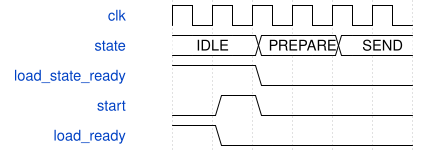

# road_stem_tile_scheduler 模块规范

> RTL: `road_stem_tile_scheduler.v`

## 1. 模块目的

用state_next提前登记IDLE资格，切断实时状态译码到装载RAM写使能的路径。

## 2. 参数

| 参数 | 默认值 | 说明 |
| --- | --- | --- |
| — | — | 本模块没有可配置参数。 |

## 3. 时钟与复位

- 时钟：`{"name": "i_clk", "edge": "posedge", "frequency_hz": 100000000}`
- 复位：`{"name": "i_rstn", "active": "low", "synchronous": false, "values": "立即取消旧事务；同步释放后重新完整装载1024项表及全部参数/halo。"}`

## 4. 接口信号规范

| 信号 | 方向 | 位宽 | 时钟域 | 语义角色 | 描述 |
| --- | --- | --- | --- | --- | --- |
| `i_clk` | input | 1 | i_clk | i_clk | 沿用冻结Stem接口；valid保持到ready，复位立即取消。 |
| `i_rstn` | input | 1 | i_clk | i_rstn | 沿用冻结Stem接口；valid保持到ready，复位立即取消。 |
| `i_table_loaded` | input | 1 | i_clk | i_table_loaded | 沿用冻结Stem接口；valid保持到ready，复位立即取消。 |
| `i_load_valid` | input | 1 | i_clk | i_load_valid | 沿用冻结Stem接口；valid保持到ready，复位立即取消。 |
| `i_load_kind` | input | 3 | i_clk | i_load_kind | 沿用冻结Stem接口；valid保持到ready，复位立即取消。 |
| `i_load_addr` | input | 9 | i_clk | i_load_addr | 沿用冻结Stem接口；valid保持到ready，复位立即取消。 |
| `i_load_data` | input | 32 | i_clk | i_load_data | 沿用冻结Stem接口；valid保持到ready，复位立即取消。 |
| `o_load_ready` | output | 1 | i_clk | o_load_ready | 沿用冻结Stem接口；valid保持到ready，复位立即取消。 |
| `i_start` | input | 1 | i_clk | i_start | 沿用冻结Stem接口；valid保持到ready，复位立即取消。 |
| `o_busy` | output | 1 | i_clk | o_busy | 沿用冻结Stem接口；valid保持到ready，复位立即取消。 |
| `o_done` | output | 1 | i_clk | o_done | 沿用冻结Stem接口；valid保持到ready，复位立即取消。 |
| `o_fault` | output | 1 | i_clk | o_fault | 沿用冻结Stem接口；valid保持到ready，复位立即取消。 |
| `o_core_cycles` | output | 32 | i_clk | o_core_cycles | 沿用冻结Stem接口；valid保持到ready，复位立即取消。 |
| `o_mac_valid` | output | 1 | i_clk | o_mac_valid | 沿用冻结Stem接口；valid保持到ready，复位立即取消。 |
| `i_mac_ready` | input | 1 | i_clk | i_mac_ready | 沿用冻结Stem接口；valid保持到ready，复位立即取消。 |
| `o_mac_first` | output | 1 | i_clk | o_mac_first | 沿用冻结Stem接口；valid保持到ready，复位立即取消。 |
| `o_mac_last` | output | 1 | i_clk | o_mac_last | 沿用冻结Stem接口；valid保持到ready，复位立即取消。 |
| `o_mac_mask` | output | 8 | i_clk | o_mac_mask | 沿用冻结Stem接口；valid保持到ready，复位立即取消。 |
| `o_mac_activation` | output | 64 | i_clk | o_mac_activation | 沿用冻结Stem接口；valid保持到ready，复位立即取消。 |
| `o_mac_weight` | output | 192 | i_clk | o_mac_weight | 沿用冻结Stem接口；valid保持到ready，复位立即取消。 |
| `o_mac_bias` | output | 96 | i_clk | o_mac_bias | 沿用冻结Stem接口；valid保持到ready，复位立即取消。 |
| `i_mac_result_valid` | input | 1 | i_clk | i_mac_result_valid | 沿用冻结Stem接口；valid保持到ready，复位立即取消。 |
| `o_mac_result_ready` | output | 1 | i_clk | o_mac_result_ready | 沿用冻结Stem接口；valid保持到ready，复位立即取消。 |
| `i_mac_result` | input | 96 | i_clk | i_mac_result | 沿用冻结Stem接口；valid保持到ready，复位立即取消。 |
| `i_mac_fault` | input | 1 | i_clk | i_mac_fault | 沿用冻结Stem接口；valid保持到ready，复位立即取消。 |
| `o_pp_valid` | output | 1 | i_clk | o_pp_valid | 沿用冻结Stem接口；valid保持到ready，复位立即取消。 |
| `i_pp_ready` | input | 1 | i_clk | i_pp_ready | 沿用冻结Stem接口；valid保持到ready，复位立即取消。 |
| `o_pp_acc` | output | 96 | i_clk | o_pp_acc | 沿用冻结Stem接口；valid保持到ready，复位立即取消。 |
| `o_pp_multipliers` | output | 96 | i_clk | o_pp_multipliers | 沿用冻结Stem接口；valid保持到ready，复位立即取消。 |
| `o_pp_shifts` | output | 18 | i_clk | o_pp_shifts | 沿用冻结Stem接口；valid保持到ready，复位立即取消。 |
| `o_pp_post_multiplier` | output | 32 | i_clk | o_pp_post_multiplier | 沿用冻结Stem接口；valid保持到ready，复位立即取消。 |
| `o_pp_post_shift` | output | 6 | i_clk | o_pp_post_shift | 沿用冻结Stem接口；valid保持到ready，复位立即取消。 |
| `o_pp_mask` | output | 3 | i_clk | o_pp_mask | 沿用冻结Stem接口；valid保持到ready，复位立即取消。 |
| `o_pp_tags` | output | 48 | i_clk | o_pp_tags | 沿用冻结Stem接口；valid保持到ready，复位立即取消。 |
| `i_pp_valid` | input | 1 | i_clk | i_pp_valid | 沿用冻结Stem接口；valid保持到ready，复位立即取消。 |
| `o_pp_ready` | output | 1 | i_clk | o_pp_ready | 沿用冻结Stem接口；valid保持到ready，复位立即取消。 |
| `i_pp_data` | input | 16 | i_clk | i_pp_data | 沿用冻结Stem接口；valid保持到ready，复位立即取消。 |
| `i_pp_tag` | input | 16 | i_clk | i_pp_tag | 沿用冻结Stem接口；valid保持到ready，复位立即取消。 |
| `i_pp_int16` | input | 1 | i_clk | i_pp_int16 | 沿用冻结Stem接口；valid保持到ready，复位立即取消。 |
| `i_pp_fault` | input | 1 | i_clk | i_pp_fault | 沿用冻结Stem接口；valid保持到ready，复位立即取消。 |
| `i_commit_ready` | input | 1 | i_clk | i_commit_ready | 沿用冻结Stem接口；valid保持到ready，复位立即取消。 |
| `i_export_start` | input | 1 | i_clk | i_export_start | 沿用冻结Stem接口；valid保持到ready，复位立即取消。 |
| `o_output_valid` | output | 1 | i_clk | o_output_valid | 沿用冻结Stem接口；valid保持到ready，复位立即取消。 |
| `i_output_ready` | input | 1 | i_clk | i_output_ready | 沿用冻结Stem接口；valid保持到ready，复位立即取消。 |
| `o_output_data` | output | 8 | i_clk | o_output_data | 沿用冻结Stem接口；valid保持到ready，复位立即取消。 |
| `o_output_index` | output | 8 | i_clk | o_output_index | 沿用冻结Stem接口；valid保持到ready，复位立即取消。 |
| `o_export_done` | output | 1 | i_clk | o_export_done | 沿用冻结Stem接口；valid保持到ready，复位立即取消。 |

## 5. 周期行为与延迟

- 4×4输出tile，3输入16输出，3×3 stride2，9×9×3 halo，OIHW432字节权重。
- 输出通道组仅0/3/6/9/12/15，归约四组八lane，最后组仅前三lane有效。
- 权重地址=六组常量基址+9位零扩展term；合法地址0..431，输出尾路置零。
- PREPARE注册到SEND；SEND背压时载荷保持，不增加寄存器、延迟或II。
- 偏置仅first加入；真实缓存256项完整写回后才可导出；故障只可复位恢复。
- flag_load_state_ready复位为1，每沿更新为state_next==IDLE，与更新后state_current==IDLE等价。
- 只替换ready中的状态资格，rstn/start/export/fault保持实时；没有新增写缓存、写延迟或准入气泡。
- 原halo/weight合法写入仍在接受同沿，非法load当沿置粘滞故障，复位立即关闭ready。

## 6. WaveDrom 时序图

### IDLE资格与状态同沿更新

原接受沿、核心窗口、反压及复位取消规则不变，图仅示意已有状态边界。

- WaveJSON：[road_stem_tile_scheduler_equal.json5](waveforms/road_stem_tile_scheduler_equal.json5)

## 7. 边界、反压与错误

- channel15尾路、group3尾lane、地址431、负权重、反压、装载/计算中复位。

## 8. CDC 与综合约束

- TEST_ONLY量化参数；仅前三个卷积验证；不含DDR/生产/位流。
- 调度FSM及全部算术源码冻结，非合法通道状态不扩展契约。

## 9. 验证与验收

- Python地址穷举；RTL两组权重指纹穷举；冻结normal/stalls/control整帧回归。
- 同向量完整normal/stalls周期和输出逐字节比较、专项存储/ready枚举、实际50IO顶层TD全端点检查。

## 10. 可追溯性

- 规格模块：`road_stem_tile_scheduler`
- RTL 路径：`road_stem_tile_scheduler.v`
- 交付要求：本文档、WaveJSON 和 SVG 必须与同一版本规格一同发布。
