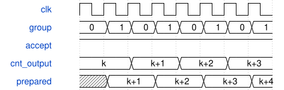

# road_down2_tile_scheduler 模块规范

> RTL: `road_down2_tile_scheduler.v`

## 1. 模块目的

每拍提前准备最后组后的5位输出计数；原接受沿提交，接口和周期不变。

## 2. 参数

| 参数 | 默认值 | 说明 |
| --- | --- | --- |
| — | — | 本模块没有可配置参数。 |

## 3. 时钟与复位

- 时钟：`{"name": "i_clk", "edge": "posedge", "frequency_hz": 100000000}`
- 复位：`{"name": "i_rstn", "active": "low", "synchronous": false, "values": "取消环和active有效性；数据不整阵列清零；调用者同步释放并完整重装表及参数。"}`

## 4. 接口信号规范

| 信号 | 方向 | 位宽 | 时钟域 | 语义角色 | 描述 |
| --- | --- | --- | --- | --- | --- |
| `i_clk` | input | 1 | i_clk | i_clk | 冻结端口；仅 valid 与 ready 同时有效时接受，停顿保持负载。 |
| `i_rstn` | input | 1 | i_clk | i_rstn | 冻结端口；仅 valid 与 ready 同时有效时接受，停顿保持负载。 |
| `i_table_loaded` | input | 1 | i_clk | i_table_loaded | 冻结端口；仅 valid 与 ready 同时有效时接受，停顿保持负载。 |
| `i_load_valid` | input | 1 | i_clk | i_load_valid | 冻结端口；仅 valid 与 ready 同时有效时接受，停顿保持负载。 |
| `i_load_kind` | input | 3 | i_clk | i_load_kind | 冻结端口；仅 valid 与 ready 同时有效时接受，停顿保持负载。 |
| `i_load_addr` | input | 11 | i_clk | i_load_addr | 冻结端口；仅 valid 与 ready 同时有效时接受，停顿保持负载。 |
| `i_load_data` | input | 32 | i_clk | i_load_data | 冻结端口；仅 valid 与 ready 同时有效时接受，停顿保持负载。 |
| `o_load_ready` | output | 1 | i_clk | o_load_ready | 冻结端口；仅 valid 与 ready 同时有效时接受，停顿保持负载。 |
| `i_start` | input | 1 | i_clk | i_start | 冻结端口；仅 valid 与 ready 同时有效时接受，停顿保持负载。 |
| `i_pw_only` | input | 1 | i_clk | i_pw_only | 冻结端口；仅 valid 与 ready 同时有效时接受，停顿保持负载。 |
| `i_commit_ready` | input | 1 | i_clk | i_commit_ready | 冻结端口；仅 valid 与 ready 同时有效时接受，停顿保持负载。 |
| `o_busy` | output | 1 | i_clk | o_busy | 冻结端口；仅 valid 与 ready 同时有效时接受，停顿保持负载。 |
| `o_done` | output | 1 | i_clk | o_done | 冻结端口；仅 valid 与 ready 同时有效时接受，停顿保持负载。 |
| `o_fault` | output | 1 | i_clk | o_fault | 冻结端口；仅 valid 与 ready 同时有效时接受，停顿保持负载。 |
| `i_export_start` | input | 1 | i_clk | i_export_start | 冻结端口；仅 valid 与 ready 同时有效时接受，停顿保持负载。 |
| `i_output_ready` | input | 1 | i_clk | i_output_ready | 冻结端口；仅 valid 与 ready 同时有效时接受，停顿保持负载。 |
| `o_output_valid` | output | 1 | i_clk | o_output_valid | 冻结端口；仅 valid 与 ready 同时有效时接受，停顿保持负载。 |
| `o_output_data` | output | 8 | i_clk | o_output_data | 冻结端口；仅 valid 与 ready 同时有效时接受，停顿保持负载。 |
| `o_output_index` | output | 9 | i_clk | o_output_index | 冻结端口；仅 valid 与 ready 同时有效时接受，停顿保持负载。 |
| `o_export_done` | output | 1 | i_clk | o_export_done | 冻结端口；仅 valid 与 ready 同时有效时接受，停顿保持负载。 |
| `o_debug_valid` | output | 1 | i_clk | o_debug_valid | 冻结端口；仅 valid 与 ready 同时有效时接受，停顿保持负载。 |
| `o_debug_phase` | output | 2 | i_clk | o_debug_phase | 冻结端口；仅 valid 与 ready 同时有效时接受，停顿保持负载。 |
| `o_debug_layer` | output | 1 | i_clk | o_debug_layer | 冻结端口；仅 valid 与 ready 同时有效时接受，停顿保持负载。 |
| `o_debug_position` | output | 4 | i_clk | o_debug_position | 冻结端口；仅 valid 与 ready 同时有效时接受，停顿保持负载。 |
| `o_debug_channel` | output | 5 | i_clk | o_debug_channel | 冻结端口；仅 valid 与 ready 同时有效时接受，停顿保持负载。 |
| `o_debug_value` | output | 32 | i_clk | o_debug_value | 冻结端口；仅 valid 与 ready 同时有效时接受，停顿保持负载。 |
| `o_preload_writes` | output | 32 | i_clk | o_preload_writes | 冻结端口；仅 valid 与 ready 同时有效时接受，停顿保持负载。 |
| `o_core_cycles` | output | 32 | i_clk | o_core_cycles | 冻结端口；仅 valid 与 ready 同时有效时接受，停顿保持负载。 |
| `o_mac_cycles` | output | 32 | i_clk | o_mac_cycles | 冻结端口；仅 valid 与 ready 同时有效时接受，停顿保持负载。 |
| `o_pre_cycles` | output | 32 | i_clk | o_pre_cycles | 冻结端口；仅 valid 与 ready 同时有效时接受，停顿保持负载。 |
| `o_silu_cycles` | output | 32 | i_clk | o_silu_cycles | 冻结端口；仅 valid 与 ready 同时有效时接受，停顿保持负载。 |
| `o_post_cycles` | output | 32 | i_clk | o_post_cycles | 冻结端口；仅 valid 与 ready 同时有效时接受，停顿保持负载。 |
| `o_writeback_cycles` | output | 32 | i_clk | o_writeback_cycles | 冻结端口；仅 valid 与 ready 同时有效时接受，停顿保持负载。 |
| `o_storage_wait_cycles` | output | 32 | i_clk | o_storage_wait_cycles | 冻结端口；仅 valid 与 ready 同时有效时接受，停顿保持负载。 |
| `o_scheduler_idle_cycles` | output | 32 | i_clk | o_scheduler_idle_cycles | 冻结端口；仅 valid 与 ready 同时有效时接受，停顿保持负载。 |
| `o_export_cycles` | output | 32 | i_clk | o_export_cycles | 冻结端口；仅 valid 与 ready 同时有效时接受，停顿保持负载。 |
| `o_result_queue_count` | output | 2 | i_clk | o_result_queue_count | 冻结端口；仅 valid 与 ready 同时有效时接受，停顿保持负载。 |
| `o_result_reserved` | output | 1 | i_clk | o_result_reserved | 冻结端口；仅 valid 与 ready 同时有效时接受，停顿保持负载。 |
| `o_meta_count` | output | 4 | i_clk | o_meta_count | 冻结端口；仅 valid 与 ready 同时有效时接受，停顿保持负载。 |
| `o_mac_result_count` | output | 32 | i_clk | o_mac_result_count | 冻结端口；仅 valid 与 ready 同时有效时接受，停顿保持负载。 |
| `o_pre_accept_count` | output | 32 | i_clk | o_pre_accept_count | 冻结端口；仅 valid 与 ready 同时有效时接受，停顿保持负载。 |
| `o_silu_accept_count` | output | 32 | i_clk | o_silu_accept_count | 冻结端口；仅 valid 与 ready 同时有效时接受，停顿保持负载。 |
| `o_post_accept_count` | output | 32 | i_clk | o_post_accept_count | 冻结端口；仅 valid 与 ready 同时有效时接受，停顿保持负载。 |
| `o_writeback_count` | output | 32 | i_clk | o_writeback_count | 冻结端口；仅 valid 与 ready 同时有效时接受，停顿保持负载。 |
| `i_mac_ready` | input | 1 | i_clk | i_mac_ready | 冻结端口；仅 valid 与 ready 同时有效时接受，停顿保持负载。 |
| `i_mac_result_valid` | input | 1 | i_clk | i_mac_result_valid | 冻结端口；仅 valid 与 ready 同时有效时接受，停顿保持负载。 |
| `i_mac_result` | input | 96 | i_clk | i_mac_result | 冻结端口；仅 valid 与 ready 同时有效时接受，停顿保持负载。 |
| `i_mac_fault` | input | 1 | i_clk | i_mac_fault | 冻结端口；仅 valid 与 ready 同时有效时接受，停顿保持负载。 |
| `o_mac_valid` | output | 1 | i_clk | o_mac_valid | 冻结端口；仅 valid 与 ready 同时有效时接受，停顿保持负载。 |
| `o_mac_first` | output | 1 | i_clk | o_mac_first | 冻结端口；仅 valid 与 ready 同时有效时接受，停顿保持负载。 |
| `o_mac_last` | output | 1 | i_clk | o_mac_last | 冻结端口；仅 valid 与 ready 同时有效时接受，停顿保持负载。 |
| `o_mac_mask` | output | 8 | i_clk | o_mac_mask | 冻结端口；仅 valid 与 ready 同时有效时接受，停顿保持负载。 |
| `o_mac_activation` | output | 64 | i_clk | o_mac_activation | 冻结端口；仅 valid 与 ready 同时有效时接受，停顿保持负载。 |
| `o_mac_weight` | output | 192 | i_clk | o_mac_weight | 冻结端口；仅 valid 与 ready 同时有效时接受，停顿保持负载。 |
| `o_mac_bias` | output | 96 | i_clk | o_mac_bias | 冻结端口；仅 valid 与 ready 同时有效时接受，停顿保持负载。 |
| `o_mac_result_ready` | output | 1 | i_clk | o_mac_result_ready | 冻结端口；仅 valid 与 ready 同时有效时接受，停顿保持负载。 |
| `i_pp_ready` | input | 1 | i_clk | i_pp_ready | 冻结端口；仅 valid 与 ready 同时有效时接受，停顿保持负载。 |
| `i_pp_valid` | input | 1 | i_clk | i_pp_valid | 冻结端口；仅 valid 与 ready 同时有效时接受，停顿保持负载。 |
| `i_pp_data` | input | 16 | i_clk | i_pp_data | 冻结端口；仅 valid 与 ready 同时有效时接受，停顿保持负载。 |
| `i_pp_tag` | input | 16 | i_clk | i_pp_tag | 冻结端口；仅 valid 与 ready 同时有效时接受，停顿保持负载。 |
| `i_pp_int16` | input | 1 | i_clk | i_pp_int16 | 冻结端口；仅 valid 与 ready 同时有效时接受，停顿保持负载。 |
| `i_pp_fault` | input | 1 | i_clk | i_pp_fault | 冻结端口；仅 valid 与 ready 同时有效时接受，停顿保持负载。 |
| `i_pp_result_queue_count` | input | 2 | i_clk | i_pp_result_queue_count | 冻结端口；仅 valid 与 ready 同时有效时接受，停顿保持负载。 |
| `i_pp_meta_count` | input | 4 | i_clk | i_pp_meta_count | 冻结端口；仅 valid 与 ready 同时有效时接受，停顿保持负载。 |
| `i_pp_pre_busy` | input | 1 | i_clk | i_pp_pre_busy | 冻结端口；仅 valid 与 ready 同时有效时接受，停顿保持负载。 |
| `i_pp_silu_busy` | input | 1 | i_clk | i_pp_silu_busy | 冻结端口；仅 valid 与 ready 同时有效时接受，停顿保持负载。 |
| `i_pp_post_busy` | input | 1 | i_clk | i_pp_post_busy | 冻结端口；仅 valid 与 ready 同时有效时接受，停顿保持负载。 |
| `i_pp_pre_accept` | input | 1 | i_clk | i_pp_pre_accept | 冻结端口；仅 valid 与 ready 同时有效时接受，停顿保持负载。 |
| `i_pp_silu_accept` | input | 1 | i_clk | i_pp_silu_accept | 冻结端口；仅 valid 与 ready 同时有效时接受，停顿保持负载。 |
| `i_pp_post_accept` | input | 1 | i_clk | i_pp_post_accept | 冻结端口；仅 valid 与 ready 同时有效时接受，停顿保持负载。 |
| `o_pp_valid` | output | 1 | i_clk | o_pp_valid | 冻结端口；仅 valid 与 ready 同时有效时接受，停顿保持负载。 |
| `o_pp_acc` | output | 96 | i_clk | o_pp_acc | 冻结端口；仅 valid 与 ready 同时有效时接受，停顿保持负载。 |
| `o_pp_multipliers` | output | 96 | i_clk | o_pp_multipliers | 冻结端口；仅 valid 与 ready 同时有效时接受，停顿保持负载。 |
| `o_pp_shifts` | output | 18 | i_clk | o_pp_shifts | 冻结端口；仅 valid 与 ready 同时有效时接受，停顿保持负载。 |
| `o_pp_post_multiplier` | output | 32 | i_clk | o_pp_post_multiplier | 冻结端口；仅 valid 与 ready 同时有效时接受，停顿保持负载。 |
| `o_pp_post_shift` | output | 6 | i_clk | o_pp_post_shift | 冻结端口；仅 valid 与 ready 同时有效时接受，停顿保持负载。 |
| `o_pp_mask` | output | 3 | i_clk | o_pp_mask | 冻结端口；仅 valid 与 ready 同时有效时接受，停顿保持负载。 |
| `o_pp_tags` | output | 48 | i_clk | o_pp_tags | 冻结端口；仅 valid 与 ready 同时有效时接受，停顿保持负载。 |
| `o_pp_input_fault` | output | 1 | i_clk | o_pp_input_fault | 冻结端口；仅 valid 与 ready 同时有效时接受，停顿保持负载。 |
| `o_pp_ready` | output | 1 | i_clk | o_pp_ready | 冻结端口；仅 valid 与 ready 同时有效时接受，停顿保持负载。 |

## 5. 周期行为与延迟

- 原四项所有权环同一个first握手同时登记任务身份和152位参数，不增加队列或II。
- 参数记录高到低为post_shift6、post_multiplier32、pre_shifts18、pre_multipliers96。
- PW参数索引16+输出组起始通道；DW索引为当前发射通道向下对齐到三通道组。
- PW结果使用旧队首记录；DW结果与参数、active_meta同拍保存，三空间点复用同一参数。
- 满环同拍pop/push必须消费旧队首；DW末标量和新结果同拍时新active安装优先。
- 原状态机、标签、mask、shape fault及数值核不变；fault终止后只能复位恢复。
- 准备寄存器每拍计算：DW小于15加一否则0；PW小于7加一，否则非最后位置清0、最后位置保持。
- 每个合法last接受前至少已有一拍当前layer/position/output稳定，PW group0提供最短准备窗口。
- cnt_output仅在原last接受沿提交准备值，IDLE/start及DW_DRAIN清零、PP/load故障保持优先级不变。
- 异步复位同时清零准备寄存器；算术、元数据、端口、II和外部延迟不变。

## 6. WaveDrom 时序图

### PW两组连续接受与准备值

每个上升沿前的值；group0接受沿刷新准备值，group1接受沿提交；反压保持原计数。

- WaveJSON：[road_down2_tile_scheduler_prepared-counter.json5](waveforms/road_down2_tile_scheduler_prepared-counter.json5)

## 7. 边界、反压与错误

- 满环同址pop/push、DW active替换、尾通道15、长反压、故障与复位。

## 8. CDC 与综合约束

- TEST_ONLY参数，非部署QAT；无DDR、整网或板级通过声明。
- 接口与计算周期不变；完整RAM/DSP端点时序必须另测。

## 9. 验证与验收

- Python归属参考、原五类回归、专项参数对拍、实际顶层物理实现。
- Python可达状态转移枚举、RTL准备值不变量/原递推逐拍检查、原完整回归及全量周期比较。

## 10. 可追溯性

- 规格模块：`road_down2_tile_scheduler`
- RTL 路径：`road_down2_tile_scheduler.v`
- 交付要求：本文档、WaveJSON 和 SVG 必须与同一版本规格一同发布。
