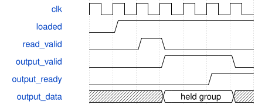

# tb_csp_dw_cache 模块规范

> RTL: `tb_csp_dw_cache.v`

## 1. 模块目的

缓存握手及实际计算回归，不是整网或DDR验收

## 2. 参数

| 参数 | 默认值 | 说明 |
| --- | --- | --- |
| — | — | 本模块没有可配置参数。 |

## 3. 时钟与复位

- 时钟：`{"name": "clk", "edge": "posedge", "frequency_hz": 100000000, "internal": true}`
- 复位：`{"name": "rstn", "active": "low", "synchronous": false, "internal": true}`

## 4. 接口信号规范

| 信号 | 方向 | 位宽 | 时钟域 | 语义角色 | 描述 |
| --- | --- | --- | --- | --- | --- |
| `o_test_done` | output | 1 | clk | test_complete | 全部检查通过后置位 |

## 5. 周期行为与延迟

- 采集阶段只写不读，全部192个唯一结果到齐后只读不写。
- 每读请求一个上升沿后产生64bit注册响应；一槽可同拍出入。
- reset清有效位/计数/响应，不清RAM；恢复后必须完整重写，禁止旧响应泄漏。

## 6. WaveDrom 时序图

### 完整采集后注册读取及响应保持

最后一字节写入之后开放读，接受读的上升沿后产生响应；停顿时数据和元数据保持。

- WaveJSON：[tb_csp_dw_cache_read.json5](waveforms/tb_csp_dw_cache_read.json5)

## 7. 边界、反压与错误

- 最后一字节、索引191/192/255、重复写、请求/响应停顿、复位中断。

## 8. CDC 与综合约束

- 仅测试，不可综合

## 9. 验证与验收

- 32组数据对拍、随机写序、长响应反压、未满不读、故障及复位；17项真实计算回归。

## 10. 可追溯性

- 规格模块：`tb_csp_dw_cache`
- RTL 路径：`tb_csp_dw_cache.v`
- 交付要求：本文档、WaveJSON 和 SVG 必须与同一版本规格一同发布。
