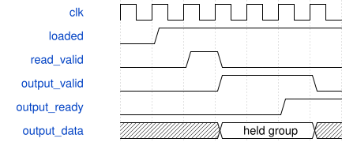

# road_csp_dw_cache 模块规范

> RTL: `road_csp_dw_cache.v`

## 1. 模块目的

固定首残差DW→PW八bank缓存，不含DDR或算术

## 2. 参数

| 参数 | 默认值 | 说明 |
| --- | --- | --- |
| — | — | 本模块没有可配置参数。 |

## 3. 时钟与复位

- 时钟：`{"name": "i_clk", "edge": "posedge", "frequency_hz": 100000000}`
- 复位：`{"name": "i_rstn", "active": "low", "synchronous": false}`

## 4. 接口信号规范

| 信号 | 方向 | 位宽 | 时钟域 | 语义角色 | 描述 |
| --- | --- | --- | --- | --- | --- |
| `i_clk` | input | 1 | i_clk | native | 100MHz同域时钟 |
| `i_rstn` | input | 1 | i_clk | native | 共同异步取消，释放由现顶层保证 |
| `i_clear` | input | 1 | i_clk | native | 只在tile空闲边界同步清有效状态，不清RAM、不清sticky fault |
| `i_write_valid` | input | 1 | i_clk | native | DW实际结果写请求，保持到接受 |
| `i_write_index` | input | 8 | i_clk | native | DW局部HWC索引0..191，非法索引被接受后置错但不写内存 |
| `i_write_data` | input | 8 | i_clk | native | 真实DW INT8输出 |
| `o_write_ready` | output | 1 | i_clk | native | 采集阶段且健康时允许写 |
| `o_loaded` | output | 1 | i_clk | native | 全部192个不同地址已被接收 |
| `o_write_count` | output | 8 | i_clk | native | 唯一有效写计数0..192 |
| `o_fault` | output | 1 | i_clk | native | 重复/越界写粘滞故障，共同复位清除 |
| `i_read_valid` | input | 1 | i_clk | native | PW组读请求，保持到ready |
| `i_read_pixel` | input | 4 | i_clk | native | 4×4局部pixel索引 |
| `i_read_group` | input | 1 | i_clk | native | 0=通道0..7；1=通道8..11及四零lane |
| `o_read_ready` | output | 1 | i_clk | native | 完整采集且响应槽可容纳才接受 |
| `i_output_ready` | input | 1 | i_clk | native | PW操作数端真实接受 |
| `o_output_valid` | output | 1 | i_clk | native | 读响应一槽，反压保持 |
| `o_output_data` | output | 64 | i_clk | native | 8个低字节优先INT8 |
| `o_output_mask` | output | 8 | i_clk | native | ff或0f，末组四零lane |
| `o_output_pixel` | output | 4 | i_clk | native | 与载荷同步的pixel |
| `o_output_group` | output | 1 | i_clk | native | 与载荷同步的组号 |

## 5. 周期行为与延迟

- 采集阶段只写不读，全部192个唯一结果到齐后只读不写。
- 每读请求一个上升沿后产生64bit注册响应；一槽可同拍出入。
- reset清有效位/计数/响应，不清RAM；恢复后必须完整重写，禁止旧响应泄漏。
- i_clear期间禁止接受读写，沿后清count/有效位/响应；fault只能共同reset清除。

## 6. WaveDrom 时序图

### 完整采集后注册读取及响应保持

最后一字节写入之后开放读，接受读的上升沿后产生响应；停顿时数据和元数据保持。

- WaveJSON：[road_csp_dw_cache_read.json5](waveforms/road_csp_dw_cache_read.json5)

## 7. 边界、反压与错误

- 最后一字节、索引191/192/255、重复写、请求/响应停顿、复位中断。

## 8. CDC 与综合约束

- i_clear仅由空闲调度边界产生，不能取消在途计算或模拟DDR排空。

## 9. 验证与验收

- 32组数据对拍、随机写序、长响应反压、未满不读、故障及复位；17项真实计算回归。

## 10. 可追溯性

- 规格模块：`road_csp_dw_cache`
- RTL 路径：`road_csp_dw_cache.v`
- 交付要求：本文档、WaveJSON 和 SVG 必须与同一版本规格一同发布。
