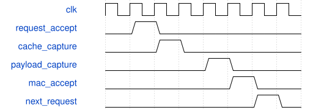

# road_csp_scheduled_chain 模块规范

> RTL: `road_csp_scheduled_chain.v`

## 1. 模块目的

固定首残差硬件调度及单事务取数；参数/halo端为内部provider，不是外设接口

## 2. 参数

| 参数 | 默认值 | 说明 |
| --- | --- | --- |
| — | — | 本模块没有可配置参数。 |

## 3. 时钟与复位

- 时钟：`{"name": "i_clk", "edge": "posedge", "frequency_hz": 100000000}`
- 复位：`{"name": "i_rstn", "active": "low", "synchronous": false}`

## 4. 接口信号规范

| 信号 | 方向 | 位宽 | 时钟域 | 语义角色 | 描述 |
| --- | --- | --- | --- | --- | --- |
| `i_clk` | input | 1 | i_clk | native | 同域100MHz时钟 |
| `i_rstn` | input | 1 | i_clk | native | 共同异步取消，释放由现顶层保证 |
| `i_start` | input | 1 | i_clk | native | 与start_ready握手启动一个固定tile |
| `i_table_valid` | input | 1 | i_clk | native | 仅空闲时允许顺序装表，启动与装表互斥 |
| `i_table_addr` | input | 10 | i_clk | native | 原1024项表地址 |
| `i_table_data` | input | 16 | i_clk | native | 原signed16表值 |
| `o_start_ready` | output | 1 | i_clk | native | 表已满且完全空闲时允许启动 |
| `o_table_ready` | output | 1 | i_clk | native | 真实装表准入 |
| `o_table_loaded` | output | 1 | i_clk | native | 核的完整装表许可 |
| `o_busy` | output | 1 | i_clk | native | 当前tile占有 |
| `o_done` | output | 1 | i_clk | native | 所有任务末路提交后完成 |
| `o_fault` | output | 1 | i_clk | native | 核/缓存/描述符故障，仅共同复位恢复 |
| `o_operand_request_valid` | output | 1 | i_clk | native | 单个取数请求，保持到ready |
| `i_operand_request_ready` | input | 1 | i_clk | native | 取数端接收请求 |
| `o_operand_request_descriptor` | output | 25 | i_clk | native | 沿冻结task/pw/y/x/channel/first/last/mask布局 |
| `i_operand_response_valid` | input | 1 | i_clk | native | 取数响应，保持全部载荷到ready |
| `o_operand_response_ready` | output | 1 | i_clk | native | 已登记请求且尚未保存响应 |
| `i_operand_response_descriptor` | input | 25 | i_clk | native | 必须回显当前唯一请求，失配置错不计算 |
| `i_operand_activation` | input | 64 | i_clk | native | 仅DW采用；PW忽略此字段而读取实际缓存 |
| `i_operand_weight` | input | 192 | i_clk | native | 三路八输入权重 |
| `i_operand_bias` | input | 96 | i_clk | native | 三路INT32偏置 |
| `i_operand_pre_multipliers` | input | 96 | i_clk | native | 三路真实前乘数 |
| `i_operand_pre_shifts` | input | 18 | i_clk | native | 三路六位移位 |
| `i_operand_post_multiplier` | input | 32 | i_clk | native | 当前层后乘数 |
| `i_operand_post_shift` | input | 6 | i_clk | native | 当前层后移位 |
| `i_operand_bypass` | input | 24 | i_clk | native | PW残差三路原输入旁路 |
| `i_operand_fault` | input | 1 | i_clk | native | 首组输入故障标志 |
| `i_result_ready` | input | 1 | i_clk | native | 结果接收端的真实ready |
| `o_result_valid` | output | 1 | i_clk | native | 与DW缓存原子提交的结果valid |
| `o_result_data` | output | 8 | i_clk | native | 真实INT8结果 |
| `o_result_tag` | output | 16 | i_clk | native | RTL根据任务坐标派生的tag |
| `o_result_address` | output | 32 | i_clk | native | 冻结逻辑字节地址 |
| `o_result_sum` | output | 9 | i_clk | native | 真实残差饱和前和 |
| `o_group_accept` | output | 1 | i_clk | native | MAC真实接收一组 |
| `o_task_commit` | output | 1 | i_clk | native | 当前任务最后一路已实际提交 |
| `o_request_accept` | output | 1 | i_clk | native | 取数请求真实接受 |
| `o_cache_read_accept` | output | 1 | i_clk | native | PW缓存请求真实接受 |
| `o_cache_write_accept` | output | 1 | i_clk | native | DW缓存字节真实接受 |
| `o_cycle_reason` | output | 3 | i_clk | native | 0空闲/1MAC发射/2请求阶段/3响应等待接收/4缓存等待/5MAC等待/6写端反压/7其他流水提交 |

## 5. 周期行为与延迟

- 160任务/320组由冻结调度器产生；一笔取数在途，响应与PW缓存数据各锁存，齐备才送原核。
- PW输入忽略provider activation，来自真实DW缓存；tag/逻辑地址由RTL坐标计算。
- 三路或单路结果全部实际提交才task_done；每次tile开始局部清缓存，不复位核或重装SiLU。
- 共同reset取消所有暂存；provider必须共同取消旧响应，本接口不能直接接DDR晚返回。

## 6. WaveDrom 时序图

### 取数与PW缓存汇合再发射

同一个请求对应两路锁存；MAC真实接受后才推进组。

- WaveJSON：[road_csp_scheduled_chain_join.json5](waveforms/road_csp_scheduled_chain_join.json5)

## 7. 边界、反压与错误

- 响应先于/晚于缓存、长结果反压、首末组、1/3路提交、reset、双tile及失配响应。

## 8. CDC 与综合约束

- 不改核端口/数值/II；串行请求适配可能增加组间间隔，按端点周期测量而不冒称II加速。
- 提供者在空闲装表时具有优先级，忙时装表不被接受；仅单上下文，不新增队列或外设。

## 9. 验证与验收

- 实际acc/pre/SiLU/post/sum/地址/输出；随机provider与反压；故障及reset；旧回归单列。

## 10. 可追溯性

- 规格模块：`road_csp_scheduled_chain`
- RTL 路径：`road_csp_scheduled_chain.v`
- 交付要求：本文档、WaveJSON 和 SVG 必须与同一版本规格一同发布。
