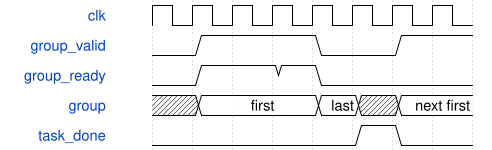

# road_csp_tile_schedule 模块规范

> RTL: `road_csp_tile_schedule.v`

## 1. 模块目的

固定左上首残差4×4×12任务计数器；无数据通路或通用微码

## 2. 参数

| 参数 | 默认值 | 说明 |
| --- | --- | --- |
| — | — | 本模块没有可配置参数。 |

## 3. 时钟与复位

- 时钟：`{"name": "i_clk", "edge": "posedge", "frequency_hz": 100000000}`
- 复位：`{"name": "i_rstn", "active": "low", "synchronous": false}`

## 4. 接口信号规范

| 信号 | 方向 | 位宽 | 时钟域 | 语义角色 | 描述 |
| --- | --- | --- | --- | --- | --- |
| `i_clk` | input | 1 | i_clk | native | 100MHz同域时钟 |
| `i_rstn` | input | 1 | i_clk | native | 共同低有效异步取消，释放由现顶层保证 |
| `i_start` | input | 1 | i_clk | native | 与start_ready握手启动，忙时不接受 |
| `i_table_loaded` | input | 1 | i_clk | native | 来自冻结核，复位后重装1024项才允许启动 |
| `i_group_ready` | input | 1 | i_clk | native | 操作数适配器和核共同接受本组 |
| `i_task_done` | input | 1 | i_clk | native | 末路本地接收事件；一段高电平只消费一次，回低后重武装 |
| `i_core_fault` | input | 1 | i_clk | native | 共同核故障，优先取消，恢复必须共同复位 |
| `o_start_ready` | output | 1 | i_clk | native | 空闲且表已满且健康时允许启动 |
| `o_group_valid` | output | 1 | i_clk | native | 当前组描述符有效，背压保持 |
| `o_first` | output | 1 | i_clk | native | 两组中的首组 |
| `o_last` | output | 1 | i_clk | native | 两组中的末组 |
| `o_pw` | output | 1 | i_clk | native | 0 DW，1 PW |
| `o_y` | output | 2 | i_clk | native | 输出tile行0至3 |
| `o_x` | output | 2 | i_clk | native | DW三点起点0或3；PW单位置0至3 |
| `o_channel` | output | 4 | i_clk | native | DW同一通道0至11；PW输出起点0/3/6/9 |
| `o_output_mask` | output | 3 | i_clk | native | DW尾空间点001，其余111 |
| `o_input_mask` | output | 8 | i_clk | native | DW并集15/9，PW输入12，末组显式mask |
| `o_task_index` | output | 8 | i_clk | native | 固定任务序号0至159 |
| `o_busy` | output | 1 | i_clk | native | 当前tile尚未完整结束 |
| `o_done` | output | 1 | i_clk | native | 160个任务全部本地提交后单周期完成 |
| `o_fault` | output | 1 | i_clk | native | 早到完成或核故障粘滞，禁止发布 |

## 5. 周期行为与延迟

- DW y/channel/x0或3，96任务；PW y/x/channel0或3或6或9，64任务。
- 每任务两组；仅valid与ready推进组，WAIT收到最后结果提交才推进任务。
- 未装满表拒绝启动；忙时start忽略；未消费的提前task_done故障；已消费高电平尾部不报错或重复推进；reset立即取消旧描述符。
- 最终done周期允许start_ready，同时握手可立即启动下一tile；fault在reset期间强制低。

## 6. WaveDrom 时序图

### 双组及完整结果提交后推进

两次group握手后等待task_done；背压不改变当前描述符。

- WaveJSON：[road_csp_tile_schedule_task.json5](waveforms/road_csp_tile_schedule_task.json5)

## 7. 边界、反压与错误

- DW末点、阶段切换、最终PW、任意反压、WAIT复位、早到done。

## 8. CDC 与综合约束

- 仅本固定tile，不生成全局DDR地址，不证明写可见性，不改变冻结核II或接口。

## 9. 验证与验收

- 320组逐项同冻结mac_tasks；随机ready/完成延迟、长反压、逐状态复位、故障。

## 10. 可追溯性

- 规格模块：`road_csp_tile_schedule`
- RTL 路径：`road_csp_tile_schedule.v`
- 交付要求：本文档、WaveJSON 和 SVG 必须与同一版本规格一同发布。
