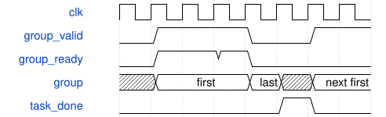

# tb_csp_tile_schedule 模块规范

> RTL: `tb_csp_tile_schedule.v`

## 1. 模块目的

固定调度顺序及握手自检，不执行算术或DDR

## 2. 参数

| 参数 | 默认值 | 说明 |
| --- | --- | --- |
| — | — | 本模块没有可配置参数。 |

## 3. 时钟与复位

- 时钟：`{"name": "clk", "edge": "posedge", "frequency_hz": 100000000, "internal": true}`
- 复位：`{"name": "rstn", "active": "low", "synchronous": false, "internal": true}`

## 4. 接口信号规范

| 信号 | 方向 | 位宽 | 时钟域 | 语义角色 | 描述 |
| --- | --- | --- | --- | --- | --- |
| `o_test_done` | output | 1 | clk | test_complete | 全部自检通过后置位 |

## 5. 周期行为与延迟

- 逐组与Python冻结描述符比较；故障和复位不得泄漏旧任务。

## 6. WaveDrom 时序图

### 双组及完整结果提交后推进

两次group握手后等待task_done；背压不改变当前描述符。

- WaveJSON：[tb_csp_tile_schedule_task.json5](waveforms/tb_csp_tile_schedule_task.json5)

## 7. 边界、反压与错误

- DW末点、阶段切换、最终PW、任意反压、WAIT复位、早到done。

## 8. CDC 与综合约束

- 仅仿真，不替代算术回归或物理检查。

## 9. 验证与验收

- 320组逐项同冻结mac_tasks；随机ready/完成延迟、长反压、逐状态复位、故障。

## 10. 可追溯性

- 规格模块：`tb_csp_tile_schedule`
- RTL 路径：`tb_csp_tile_schedule.v`
- 交付要求：本文档、WaveJSON 和 SVG 必须与同一版本规格一同发布。
