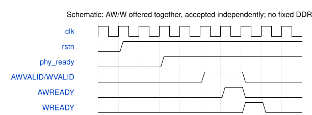

# road_ddr_selftest 模块规范

> RTL: `road_ddr_selftest.v`

## 1. 模块目的

Exclusive native PAXI DDR diagnostic, not full CNN or memory capacity proof.

## 2. 参数

| 参数 | 默认值 | 说明 |
| --- | --- | --- |
| — | — | 本模块没有可配置参数。 |

## 3. 时钟与复位

- 时钟：`{"domains": "DDR user ~133.33MHz; top additionally 100MHz ref,75MHz pixel,375MHz serial"}`
- 复位：`{"assertion": "Asynchronous, full DDR IP and requester reset together", "release": "Top two-flop release per domain; PHY reset also gates requester"}`

## 4. 接口信号规范

| 信号 | 方向 | 位宽 | 时钟域 | 语义角色 | 描述 |
| --- | --- | --- | --- | --- | --- |
| `i_clk` | input | 1 | 未声明 | 原厂DDR用户域时钟 | 原厂DDR用户域时钟 |
| `i_rstn` | input | 1 | 未声明 | 顶层异步断言、同步释放复位 | 顶层异步断言、同步释放复位 |
| `i_phy_ready` | input | 1 | 未声明 | 初始化状态，不代表存储已经通过 | 初始化状态，不代表存储已经通过 |
| `i_awready` | input | 1 | 未声明 | 写地址实际接受许可 | 写地址实际接受许可 |
| `i_wready` | input | 1 | 未声明 | 写数据实际接受许可 | 写数据实际接受许可 |
| `i_arready` | input | 1 | 未声明 | 读地址实际接受许可 | 读地址实际接受许可 |
| `i_rvalid` | input | 1 | 未声明 | 控制器返回数据有效 | 控制器返回数据有效 |
| `i_rlast` | input | 1 | 未声明 | 当前单拍读响应结束标记 | 当前单拍读响应结束标记 |
| `i_rdata` | input | 128 | 未声明 | 本次真实读回数据 | 本次真实读回数据 |
| `o_awaddr` | output | 25 | 未声明 | 原生PAXI写地址，不解释字节单位 | 原生PAXI写地址，不解释字节单位 |
| `o_awvalid` | output | 1 | 未声明 | 写地址保持到自身握手 | 写地址保持到自身握手 |
| `o_wdata` | output | 128 | 未声明 | 当前地址对应确定性测试字 | 当前地址对应确定性测试字 |
| `o_wstrb` | output | 16 | 未声明 | 沿当前PH1P工程的零掩码 | 沿当前PH1P工程的零掩码 |
| `o_wvalid` | output | 1 | 未声明 | 写数据保持到自身握手 | 写数据保持到自身握手 |
| `o_wlast` | output | 1 | 未声明 | 每个写命令只有一拍 | 每个写命令只有一拍 |
| `o_araddr` | output | 25 | 未声明 | 逆序访问四个原生地址 | 逆序访问四个原生地址 |
| `o_arvalid` | output | 1 | 未声明 | 独立读请求有效 | 独立读请求有效 |
| `o_rready` | output | 1 | 未声明 | 只为已接受读请求接收数据 | 只为已接受读请求接收数据 |
| `o_status` | output | 2 | 未声明 | 零运行、一观察通过、二失败 | 零运行、一观察通过、二失败 |
| `o_error` | output | 4 | 未声明 | 首错类型，复位前不覆盖 | 首错类型，复位前不覆盖 |
| `o_state` | output | 4 | 未声明 | 当前实验阶段 | 当前实验阶段 |
| `o_writes` | output | 4 | 未声明 | 地址和数据都已接受的写次数 | 地址和数据都已接受的写次数 |
| `o_reads` | output | 4 | 未声明 | 比较正确的读次数 | 比较正确的读次数 |
| `o_address` | output | 25 | 未声明 | 当前或首错地址 | 当前或首错地址 |
| `o_expected` | output | 128 | 未声明 | 当前或首错的完整期望字 | 当前或首错的完整期望字 |
| `o_actual` | output | 128 | 未声明 | 最近或首错的完整实际字 | 最近或首错的完整实际字 |
| `o_cycles` | output | 32 | 未声明 | 核心域经过周期，不折算带宽 | 核心域经过周期，不折算带宽 |

## 5. 周期行为与延迟

- Wait PHY ready; write four native addresses 0/8/16/24, read reverse, repeat with complement.
- Keep AW/W payload stable until own acceptance; present W with AW (zero launch delay).
- One read outstanding; compare all 128 bits and RLAST; latch first failure, no retry.
- PAXI mask=0; byte address=native*2 for current 16-bit DDR, not full-capacity validation.
- HDMI frozen snapshots contain error/address/counts and alternate full expected/actual pages.

## 6. WaveDrom 时序图

### Split AW/W acceptance

Compressed schematic only; maximum W generation delay is zero in requester.

- WaveJSON：[road_ddr_selftest_backpressure.json5](waveforms/road_ddr_selftest_backpressure.json5)

## 7. 边界、反压与错误

- Independent AW/W backpressure, missing response, mismatch, unsolicited R, PHY lost, partial reset.

## 8. CDC 与综合约束

- No write completion fabricated from AW/W acceptance. No production Tensor READY claim.
- C_TIMEOUT=27h7ffffff per waiting stage; immediate fault cancellation requires full IP reset before retry.

## 9. 验证与验收

- 17 controlled-endpoint cases; separate actual-IP implementation; real DDR readback requires board.

## 10. 可追溯性

- 规格模块：`road_ddr_selftest`
- RTL 路径：`road_ddr_selftest.v`
- 交付要求：本文档、WaveJSON 和 SVG 必须与同一版本规格一同发布。
