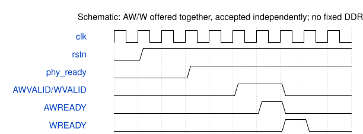

# road_ddr_selftest_top 模块规范

> RTL: `road_ddr_selftest_top.v`

## 1. 模块目的

Exclusive native PAXI DDR diagnostic, not full CNN or memory capacity proof.

## 2. 参数

| 参数 | 默认值 | 说明 |
| --- | --- | --- |
| — | — | 本模块没有可配置参数。 |

## 3. 时钟与复位

- 时钟：`{"domains": "DDR user ~133.33MHz; top additionally 100MHz ref,75MHz pixel,375MHz serial"}`
- 复位：`{"assertion": "Asynchronous, full DDR IP and requester reset together", "release": "Top two-flop release per domain; PHY reset also gates requester"}`

## 4. 接口信号规范

| 信号 | 方向 | 位宽 | 时钟域 | 语义角色 | 描述 |
| --- | --- | --- | --- | --- | --- |
| `i_sys_clk` | input | 1 | 未声明 | C4板载50MHz | C4板载50MHz |
| `i_rstn` | input | 1 | 未声明 | C7按键同时复位DDR和测试器 | C7按键同时复位DDR和测试器 |
| `o_tmds_blue_p` | output | 1 | 未声明 | HDMI1蓝色正端 | HDMI1蓝色正端 |
| `o_tmds_green_p` | output | 1 | 未声明 | HDMI1绿色正端 | HDMI1绿色正端 |
| `o_tmds_red_p` | output | 1 | 未声明 | HDMI1红色正端 | HDMI1红色正端 |
| `o_tmds_clock_p` | output | 1 | 未声明 | HDMI1时钟正端 | HDMI1时钟正端 |
| `ddr_ck_p` | output | 1 | 未声明 | 原厂IP封装内DDR专用端口 | 原厂IP封装内DDR专用端口 |
| `ddr_ck_n` | output | 1 | 未声明 | 沿原厂IP固定物理位置 | 沿原厂IP固定物理位置 |
| `ddr_cke` | output | 1 | 未声明 | DDR时钟使能 | DDR时钟使能 |
| `ddr_odt` | output | 1 | 未声明 | DDR终端控制 | DDR终端控制 |
| `ddr_cs_n` | output | 1 | 未声明 | DDR片选 | DDR片选 |
| `ddr_ras_n` | output | 1 | 未声明 | DDR行命令 | DDR行命令 |
| `ddr_cas_n` | output | 1 | 未声明 | DDR列命令 | DDR列命令 |
| `ddr_we_n` | output | 1 | 未声明 | DDR写命令 | DDR写命令 |
| `ddr_ba` | output | 2 | 未声明 | DDR bank地址 | DDR bank地址 |
| `ddr_addr` | output | 13 | 未声明 | DDR行列复用地址 | DDR行列复用地址 |
| `ddr_dqs_p` | inout | 2 | 未声明 | DDR双向差分选通 | DDR双向差分选通 |
| `ddr_dqs_n` | inout | 2 | 未声明 | DDR双向差分选通负端 | DDR双向差分选通负端 |
| `ddr_dq` | inout | 16 | 未声明 | DDR物理数据总线 | DDR物理数据总线 |
| `ddr_dm` | inout | 2 | 未声明 | DDR数据掩码物理端口 | DDR数据掩码物理端口 |

## 5. 周期行为与延迟

- Wait PHY ready; write four native addresses 0/8/16/24, read reverse, repeat with complement.
- Keep AW/W payload stable until own acceptance; present W with AW (zero launch delay).
- One read outstanding; compare all 128 bits and RLAST; latch first failure, no retry.
- PAXI mask=0; byte address=native*2 for current 16-bit DDR, not full-capacity validation.
- HDMI frozen snapshots contain error/address/counts and alternate full expected/actual pages.

## 6. WaveDrom 时序图

### Split AW/W acceptance

Compressed schematic only; maximum W generation delay is zero in requester.

- WaveJSON：[road_ddr_selftest_top_backpressure.json5](waveforms/road_ddr_selftest_top_backpressure.json5)

## 7. 边界、反压与错误

- Independent AW/W backpressure, missing response, mismatch, unsolicited R, PHY lost, partial reset.

## 8. CDC 与综合约束

- No write completion fabricated from AW/W acceptance. No production Tensor READY claim.
- C_TIMEOUT=27h7ffffff per waiting stage; immediate fault cancellation requires full IP reset before retry.

## 9. 验证与验收

- 17 controlled-endpoint cases; separate actual-IP implementation; real DDR readback requires board.

## 10. 可追溯性

- 规格模块：`road_ddr_selftest_top`
- RTL 路径：`road_ddr_selftest_top.v`
- 交付要求：本文档、WaveJSON 和 SVG 必须与同一版本规格一同发布。
