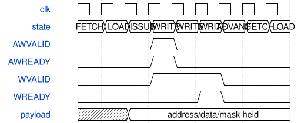

# road_ddr_selftest 模块规范

> RTL: `road_ddr_selftest.v`

## 1. 模块目的

固定1056条命令的独占DDR边界与字节掩码自检；临时SRAM诊断。

## 2. 参数

| 参数 | 默认值 | 说明 |
| --- | --- | --- |
| — | — | 本模块没有可配置参数。 |

## 3. 时钟与复位

- 时钟：`{"domains": "DDR user ~133.33MHz; top ref100MHz/pixel75MHz/serial375MHz"}`
- 复位：`{"assertion": "Async assertion resets requester and entire controller together", "release": "Top two-flop release; requester additionally waits PHY permission"}`

## 4. 接口信号规范

| 信号 | 方向 | 位宽 | 时钟域 | 语义角色 | 描述 |
| --- | --- | --- | --- | --- | --- |
| `i_clk` | input | 1 | 未声明 | 原厂DDR用户时钟 | 原厂DDR用户时钟 |
| `i_rstn` | input | 1 | 未声明 | 与整个DDR控制器共同复位 | 与整个DDR控制器共同复位 |
| `i_phy_ready` | input | 1 | 未声明 | 初始化完成许可 | 初始化完成许可 |
| `i_awready` | input | 1 | 未声明 | 写地址接受条件 | 写地址接受条件 |
| `i_wready` | input | 1 | 未声明 | 写数据接受条件 | 写数据接受条件 |
| `i_arready` | input | 1 | 未声明 | 读地址接受条件 | 读地址接受条件 |
| `i_rvalid` | input | 1 | 未声明 | 实际读返回有效 | 实际读返回有效 |
| `i_rlast` | input | 1 | 未声明 | 单拍响应结束标志 | 单拍响应结束标志 |
| `i_rdata` | input | 128 | 未声明 | 全位宽读回数据 | 全位宽读回数据 |
| `o_awaddr` | output | 25 | 未声明 | native16位字地址 | native16位字地址 |
| `o_awvalid` | output | 1 | 未声明 | 保持至AW握手 | 保持至AW握手 |
| `o_wdata` | output | 128 | 未声明 | 不随背压变化的写数据 | 不随背压变化的写数据 |
| `o_wstrb` | output | 16 | 未声明 | 位为一则禁止该字节写入 | 位为一则禁止该字节写入 |
| `o_wvalid` | output | 1 | 未声明 | 保持至独立W握手 | 保持至独立W握手 |
| `o_wlast` | output | 1 | 未声明 | 每个命令仅一拍 | 每个命令仅一拍 |
| `o_araddr` | output | 25 | 未声明 | 当前唯一读命令地址 | 当前唯一读命令地址 |
| `o_arvalid` | output | 1 | 未声明 | 读地址提交 | 读地址提交 |
| `o_rready` | output | 1 | 未声明 | 已登记或同拍登记读许可 | 已登记或同拍登记读许可 |
| `o_status` | output | 2 | 未声明 | 零运行、一通过、二首错 | 零运行、一通过、二首错 |
| `o_error` | output | 4 | 未声明 | 失败原因锁存 | 失败原因锁存 |
| `o_state` | output | 4 | 未声明 | 当前协议阶段 | 当前协议阶段 |
| `o_writes` | output | 10 | 未声明 | 完整AW/W对接受数 | 完整AW/W对接受数 |
| `o_reads` | output | 10 | 未声明 | 正确比较读字数 | 正确比较读字数 |
| `o_address` | output | 25 | 未声明 | 当前或失败地址 | 当前或失败地址 |
| `o_expected` | output | 128 | 未声明 | 当前写字或读期望 | 当前写字或读期望 |
| `o_actual` | output | 128 | 未声明 | 最近实际响应 | 最近实际响应 |
| `o_cycles` | output | 32 | 未声明 | PHY就绪后的运行周期 | PHY就绪后的运行周期 |
| `o_init_cycles` | output | 32 | 未声明 | 初始化等待周期 | 初始化等待周期 |
| `o_wait_both` | output | 32 | 未声明 | AW/W均未完成的等待拍 | AW/W均未完成的等待拍 |
| `o_wait_aw` | output | 32 | 未声明 | 仅AW尚未完成的等待拍 | 仅AW尚未完成的等待拍 |
| `o_wait_w` | output | 32 | 未声明 | 仅W尚未完成的等待拍 | 仅W尚未完成的等待拍 |
| `o_wait_ar` | output | 32 | 未声明 | AR尚未接受的等待拍 | AR尚未接受的等待拍 |
| `o_wait_r` | output | 32 | 未声明 | AR接受后缺少响应的等待拍 | AR接受后缺少响应的等待拍 |

## 5. 周期行为与延迟

- 同步ROM读取：FETCH沿读，LOAD沿锁存，ISSUE核对魔数/索引/对齐/范围，然后才发请求。
- 1056个合法命令，528写和528读；194地址，两轮别名检查及140组掩码写读。
- AW/W同拍呈现，各自保持至ready；一个读在途，支持AR同拍返回。
- 掩码为一保留原字节；128位逐项比较和RLAST正确才计入成功读。
- 首错锁定；初始化与核心窗口分别统计；WRITE的both/AW-only/W-only与AR/R等待互斥。
- 显示最高两位为状态，四页携带期望、实际和等待计数；冻结payload直到ack，SOF接收。

## 6. WaveDrom 时序图

### 命令读取与独立接受

阶段图非控制器固定延迟；AW先接受时W继续保持，所有请求在ISSUE检查后。

- WaveJSON：[road_ddr_selftest_split-write.json5](waveforms/road_ddr_selftest_split-write.json5)

## 7. 边界、反压与错误

- 独立AW/W背压、即时读返回、错数据/末拍、超时、PHY丢失、异常返回、指令损坏、部分事务中公共复位。

## 8. CDC 与综合约束

- native地址单位2字节，范围0x1a00000到0x1fffff8；ROM有效字1056、总深度2048、每字192位。
- C_TIMEOUT=27h7ffffff；不从AW/W接受虚构写完成，不赋予CNN输入槽READY语义。
- 保留原显示CDC两级与已批准精确首级/7.5ns最大数据延迟处理；无全局false path。

## 9. 验证与验收

- 24项受控端点计划、完整命令scoreboard、真实TD实现和独立板测。

## 10. 可追溯性

- 规格模块：`road_ddr_selftest`
- RTL 路径：`road_ddr_selftest.v`
- 交付要求：本文档、WaveJSON 和 SVG 必须与同一版本规格一同发布。
