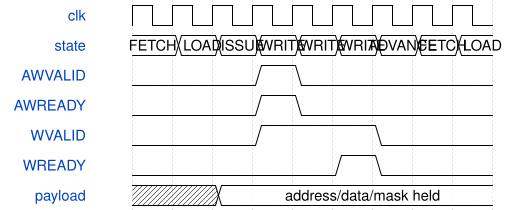

# road_ddr_selftest_top 模块规范

> RTL: `road_ddr_selftest_top.v`

## 1. 模块目的

固定1056条命令的独占DDR边界与字节掩码自检；临时SRAM诊断。

## 2. 参数

| 参数 | 默认值 | 说明 |
| --- | --- | --- |
| — | — | 本模块没有可配置参数。 |

## 3. 时钟与复位

- 时钟：`{"domains": "DDR user ~133.33MHz; top ref100MHz/pixel75MHz/serial375MHz"}`
- 复位：`{"assertion": "Async assertion resets requester and entire controller together", "release": "Top two-flop release; requester additionally waits PHY permission"}`

## 4. 接口信号规范

| 信号 | 方向 | 位宽 | 时钟域 | 语义角色 | 描述 |
| --- | --- | --- | --- | --- | --- |
| `i_sys_clk` | input | 1 | 未声明 | C4板载50MHz | C4板载50MHz |
| `i_rstn` | input | 1 | 未声明 | C7按键同时复位DDR和测试器 | C7按键同时复位DDR和测试器 |
| `o_tmds_blue_p` | output | 1 | 未声明 | HDMI1蓝色正端 | HDMI1蓝色正端 |
| `o_tmds_green_p` | output | 1 | 未声明 | HDMI1绿色正端 | HDMI1绿色正端 |
| `o_tmds_red_p` | output | 1 | 未声明 | HDMI1红色正端 | HDMI1红色正端 |
| `o_tmds_clock_p` | output | 1 | 未声明 | HDMI1时钟正端 | HDMI1时钟正端 |
| `ddr_ck_p` | output | 1 | 未声明 | 原厂IP封装内DDR专用端口 | 原厂IP封装内DDR专用端口 |
| `ddr_ck_n` | output | 1 | 未声明 | 沿原厂IP固定物理位置 | 沿原厂IP固定物理位置 |
| `ddr_cke` | output | 1 | 未声明 | DDR时钟使能 | DDR时钟使能 |
| `ddr_odt` | output | 1 | 未声明 | DDR终端控制 | DDR终端控制 |
| `ddr_cs_n` | output | 1 | 未声明 | DDR片选 | DDR片选 |
| `ddr_ras_n` | output | 1 | 未声明 | DDR行命令 | DDR行命令 |
| `ddr_cas_n` | output | 1 | 未声明 | DDR列命令 | DDR列命令 |
| `ddr_we_n` | output | 1 | 未声明 | DDR写命令 | DDR写命令 |
| `ddr_ba` | output | 2 | 未声明 | DDR bank地址 | DDR bank地址 |
| `ddr_addr` | output | 13 | 未声明 | DDR行列复用地址 | DDR行列复用地址 |
| `ddr_dqs_p` | inout | 2 | 未声明 | DDR双向差分选通 | DDR双向差分选通 |
| `ddr_dqs_n` | inout | 2 | 未声明 | DDR双向差分选通负端 | DDR双向差分选通负端 |
| `ddr_dq` | inout | 16 | 未声明 | DDR物理数据总线 | DDR物理数据总线 |
| `ddr_dm` | inout | 2 | 未声明 | DDR数据掩码物理端口 | DDR数据掩码物理端口 |

## 5. 周期行为与延迟

- 同步ROM读取：FETCH沿读，LOAD沿锁存，ISSUE核对魔数/索引/对齐/范围，然后才发请求。
- 1056个合法命令，528写和528读；194地址，两轮别名检查及140组掩码写读。
- AW/W同拍呈现，各自保持至ready；一个读在途，支持AR同拍返回。
- 掩码为一保留原字节；128位逐项比较和RLAST正确才计入成功读。
- 首错锁定；初始化与核心窗口分别统计；WRITE的both/AW-only/W-only与AR/R等待互斥。
- 显示最高两位为状态，四页携带期望、实际和等待计数；冻结payload直到ack，SOF接收。

## 6. WaveDrom 时序图

### 命令读取与独立接受

阶段图非控制器固定延迟；AW先接受时W继续保持，所有请求在ISSUE检查后。

- WaveJSON：[road_ddr_selftest_top_split-write.json5](waveforms/road_ddr_selftest_top_split-write.json5)

## 7. 边界、反压与错误

- 独立AW/W背压、即时读返回、错数据/末拍、超时、PHY丢失、异常返回、指令损坏、部分事务中公共复位。

## 8. CDC 与综合约束

- native地址单位2字节，范围0x1a00000到0x1fffff8；ROM有效字1056、总深度2048、每字192位。
- C_TIMEOUT=27h7ffffff；不从AW/W接受虚构写完成，不赋予CNN输入槽READY语义。
- 保留原显示CDC两级与已批准精确首级/7.5ns最大数据延迟处理；无全局false path。

## 9. 验证与验收

- 24项受控端点计划、完整命令scoreboard、真实TD实现和独立板测。

## 10. 可追溯性

- 规格模块：`road_ddr_selftest_top`
- RTL 路径：`road_ddr_selftest_top.v`
- 交付要求：本文档、WaveJSON 和 SVG 必须与同一版本规格一同发布。
