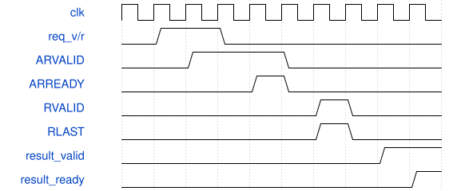
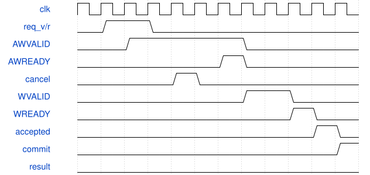

# 完整张量 PAXI 条件回归规格

本测试台无顶层引脚，不可综合。沿用上一轮的 Stem 和 down2 调度器及计算核；新增 `ddr_tensor_driver.vh` 把真实 Stem 输出经已有单在途 PAXI 桥写入、读回，再供 down2 使用。它验证搬运接口，不构成可上板 DMA 主机。

## 接口与时钟

100 MHz 单时钟；桥的请求为 valid/ready、读写方向、32 位字节地址、128 位数据、16 位禁止写掩码、epoch 和 owner。回复包含同一 owner/epoch、方向、读数据和写可见标志。控制器侧 AW、W、AR 分别握手，读返回空间预留。本桥没有暴露 RREADY；真实 PAXI 有此信号，当前视频包装层固定为 1。

同一时刻最多一个事务。32 位地址从 `0x03500000` 到 `0x0358FFF0`，步长 16；PAXI 地址右移一位，步长 8。掩码 0 表示本次写入全部 16 字节，byte0 放在 data[7:0]。

## 逐段调度

1. Stem 2304 tile 完成，实际缓存导出 589824 字节。
2. 36864 个请求依次写出；AW 接受后下一拍呈现 W，数据保持到真实 WREADY。
3. 端点先接受 W，再在显式模型可见事件时修改存储。桥只在该事件后发布写完成。
4. 将原张量全部填为 X，避免旁路旧值造成假通过。
5. 36864 个请求读回；每个字节与独立参考比对，重新填入输入张量。
6. down2 576 tile 使用读回张量，DW 和 PW 中间结果、最终 221184 字节逐项核验。

正常模型的延迟由 `model_write_delay=3` 和 `model_read_delay=5` 倒计数实现；这是有意选择的测试行为，不是安路时序保证。stalls 模式独立改变 AW/W/AR 接受及结果消费时刻。协议停顿计数是观测量，不得额外相加到包含它们的端点总周期。

## 故障与取消

写接受后关闭可见事件 32 拍，取消后再等待 32 拍，两阶段均不得发布完成、释放 ready 或报告排空。重新允许可见事件后只排空，不产生成功结果。读地址在反压中取消仍保持 valid/address；允许接受、实际晚返后才排空。两个取消事务必须使 late_discard 和 cancelled_drain 均为 2，成功计数为 0。

此处未增加活跃事务期间单独硬复位控制器的测试。硬复位协调语义沿用冻结桥，不能以取消测试替代任意控制器复位的正确性证据。

## 周期图

复用未修改桥的规范生成图，图中的 commit_confirmed 仅表示外部已证明可见事件；本轮该事件来自条件模型。

规范工具不接受 ports 为空的测试台。保留实际失败记录和本说明，不添加假端口，不将手写说明记成规范生成通过。
