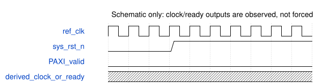

# 原厂 DDR 启动观察测试台

接口：无外部引脚、不可综合。实例为原厂 `ddr2` 控制器及 PHY，未连接 DDR2 存储器模型。所有 APB 选择及 PAXI 请求保持无效，APB 地址和写数据为 0，RREADY 为 1。ref_clk 固定 100 MHz；sys_rst_n 低 2 us 后释放，再观察 1 ms。

本测试只增加激励和观测，没有修改 IP、缩短厂商初始化延迟、强制 PLL lock/ready、替换时钟或伪造读回。允许观察 ready，但无论 ready 是否拉高，都不能据此宣称存储读写通过。

检查参考时钟每周期 10000 ps，结束时 100200 个上升沿；记录 cfg/dhi/DDR 时钟边沿、复位、PHY ready、初始化命令和无请求的读返回。出现无请求读返回则失败。时钟缺失和未 ready 单独报告，不自动延长等待或绕过启动条件。

图是压缩的刺激示意，未知波形表示输出由原厂模型决定，不表示测得的锁定周期。实际时间以仿真日志和波形为准。原日志 `%t` 使用厂商模型的最小 1fs 格式，`time_ps` 字段名错误；`status.json` 将它除以1000，明确发布为 ps，未以错误单位推算频率或延迟。

规范生成器拒绝无端口 TB，保留 canonical 失败及手写规格。SVG 单独由技能的受管 WaveDrom 渲染器生成，不宣称完整规范门禁通过。严格检查、原厂编译和动态仿真各自保留状态。
