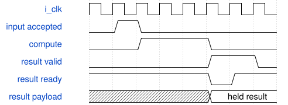

# down2_dynamic_tile_runner 模块规范

> RTL: `down2_dynamic_tile_runner.v`

## 1. 模块目的

down2 DW16 stride2 与 PW16→24 固定4×4探针的接口

## 2. 参数

| 参数 | 默认值 | 说明 |
| --- | --- | --- |
| — | — | 本模块没有可配置参数。 |

## 3. 时钟与复位

- 时钟：`{"name": "i_clk", "edge": "posedge", "frequency_hz": 100000000}`
- 复位：`{"name": "i_rstn", "active": "low", "synchronous": false, "values": "异步取消全部在途任务及装载计数；调用方提供同步释放，重新装满1024项表。"}`

## 4. 接口信号规范

| 信号 | 方向 | 位宽 | 时钟域 | 语义角色 | 描述 |
| --- | --- | --- | --- | --- | --- |
| `i_clk` | input | 1 | i_clk | i_clk | i_clk |
| `i_rstn` | input | 1 | i_clk | i_rstn | i_rstn |
| `i_table_valid` | input | 1 | i_clk | i_table_valid | i_table_valid |
| `i_table_addr` | input | 10 | i_clk | i_table_addr | i_table_addr |
| `i_table_data` | input | 16 | i_clk | i_table_data | i_table_data |
| `i_load_valid` | input | 1 | i_clk | i_load_valid | i_load_valid |
| `i_load_kind` | input | 3 | i_clk | i_load_kind | i_load_kind |
| `i_load_addr` | input | 11 | i_clk | i_load_addr | i_load_addr |
| `i_load_data` | input | 32 | i_clk | i_load_data | i_load_data |
| `i_start` | input | 1 | i_clk | i_start | i_start |
| `i_pw_only` | input | 1 | i_clk | i_pw_only | i_pw_only |
| `i_commit_ready` | input | 1 | i_clk | i_commit_ready | i_commit_ready |
| `i_export_start` | input | 1 | i_clk | i_export_start | i_export_start |
| `i_output_ready` | input | 1 | i_clk | i_output_ready | i_output_ready |
| `o_table_ready` | output | 1 | i_clk | o_table_ready | o_table_ready |
| `o_table_loaded` | output | 1 | i_clk | o_table_loaded | o_table_loaded |
| `o_table_fault` | output | 1 | i_clk | o_table_fault | o_table_fault |
| `o_load_ready` | output | 1 | i_clk | o_load_ready | o_load_ready |
| `o_busy` | output | 1 | i_clk | o_busy | o_busy |
| `o_done` | output | 1 | i_clk | o_done | o_done |
| `o_fault` | output | 1 | i_clk | o_fault | o_fault |
| `o_output_valid` | output | 1 | i_clk | o_output_valid | o_output_valid |
| `o_output_data` | output | 8 | i_clk | o_output_data | o_output_data |
| `o_output_index` | output | 9 | i_clk | o_output_index | o_output_index |
| `o_export_done` | output | 1 | i_clk | o_export_done | o_export_done |
| `o_debug_valid` | output | 1 | i_clk | o_debug_valid | o_debug_valid |
| `o_debug_phase` | output | 2 | i_clk | o_debug_phase | o_debug_phase |
| `o_debug_layer` | output | 1 | i_clk | o_debug_layer | o_debug_layer |
| `o_debug_position` | output | 4 | i_clk | o_debug_position | o_debug_position |
| `o_debug_channel` | output | 5 | i_clk | o_debug_channel | o_debug_channel |
| `o_debug_value` | output | 32 | i_clk | o_debug_value | o_debug_value |
| `o_preload_writes` | output | 32 | i_clk | o_preload_writes | o_preload_writes |
| `o_core_cycles` | output | 32 | i_clk | o_core_cycles | o_core_cycles |
| `o_mac_cycles` | output | 32 | i_clk | o_mac_cycles | o_mac_cycles |
| `o_pre_cycles` | output | 32 | i_clk | o_pre_cycles | o_pre_cycles |
| `o_silu_cycles` | output | 32 | i_clk | o_silu_cycles | o_silu_cycles |
| `o_post_cycles` | output | 32 | i_clk | o_post_cycles | o_post_cycles |
| `o_writeback_cycles` | output | 32 | i_clk | o_writeback_cycles | o_writeback_cycles |
| `o_storage_wait_cycles` | output | 32 | i_clk | o_storage_wait_cycles | o_storage_wait_cycles |
| `o_scheduler_idle_cycles` | output | 32 | i_clk | o_scheduler_idle_cycles | o_scheduler_idle_cycles |
| `o_export_cycles` | output | 32 | i_clk | o_export_cycles | o_export_cycles |
| `o_result_queue_count` | output | 2 | i_clk | o_result_queue_count | o_result_queue_count |
| `o_result_reserved` | output | 1 | i_clk | o_result_reserved | o_result_reserved |
| `o_meta_count` | output | 4 | i_clk | o_meta_count | o_meta_count |
| `o_mac_result_count` | output | 32 | i_clk | o_mac_result_count | o_mac_result_count |
| `o_pre_accept_count` | output | 32 | i_clk | o_pre_accept_count | o_pre_accept_count |
| `o_silu_accept_count` | output | 32 | i_clk | o_silu_accept_count | o_silu_accept_count |
| `o_post_accept_count` | output | 32 | i_clk | o_post_accept_count | o_post_accept_count |
| `o_writeback_count` | output | 32 | i_clk | o_writeback_count | o_writeback_count |

## 5. 周期行为与延迟

- kind0 halo1296字节；kind2 DW144权重；kind3 DW16偏置；kind4 PW384权重；kind5 PW24偏置。
- DW 3空间点MAC结果逐标量送动态核；256次DW提交写内部缓存，PW从该缓存计算。
- core_cycles覆盖start接受后busy至全部384个PW写回并done；装表/预载/导出单计。
- 旧pre/silu/post活动计数来自兼容端口并为零，应使用TB真实状态互斥分类。

## 6. WaveDrom 时序图

### 结果反压与接收

事件示意；运算期间经过多拍，图中省略中间计算拍，不声明固定延迟。

- WaveJSON：[down2_dynamic_tile_runner_result-stall.json5](waveforms/down2_dynamic_tile_runner_result-stall.json5)

## 7. 边界、反压与错误

- halo边界取零、完整装载前禁止启动、长反压、结果保持时复位、重新装表后无旧结果。

## 8. CDC 与综合约束

- TEST包系数为65536/24与16777216/31；未接真实QAT或运行时参数加载器。
- single in-flight batch；所有消费采用valid与ready握手。

## 9. 验证与验收

- 640 acc、1920 pre/SiLU/post、640唯一提交、384最终导出；DW256批、PW128批。

## 10. 可追溯性

- 规格模块：`down2_dynamic_tile_runner`
- RTL 路径：`down2_dynamic_tile_runner.v`
- 交付要求：本文档、WaveJSON 和 SVG 必须与同一版本规格一同发布。
