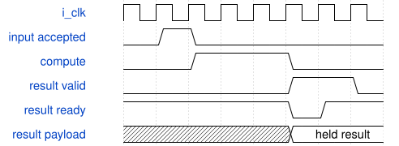

# road_down2_dynamic_adapter 模块规范

> RTL: `road_down2_dynamic_adapter.v`

## 1. 模块目的

down2 DW16 stride2 与 PW16→24 固定4×4探针的接口

## 2. 参数

| 参数 | 默认值 | 说明 |
| --- | --- | --- |
| — | — | 本模块没有可配置参数。 |

## 3. 时钟与复位

- 时钟：`{"name": "i_clk", "edge": "posedge", "frequency_hz": 100000000}`
- 复位：`{"name": "i_rstn", "active": "low", "synchronous": false, "values": "异步取消全部在途任务及装载计数；调用方提供同步释放，重新装满1024项表。"}`

## 4. 接口信号规范

| 信号 | 方向 | 位宽 | 时钟域 | 语义角色 | 描述 |
| --- | --- | --- | --- | --- | --- |
| `i_clk` | input | 1 | i_clk | i_clk | i_clk |
| `i_rstn` | input | 1 | i_clk | i_rstn | i_rstn |
| `i_table_valid` | input | 1 | i_clk | i_table_valid | i_table_valid |
| `i_table_addr` | input | 10 | i_clk | i_table_addr | i_table_addr |
| `i_table_data` | input | 16 | i_clk | i_table_data | i_table_data |
| `i_input_valid` | input | 1 | i_clk | i_input_valid | i_input_valid |
| `i_result_data` | input | 96 | i_clk | i_result_data | i_result_data |
| `i_result_fault` | input | 1 | i_clk | i_result_fault | i_result_fault |
| `i_layer` | input | 1 | i_clk | i_layer | i_layer |
| `i_position` | input | 4 | i_clk | i_position | i_position |
| `i_channel_base` | input | 5 | i_clk | i_channel_base | i_channel_base |
| `i_lane_mask` | input | 3 | i_clk | i_lane_mask | i_lane_mask |
| `i_output_ready` | input | 1 | i_clk | i_output_ready | i_output_ready |
| `o_table_ready` | output | 1 | i_clk | o_table_ready | o_table_ready |
| `o_table_loaded` | output | 1 | i_clk | o_table_loaded | o_table_loaded |
| `o_table_fault` | output | 1 | i_clk | o_table_fault | o_table_fault |
| `o_input_ready` | output | 1 | i_clk | o_input_ready | o_input_ready |
| `o_output_valid` | output | 1 | i_clk | o_output_valid | o_output_valid |
| `o_output_data` | output | 8 | i_clk | o_output_data | o_output_data |
| `o_output_tag` | output | 16 | i_clk | o_output_tag | o_output_tag |
| `o_fault` | output | 1 | i_clk | o_fault | o_fault |
| `o_result_queue_count` | output | 2 | i_clk | o_result_queue_count | o_result_queue_count |
| `o_meta_count` | output | 4 | i_clk | o_meta_count | o_meta_count |
| `o_pre_busy` | output | 1 | i_clk | o_pre_busy | o_pre_busy |
| `o_silu_busy` | output | 1 | i_clk | o_silu_busy | o_silu_busy |
| `o_post_busy` | output | 1 | i_clk | o_post_busy | o_post_busy |
| `o_pre_accept` | output | 1 | i_clk | o_pre_accept | o_pre_accept |
| `o_silu_accept` | output | 1 | i_clk | o_silu_accept | o_silu_accept |
| `o_post_accept` | output | 1 | i_clk | o_post_accept | o_post_accept |

## 5. 周期行为与延迟

- DW接受单有效lane，PW接受三有效lane；tag={layer,position4,channel5,zeros6}。
- 一个在途批次；最后有效lane提交后释放pending，输出反压时数据和tag保持。
- o_table_fault沿原有聚合故障，不是独立装表故障遥测。
- 兼容busy/accept六端口固定0，不作为真实活动率；量化核心与原串行接口保持一致。

## 6. WaveDrom 时序图

### 结果反压与接收

事件示意；运算期间经过多拍，图中省略中间计算拍，不声明固定延迟。

- WaveJSON：[road_down2_dynamic_adapter_result-stall.json5](waveforms/road_down2_dynamic_adapter_result-stall.json5)

## 7. 边界、反压与错误

- halo边界取零、完整装载前禁止启动、长反压、结果保持时复位、重新装表后无旧结果。

## 8. CDC 与综合约束

- TEST包系数为65536/24与16777216/31；未接真实QAT或运行时参数加载器。
- single in-flight batch；所有消费采用valid与ready握手。

## 9. 验证与验收

- 640 acc、1920 pre/SiLU/post、640唯一提交、384最终导出；DW256批、PW128批。

## 10. 可追溯性

- 规格模块：`road_down2_dynamic_adapter`
- RTL 路径：`road_down2_dynamic_adapter.v`
- 交付要求：本文档、WaveJSON 和 SVG 必须与同一版本规格一同发布。
