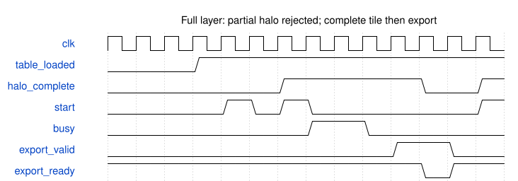

# tb_down2_full_tensor 验证规格

## 边界

这是无端口、不可综合的 testbench，不是新增全层硬件控制器。实例化未修改的 `board_selftest_20261010/core/down2_dynamic_tile_runner.v`。外部模型生成的完整输入张量采用冻结 `tile4x4_hwc`；没有 DDR 控制器行为或板测证据。

## 时钟、复位和握手

100 MHz 仿真时钟，低有效异步复位。初始复位后经真实装表口重装 1024 项 SiLU；一次装载权重、偏置和动态测试系数。每 tile 顺序装载 1296 字节 halo，装到倒数第二项时尝试启动，必须被拒绝。最后一项接受后启动原核。ready/valid 背压时，实际写回和导出数据、身份必须保持。

执行完一个 tile 的完整导出，才装载下个 halo；权重和表不重装。复位取消语义仍属于冻结核，本次新增测试没有重新宣称覆盖全部复位场景。

## 地址与数值

- 18 行 × 32 列 tile，共 576；每个输出 tile 为 4×4×24。
- 输入为 144×256×16 INT8。halo 全图起点为 `(tile_y*8-1,tile_x*8-1)`，仅越界元素填 0。
- padding=1、stride=2，右侧最大读坐标 255、下侧 143，均合法；不是四边都读补零。
- DW 和 PW 的 MAC、pre、SiLU、post、commit 每阶段各比较 368,640 项；实际输出缓存读口比较 221,184 字节。
- 每地址记分牌检查重复、漏写及越界，最终保存完整输出并逆布局还原为 HWC 再比较。
- 使用动态 stress 测试系数，不是真实模型量化参数。

## 计时

核心窗口严格复用原核 `busy/o_core_cycles`，区分 DW 与 PW；8 类按优先级互斥：写回反压、结果容量等待、提交、MAC 发射、输入准备、任务关闭、排空、其他。忙周期有重叠，不可简单相加。另列预装载和输出导出；testbench 主循环控制空拍不算核心周期。窄口、DDR、Stem、其余网络与 NMS 均不在该核心窗口。

## 周期示意

图中 busy/导出区间压缩，仅表示协议顺序，不表示测得的 1,687 拍长度。

## 工具限制

技能的 `write-spec --source` 目前拒绝空端口 testbench（`ports must be non-empty`），不能伪造模块端口绕过。本说明补齐真实测试规格，周期图仍通过技能配置的 WaveDrom 3.6.1 渲染器生成；规范生成器限制单列，不等于规范生成门已通过。
