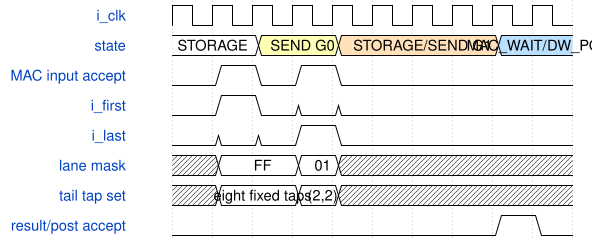

# down2_dynamic_tile_runner 模块规范

> RTL: `down2_dynamic_tile_runner.v`

## 1. 模块目的

down2固定4x4探针的DW行尾紧凑G2候选；完整外部端口、三点路径、PW路径和数值契约保持不变。

## 2. 参数

| 参数 | 默认值 | 说明 |
| --- | --- | --- |
| — | — | 本模块没有可配置参数。 |

## 3. 时钟与复位

- 时钟：`{"name": "i_clk", "edge": "posedge", "frequency_hz": 100000000}`
- 复位：`{"name": "i_rstn", "active": "low", "synchronous": false, "values": "异步取消全部在途任务及装载计数；调用方提供同步释放，重新装满1024项表。"}`

## 4. 接口信号规范

| 信号 | 方向 | 位宽 | 时钟域 | 语义角色 | 描述 |
| --- | --- | --- | --- | --- | --- |
| `i_clk` | input | 1 | i_clk | i_clk | i_clk |
| `i_rstn` | input | 1 | i_clk | i_rstn | i_rstn |
| `i_table_valid` | input | 1 | i_clk | i_table_valid | i_table_valid |
| `i_table_addr` | input | 10 | i_clk | i_table_addr | i_table_addr |
| `i_table_data` | input | 16 | i_clk | i_table_data | i_table_data |
| `i_load_valid` | input | 1 | i_clk | i_load_valid | i_load_valid |
| `i_load_kind` | input | 3 | i_clk | i_load_kind | i_load_kind |
| `i_load_addr` | input | 11 | i_clk | i_load_addr | i_load_addr |
| `i_load_data` | input | 32 | i_clk | i_load_data | i_load_data |
| `i_start` | input | 1 | i_clk | i_start | i_start |
| `i_pw_only` | input | 1 | i_clk | i_pw_only | i_pw_only |
| `i_commit_ready` | input | 1 | i_clk | i_commit_ready | i_commit_ready |
| `i_export_start` | input | 1 | i_clk | i_export_start | i_export_start |
| `i_output_ready` | input | 1 | i_clk | i_output_ready | i_output_ready |
| `o_table_ready` | output | 1 | i_clk | o_table_ready | o_table_ready |
| `o_table_loaded` | output | 1 | i_clk | o_table_loaded | o_table_loaded |
| `o_table_fault` | output | 1 | i_clk | o_table_fault | o_table_fault |
| `o_load_ready` | output | 1 | i_clk | o_load_ready | o_load_ready |
| `o_busy` | output | 1 | i_clk | o_busy | o_busy |
| `o_done` | output | 1 | i_clk | o_done | o_done |
| `o_fault` | output | 1 | i_clk | o_fault | o_fault |
| `o_output_valid` | output | 1 | i_clk | o_output_valid | o_output_valid |
| `o_output_data` | output | 8 | i_clk | o_output_data | o_output_data |
| `o_output_index` | output | 9 | i_clk | o_output_index | o_output_index |
| `o_export_done` | output | 1 | i_clk | o_export_done | o_export_done |
| `o_debug_valid` | output | 1 | i_clk | o_debug_valid | o_debug_valid |
| `o_debug_phase` | output | 2 | i_clk | o_debug_phase | o_debug_phase |
| `o_debug_layer` | output | 1 | i_clk | o_debug_layer | o_debug_layer |
| `o_debug_position` | output | 4 | i_clk | o_debug_position | o_debug_position |
| `o_debug_channel` | output | 5 | i_clk | o_debug_channel | o_debug_channel |
| `o_debug_value` | output | 32 | i_clk | o_debug_value | o_debug_value |
| `o_preload_writes` | output | 32 | i_clk | o_preload_writes | o_preload_writes |
| `o_core_cycles` | output | 32 | i_clk | o_core_cycles | o_core_cycles |
| `o_mac_cycles` | output | 32 | i_clk | o_mac_cycles | o_mac_cycles |
| `o_pre_cycles` | output | 32 | i_clk | o_pre_cycles | o_pre_cycles |
| `o_silu_cycles` | output | 32 | i_clk | o_silu_cycles | o_silu_cycles |
| `o_post_cycles` | output | 32 | i_clk | o_post_cycles | o_post_cycles |
| `o_writeback_cycles` | output | 32 | i_clk | o_writeback_cycles | o_writeback_cycles |
| `o_storage_wait_cycles` | output | 32 | i_clk | o_storage_wait_cycles | o_storage_wait_cycles |
| `o_scheduler_idle_cycles` | output | 32 | i_clk | o_scheduler_idle_cycles | o_scheduler_idle_cycles |
| `o_export_cycles` | output | 32 | i_clk | o_export_cycles | o_export_cycles |
| `o_result_queue_count` | output | 2 | i_clk | o_result_queue_count | o_result_queue_count |
| `o_result_reserved` | output | 1 | i_clk | o_result_reserved | o_result_reserved |
| `o_meta_count` | output | 4 | i_clk | o_meta_count | o_meta_count |
| `o_mac_result_count` | output | 32 | i_clk | o_mac_result_count | o_mac_result_count |
| `o_pre_accept_count` | output | 32 | i_clk | o_pre_accept_count | o_pre_accept_count |
| `o_silu_accept_count` | output | 32 | i_clk | o_silu_accept_count | o_silu_accept_count |
| `o_post_accept_count` | output | 32 | i_clk | o_post_accept_count | o_post_accept_count |
| `o_writeback_count` | output | 32 | i_clk | o_writeback_count | o_writeback_count |

## 5. 周期行为与延迟

- Load kind0 halo1296 bytes, kind2 DW144 weights, kind3 DW16 biases, kind4 PW384 weights and kind5 PW24 biases before start.
- Keep three-spatial-point DW tasks on the existing 21-value union and three MAC groups.
- For each single-point row tail at positions 3, 7, 11 and 15, use fixed G0 offsets (0,0),(0,1),(0,2),(1,0),(1,1),(1,2),(2,0),(2,1) with mask FF and fixed G1 offset (2,2) with mask 01.
- Tail activation address uses the selected 3x3 halo coordinate and current channel; tail weight address is channel times nine plus the fixed tap. The other two MAC output lanes remain zero.
- Apply the DW bias once on first group. Tail G1 is last, three-point DW G2 is last, and PW G1 remains last.
- Preserve the existing ST_STORAGE boundary between tail G0 and G1, MAC result handshake, scalar postprocess mapping, tags, commits, fault atomicity and reset cancellation.
- The analytic no-new-stall saving ceiling is 128 core cycles, from 3331 to 3203 for this fixed probe; it is not measured and is not a DDR or whole-frame claim.
- Core timing excludes table load, data preload and export exactly as in the frozen baseline.

## 6. WaveDrom 时序图

### DW行尾固定G0/G1调度

压缩事件图；G0与G1之间保留现有ST_STORAGE，G1携带唯一末tap、mask01及last。MAC关闭等待以省略号表示，不声明测得端点。

- WaveJSON：[down2_dynamic_tile_runner_dw-tail-compact-g2.json5](waveforms/down2_dynamic_tile_runner_dw-tail-compact-g2.json5)

## 7. 边界、反压与错误

- Last-tap-only case at position3/channel0 uses halo416 and weight8 and must accumulate one; changing last alone would incorrectly produce zero.
- Signed8 product groups and signed32 bias must remain within signed33 partial-accumulation bounds.
- Sparse tail G1 mask 01, negative operands, halo row boundaries, result backpressure, reset during result hold and faulted last group.

## 8. CDC 与综合约束

- All module ports, MAC source, MAC interface, signed33 accumulation, arithmetic II, dynamic postprocess and PW scheduling remain unchanged.
- Do not add PW prefetch, cross-task MAC overlap, new FSM states, timing exceptions, DDR behavior or production integration.
- G0 and G1 tap positions are fixed selections in RTL; do not implement run-time division or modulo for the compact tail path.
- The 128-cycle value is only an analytic upper bound until targeted simulation and actual layer implementation complete.

## 9. 验证与验收

- Python reference compares 1024 tail mappings against the original 21-union arithmetic and records fixed masks FF and 01.
- Targeted RTL regression must prove the halo416/weight8 last-tap case, DW groups 320, PW groups 256, MAC results 256, scalar commits 640 and exports 384.
- Run the original fourteen layer cases, long backpressure, queue-empty done and reset reload behavior.
- Re-run the actual layer physical top and strict eight-gate matrix; preserve prior failures separately.

## 10. 可追溯性

- 规格模块：`down2_dynamic_tile_runner`
- RTL 路径：`down2_dynamic_tile_runner.v`
- 交付要求：本文档、WaveJSON 和 SVG 必须与同一版本规格一同发布。
