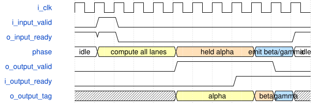

# road_dynamic_postprocess 模块规范

> RTL: `rtl/road_dynamic_postprocess.v`

## 1. 模块目的

Diagnostic single-batch three-lane dynamic quantization and optional SiLU with atomic cached publication.

## 2. 参数

| 参数 | 默认值 | 说明 |
| --- | --- | --- |
| — | — | 本模块没有可配置参数。 |

## 3. 时钟与复位

- 时钟：`{"name": "i_clk", "edge": "posedge", "frequency_hz": 100000000}`
- 复位：`{"name": "i_rstn", "active": "low", "synchronous": false, "values": "Cancel batch and all child valid immediately; clear fatal and require all 1024 table entries again. Caller synchronizes release."}`

## 4. 接口信号规范

| 信号 | 方向 | 位宽 | 时钟域 | 语义角色 | 描述 |
| --- | --- | --- | --- | --- | --- |
| `i_clk` | input | 1 | i_clk | i_clk | i_clk |
| `i_rstn` | input | 1 | i_clk | i_rstn | i_rstn |
| `i_table_valid` | input | 1 | i_clk | i_table_valid | i_table_valid |
| `i_table_addr` | input | 10 | i_clk | i_table_addr | i_table_addr |
| `i_table_data` | input | 16 | i_clk | i_table_data | i_table_data |
| `o_table_ready` | output | 1 | i_clk | o_table_ready | o_table_ready |
| `o_table_loaded` | output | 1 | i_clk | o_table_loaded | o_table_loaded |
| `i_input_valid` | input | 1 | i_clk | i_input_valid | i_input_valid |
| `i_accumulators` | input | 96 | i_clk | i_accumulators | i_accumulators |
| `i_pre_multipliers` | input | 96 | i_clk | i_pre_multipliers | i_pre_multipliers |
| `i_pre_shifts` | input | 18 | i_clk | i_pre_shifts | i_pre_shifts |
| `i_post_multiplier` | input | 32 | i_clk | i_post_multiplier | i_post_multiplier |
| `i_post_shift` | input | 6 | i_clk | i_post_shift | i_post_shift |
| `i_activate` | input | 1 | i_clk | i_activate | i_activate |
| `i_lane_mask` | input | 3 | i_clk | i_lane_mask | i_lane_mask |
| `i_tags` | input | 48 | i_clk | i_tags | i_tags |
| `i_input_fault` | input | 1 | i_clk | i_input_fault | i_input_fault |
| `o_input_ready` | output | 1 | i_clk | o_input_ready | o_input_ready |
| `i_output_ready` | input | 1 | i_clk | i_output_ready | i_output_ready |
| `o_output_valid` | output | 1 | i_clk | o_output_valid | o_output_valid |
| `o_output_data` | output | 16 | i_clk | o_output_data | o_output_data |
| `o_output_tag` | output | 16 | i_clk | o_output_tag | o_output_tag |
| `o_output_int16` | output | 1 | i_clk | o_output_int16 | o_output_int16 |
| `o_fault` | output | 1 | i_clk | o_fault | o_fault |

## 5. 周期行为与延迟

- A batch transfers only on valid and ready; capture all three coefficients, shifts, accumulators and opaque tags together.
- Input ready remains zero until sequential table addresses 0..1023 have transferred.
- Process active lanes in ascending order with one shared quantizer: pre quantization, optional SiLU, optional post quantization.
- Activated output is signed INT8 represented by sign extension into INT16; prediction output retains signed INT16 and bypasses SiLU and post quantization.
- Cache all active results before publishing the first; sticky fault suppresses the complete batch until reset.
- Output payload and valid hold under backpressure. Variable batch latency; no frame-throughput claim.
- Capture pre operands and tag in the existing SELECT edge; prepare post operands in the existing accepted SiLU-return edge. No added state, edge, II or external port change.

## 6. WaveDrom 时序图

### Batch capture and held scalar publication

Illustrative compressed timeline, compute interval is not one clock and no fixed batch latency is implied.

- WaveJSON：[road_dynamic_postprocess_atomic-batch.json5](waveforms/road_dynamic_postprocess_atomic-batch.json5)

## 7. 边界、反压与错误

- Zero mask faults; any input MAC fault prevents publication; bad last-lane parameter faults before any scalar starts.
- Reset in all eight active states; partial table reset; table sequence fault; output stall and poison live input ports after acceptance.

## 8. CDC 与综合约束

- Diagnostic functional baseline, not a throughput replacement for frozen v19.
- Only active lanes require legal pre multipliers and shift0..62; post parameter legality applies only to activated batches.
- No ROM parameter loader, DDR, model weights, bitstream or real board validation in this module.

## 9. 验证与验收

- 330 batches and 604 outputs compared against existing cnn/integer.py.
- Eight active-state resets, partial table load, six atomic batch faults, clean recovery output and wrong table address.
- Compare all 330 individual batch cycle windows and 604 output triples to frozen serial baseline.

## 10. 可追溯性

- 规格模块：`road_dynamic_postprocess`
- RTL 路径：`rtl/road_dynamic_postprocess.v`
- 交付要求：本文档、WaveJSON 和 SVG 必须与同一版本规格一同发布。
