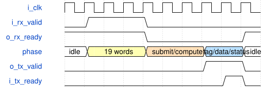

# road_dynamic_low_io_top 模块规范

> RTL: `road_dynamic_low_io_top.v`

## 1. 模块目的

38-bit runtime-loaded diagnostic shell for frozen dynamic serial postprocessing.

## 2. 参数

| 参数 | 默认值 | 说明 |
| --- | --- | --- |
| — | — | 本模块没有可配置参数。 |

## 3. 时钟与复位

- 时钟：`{"name": "i_clk", "edge": "posedge", "frequency_hz": 100000000}`
- 复位：`{"name": "i_rstn", "active": "low", "synchronous": false, "values": "Immediate assertion cancels all work, two rising edges release, reload table addresses 0..1023 before compute."}`

## 4. 接口信号规范

| 信号 | 方向 | 位宽 | 时钟域 | 语义角色 | 描述 |
| --- | --- | --- | --- | --- | --- |
| `i_clk` | input | 1 | i_clk | i_clk | i_clk |
| `i_rstn` | input | 1 | i_clk | i_rstn | i_rstn |
| `i_rx_valid` | input | 1 | i_clk | i_rx_valid | i_rx_valid |
| `i_rx_data` | input | 16 | i_clk | i_rx_data | i_rx_data |
| `o_rx_ready` | output | 1 | i_clk | o_rx_ready | o_rx_ready |
| `o_tx_valid` | output | 1 | i_clk | o_tx_valid | o_tx_valid |
| `o_tx_data` | output | 16 | i_clk | o_tx_data | o_tx_data |
| `i_tx_ready` | input | 1 | i_clk | i_tx_ready | i_tx_ready |

## 5. 周期行为与延迟

- A000 followed by 1024 signed16 words loads the table sequentially.
- B000 followed by 19 least-significant-first 16-bit words loads one 304-bit packet; only then submit.
- Packet bits: accumulator95:0 pre191:96 shifts209:192 post241:210 shift247:242 activate248 mask251:249 tags299:252 fault300 padding303:301.
- Each result transmits tag, signed16 data and flags (bit1 INT16, bit0 fault) in three accepted words; all hold under stall.
- C000 transmits input count, output count, table/fault flags. D000 transmits counted SUBMIT/WAIT clocks low/high and flags.
- Cycle counter excludes packet/table preload and TX clocks: diagnostic window, not full core latency or FPS.
- No new MAC, DDR, board protocol or timing exception.

## 6. WaveDrom 时序图

### Partial packet cannot submit

Compressed illustrative timeline; variable compute and stall durations, not cycle-exact core latency.

- WaveJSON：[road_dynamic_low_io_top_packet.json5](waveforms/road_dynamic_low_io_top_packet.json5)

## 7. 边界、反压与错误

- Partial packet/table reset, running reset, random TX stall, counter wrap after 65535 batches.

## 8. CDC 与综合约束

- 100MHz PH1P35MDG324 -3 diagnostic only, automatic pins and zero I/O delays.
- Parameters are runtime data, not constant coefficients. Existing round, SiLU and fault semantics retained.
- Strict failures and external/removal timing failures remain unclosed.

## 9. 验证与验收

- 330 batches/604 outputs, partial load and running reset, payload hold, counts.

## 10. 可追溯性

- 规格模块：`road_dynamic_low_io_top`
- RTL 路径：`road_dynamic_low_io_top.v`
- 交付要求：本文档、WaveJSON 和 SVG 必须与同一版本规格一同发布。
