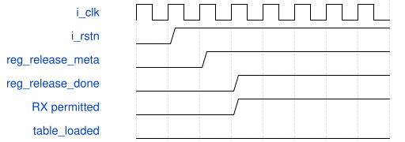

# road_dynamic_overlap_low_io_top 模块规范

> RTL: `road_dynamic_overlap_low_io_top.v`

## 1. 模块目的

38-bit diagnostic shell for the actual down2 dynamic runner, MAC, storage and fixed-TEST postprocess adapter.

## 2. 参数

| 参数 | 默认值 | 说明 |
| --- | --- | --- |
| — | — | 本模块没有可配置参数。 |

## 3. 时钟与复位

- 时钟：`{"name": "i_clk", "edge": "posedge", "frequency_hz": 100000000}`
- 复位：`{"name": "i_rstn", "active": "low", "synchronous": false, "values": "Immediate assertion cancels all work, two rising edges release, reload table addresses 0..1023 before compute."}`

## 4. 接口信号规范

| 信号 | 方向 | 位宽 | 时钟域 | 语义角色 | 描述 |
| --- | --- | --- | --- | --- | --- |
| `i_clk` | input | 1 | i_clk | i_clk | i_clk |
| `i_rstn` | input | 1 | i_clk | i_rstn | i_rstn |
| `i_rx_valid` | input | 1 | i_clk | i_rx_valid | i_rx_valid |
| `i_rx_data` | input | 16 | i_clk | i_rx_data | i_rx_data |
| `o_rx_ready` | output | 1 | i_clk | o_rx_ready | o_rx_ready |
| `o_tx_valid` | output | 1 | i_clk | o_tx_valid | o_tx_valid |
| `o_tx_data` | output | 16 | i_clk | o_tx_data | o_tx_data |
| `i_tx_ready` | input | 1 | i_clk | i_tx_ready | i_tx_ready |

## 5. 周期行为与延迟

- 1000 followed by 1024 signed16 words loads the SiLU table sequentially.
- 2000 accepts one descriptor and two least-significant-first data words per runner preload write.
- 3000 and 3001 start DW-to-PW or PW-only execution; 6000 and 6001 block or allow commit backpressure.
- 4000 exports index and INT8 data as two accepted 16-bit words; 5000 returns the frozen status and counters.
- The instantiated down2_dynamic_tile_runner public ports are unchanged and include actual MAC, halo/cache storage, dynamic pre/post, RNE and SiLU.
- The adapter coefficients are the TEST constants 65536 shift24 and 16777216 shift31; implementation may legally constant-fold them.
- No new parameter protocol, DDR, board protocol or timing exception.
- Only reg_release_done drives the internal async reset tree. Raw i_rstn still immediately masks RX ready and TX valid.
- Two synchronizer DFFs, clock, ports, numeric core and load protocol remain unchanged. No attributes or timing exceptions.
- Raw ASR recovery/removal still checked; a positive diagnostic result cannot establish asynchronous external signoff.

## 6. WaveDrom 时序图

### 异步取消、两级同步释放

数字契约示意：释放后两个有效沿；第三沿最早接收，随后必须装满表。不能模拟亚稳态。

- WaveJSON：[road_dynamic_overlap_low_io_top_reset-release.json5](waveforms/road_dynamic_overlap_low_io_top_reset-release.json5)

## 7. 边界、反压与错误

- Partial table/load reset, running reset, commit block, random TX stall and export before completion.

## 8. CDC 与综合约束

- 100MHz PH1P35MDG324 -3 diagnostic only, automatic pins and zero I/O delays.
- Layer-shell parameter loads cover runner data; adapter requant multipliers remain fixed TEST constants and do not measure universal multiplication cost.
- Strict failures and external/removal timing failures remain unclosed.

## 9. 验证与验收

- Complete table/halo/weight/bias preload, DW-to-PW run, blocked commit and 384-output export.
- Partial load and running reset, payload hold, 1024-word reload and no stale output.

## 10. 可追溯性

- 规格模块：`road_dynamic_overlap_low_io_top`
- RTL 路径：`road_dynamic_overlap_low_io_top.v`
- 交付要求：本文档、WaveJSON 和 SVG 必须与同一版本规格一同发布。
