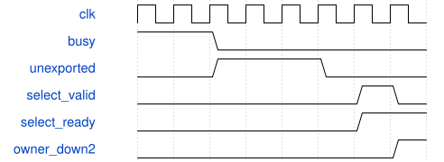

# road_down2_tile_scheduler 模块规范

> RTL: `road_down2_tile_scheduler.v`

## 1. 模块目的

冻结Stem/down2调度对唯一MAC及动态后处理的互斥共享，不含DDR和整帧存储。

## 2. 参数

| 参数 | 默认值 | 说明 |
| --- | --- | --- |
| — | — | 本模块没有可配置参数。 |

## 3. 时钟与复位

- 时钟：`{"name": "i_clk", "edge": "posedge", "frequency_hz": 100000000}`
- 复位：`{"name": "i_rstn", "active": "low", "synchronous": false, "values": "立即取消在途及所有loaded状态；调用者同步释放；重新装满1024项表与参数。"}`

## 4. 接口信号规范

| 信号 | 方向 | 位宽 | 时钟域 | 语义角色 | 描述 |
| --- | --- | --- | --- | --- | --- |
| `i_clk` | input | 1 | i_clk | i_clk | 单时钟固定前端接口；有效负载保持到ready，完整表和参数后才能计算；复位立即取消。 |
| `i_rstn` | input | 1 | i_clk | i_rstn | 单时钟固定前端接口；有效负载保持到ready，完整表和参数后才能计算；复位立即取消。 |
| `i_table_loaded` | input | 1 | i_clk | i_table_loaded | 单时钟固定前端接口；有效负载保持到ready，完整表和参数后才能计算；复位立即取消。 |
| `i_load_valid` | input | 1 | i_clk | i_load_valid | 单时钟固定前端接口；有效负载保持到ready，完整表和参数后才能计算；复位立即取消。 |
| `i_load_kind` | input | 3 | i_clk | i_load_kind | 单时钟固定前端接口；有效负载保持到ready，完整表和参数后才能计算；复位立即取消。 |
| `i_load_addr` | input | 11 | i_clk | i_load_addr | 单时钟固定前端接口；有效负载保持到ready，完整表和参数后才能计算；复位立即取消。 |
| `i_load_data` | input | 32 | i_clk | i_load_data | 单时钟固定前端接口；有效负载保持到ready，完整表和参数后才能计算；复位立即取消。 |
| `o_load_ready` | output | 1 | i_clk | o_load_ready | 单时钟固定前端接口；有效负载保持到ready，完整表和参数后才能计算；复位立即取消。 |
| `i_start` | input | 1 | i_clk | i_start | 单时钟固定前端接口；有效负载保持到ready，完整表和参数后才能计算；复位立即取消。 |
| `i_pw_only` | input | 1 | i_clk | i_pw_only | 单时钟固定前端接口；有效负载保持到ready，完整表和参数后才能计算；复位立即取消。 |
| `i_commit_ready` | input | 1 | i_clk | i_commit_ready | 单时钟固定前端接口；有效负载保持到ready，完整表和参数后才能计算；复位立即取消。 |
| `o_busy` | output | 1 | i_clk | o_busy | 单时钟固定前端接口；有效负载保持到ready，完整表和参数后才能计算；复位立即取消。 |
| `o_done` | output | 1 | i_clk | o_done | 单时钟固定前端接口；有效负载保持到ready，完整表和参数后才能计算；复位立即取消。 |
| `o_fault` | output | 1 | i_clk | o_fault | 单时钟固定前端接口；有效负载保持到ready，完整表和参数后才能计算；复位立即取消。 |
| `i_export_start` | input | 1 | i_clk | i_export_start | 单时钟固定前端接口；有效负载保持到ready，完整表和参数后才能计算；复位立即取消。 |
| `i_output_ready` | input | 1 | i_clk | i_output_ready | 单时钟固定前端接口；有效负载保持到ready，完整表和参数后才能计算；复位立即取消。 |
| `o_output_valid` | output | 1 | i_clk | o_output_valid | 单时钟固定前端接口；有效负载保持到ready，完整表和参数后才能计算；复位立即取消。 |
| `o_output_data` | output | 8 | i_clk | o_output_data | 单时钟固定前端接口；有效负载保持到ready，完整表和参数后才能计算；复位立即取消。 |
| `o_output_index` | output | 9 | i_clk | o_output_index | 单时钟固定前端接口；有效负载保持到ready，完整表和参数后才能计算；复位立即取消。 |
| `o_export_done` | output | 1 | i_clk | o_export_done | 单时钟固定前端接口；有效负载保持到ready，完整表和参数后才能计算；复位立即取消。 |
| `o_debug_valid` | output | 1 | i_clk | o_debug_valid | 单时钟固定前端接口；有效负载保持到ready，完整表和参数后才能计算；复位立即取消。 |
| `o_debug_phase` | output | 2 | i_clk | o_debug_phase | 单时钟固定前端接口；有效负载保持到ready，完整表和参数后才能计算；复位立即取消。 |
| `o_debug_layer` | output | 1 | i_clk | o_debug_layer | 单时钟固定前端接口；有效负载保持到ready，完整表和参数后才能计算；复位立即取消。 |
| `o_debug_position` | output | 4 | i_clk | o_debug_position | 单时钟固定前端接口；有效负载保持到ready，完整表和参数后才能计算；复位立即取消。 |
| `o_debug_channel` | output | 5 | i_clk | o_debug_channel | 单时钟固定前端接口；有效负载保持到ready，完整表和参数后才能计算；复位立即取消。 |
| `o_debug_value` | output | 32 | i_clk | o_debug_value | 单时钟固定前端接口；有效负载保持到ready，完整表和参数后才能计算；复位立即取消。 |
| `o_preload_writes` | output | 32 | i_clk | o_preload_writes | 单时钟固定前端接口；有效负载保持到ready，完整表和参数后才能计算；复位立即取消。 |
| `o_core_cycles` | output | 32 | i_clk | o_core_cycles | 单时钟固定前端接口；有效负载保持到ready，完整表和参数后才能计算；复位立即取消。 |
| `o_mac_cycles` | output | 32 | i_clk | o_mac_cycles | 单时钟固定前端接口；有效负载保持到ready，完整表和参数后才能计算；复位立即取消。 |
| `o_pre_cycles` | output | 32 | i_clk | o_pre_cycles | 单时钟固定前端接口；有效负载保持到ready，完整表和参数后才能计算；复位立即取消。 |
| `o_silu_cycles` | output | 32 | i_clk | o_silu_cycles | 单时钟固定前端接口；有效负载保持到ready，完整表和参数后才能计算；复位立即取消。 |
| `o_post_cycles` | output | 32 | i_clk | o_post_cycles | 单时钟固定前端接口；有效负载保持到ready，完整表和参数后才能计算；复位立即取消。 |
| `o_writeback_cycles` | output | 32 | i_clk | o_writeback_cycles | 单时钟固定前端接口；有效负载保持到ready，完整表和参数后才能计算；复位立即取消。 |
| `o_storage_wait_cycles` | output | 32 | i_clk | o_storage_wait_cycles | 单时钟固定前端接口；有效负载保持到ready，完整表和参数后才能计算；复位立即取消。 |
| `o_scheduler_idle_cycles` | output | 32 | i_clk | o_scheduler_idle_cycles | 单时钟固定前端接口；有效负载保持到ready，完整表和参数后才能计算；复位立即取消。 |
| `o_export_cycles` | output | 32 | i_clk | o_export_cycles | 单时钟固定前端接口；有效负载保持到ready，完整表和参数后才能计算；复位立即取消。 |
| `o_result_queue_count` | output | 2 | i_clk | o_result_queue_count | 单时钟固定前端接口；有效负载保持到ready，完整表和参数后才能计算；复位立即取消。 |
| `o_result_reserved` | output | 1 | i_clk | o_result_reserved | 单时钟固定前端接口；有效负载保持到ready，完整表和参数后才能计算；复位立即取消。 |
| `o_meta_count` | output | 4 | i_clk | o_meta_count | 单时钟固定前端接口；有效负载保持到ready，完整表和参数后才能计算；复位立即取消。 |
| `o_mac_result_count` | output | 32 | i_clk | o_mac_result_count | 单时钟固定前端接口；有效负载保持到ready，完整表和参数后才能计算；复位立即取消。 |
| `o_pre_accept_count` | output | 32 | i_clk | o_pre_accept_count | 单时钟固定前端接口；有效负载保持到ready，完整表和参数后才能计算；复位立即取消。 |
| `o_silu_accept_count` | output | 32 | i_clk | o_silu_accept_count | 单时钟固定前端接口；有效负载保持到ready，完整表和参数后才能计算；复位立即取消。 |
| `o_post_accept_count` | output | 32 | i_clk | o_post_accept_count | 单时钟固定前端接口；有效负载保持到ready，完整表和参数后才能计算；复位立即取消。 |
| `o_writeback_count` | output | 32 | i_clk | o_writeback_count | 单时钟固定前端接口；有效负载保持到ready，完整表和参数后才能计算；复位立即取消。 |
| `i_mac_ready` | input | 1 | i_clk | i_mac_ready | 单时钟固定前端接口；有效负载保持到ready，完整表和参数后才能计算；复位立即取消。 |
| `i_mac_result_valid` | input | 1 | i_clk | i_mac_result_valid | 单时钟固定前端接口；有效负载保持到ready，完整表和参数后才能计算；复位立即取消。 |
| `i_mac_result` | input | 96 | i_clk | i_mac_result | 单时钟固定前端接口；有效负载保持到ready，完整表和参数后才能计算；复位立即取消。 |
| `i_mac_fault` | input | 1 | i_clk | i_mac_fault | 单时钟固定前端接口；有效负载保持到ready，完整表和参数后才能计算；复位立即取消。 |
| `o_mac_valid` | output | 1 | i_clk | o_mac_valid | 单时钟固定前端接口；有效负载保持到ready，完整表和参数后才能计算；复位立即取消。 |
| `o_mac_first` | output | 1 | i_clk | o_mac_first | 单时钟固定前端接口；有效负载保持到ready，完整表和参数后才能计算；复位立即取消。 |
| `o_mac_last` | output | 1 | i_clk | o_mac_last | 单时钟固定前端接口；有效负载保持到ready，完整表和参数后才能计算；复位立即取消。 |
| `o_mac_mask` | output | 8 | i_clk | o_mac_mask | 单时钟固定前端接口；有效负载保持到ready，完整表和参数后才能计算；复位立即取消。 |
| `o_mac_activation` | output | 64 | i_clk | o_mac_activation | 单时钟固定前端接口；有效负载保持到ready，完整表和参数后才能计算；复位立即取消。 |
| `o_mac_weight` | output | 192 | i_clk | o_mac_weight | 单时钟固定前端接口；有效负载保持到ready，完整表和参数后才能计算；复位立即取消。 |
| `o_mac_bias` | output | 96 | i_clk | o_mac_bias | 单时钟固定前端接口；有效负载保持到ready，完整表和参数后才能计算；复位立即取消。 |
| `o_mac_result_ready` | output | 1 | i_clk | o_mac_result_ready | 单时钟固定前端接口；有效负载保持到ready，完整表和参数后才能计算；复位立即取消。 |
| `i_pp_ready` | input | 1 | i_clk | i_pp_ready | 单时钟固定前端接口；有效负载保持到ready，完整表和参数后才能计算；复位立即取消。 |
| `i_pp_valid` | input | 1 | i_clk | i_pp_valid | 单时钟固定前端接口；有效负载保持到ready，完整表和参数后才能计算；复位立即取消。 |
| `i_pp_data` | input | 16 | i_clk | i_pp_data | 单时钟固定前端接口；有效负载保持到ready，完整表和参数后才能计算；复位立即取消。 |
| `i_pp_tag` | input | 16 | i_clk | i_pp_tag | 单时钟固定前端接口；有效负载保持到ready，完整表和参数后才能计算；复位立即取消。 |
| `i_pp_int16` | input | 1 | i_clk | i_pp_int16 | 单时钟固定前端接口；有效负载保持到ready，完整表和参数后才能计算；复位立即取消。 |
| `i_pp_fault` | input | 1 | i_clk | i_pp_fault | 单时钟固定前端接口；有效负载保持到ready，完整表和参数后才能计算；复位立即取消。 |
| `i_pp_result_queue_count` | input | 2 | i_clk | i_pp_result_queue_count | 单时钟固定前端接口；有效负载保持到ready，完整表和参数后才能计算；复位立即取消。 |
| `i_pp_meta_count` | input | 4 | i_clk | i_pp_meta_count | 单时钟固定前端接口；有效负载保持到ready，完整表和参数后才能计算；复位立即取消。 |
| `i_pp_pre_busy` | input | 1 | i_clk | i_pp_pre_busy | 单时钟固定前端接口；有效负载保持到ready，完整表和参数后才能计算；复位立即取消。 |
| `i_pp_silu_busy` | input | 1 | i_clk | i_pp_silu_busy | 单时钟固定前端接口；有效负载保持到ready，完整表和参数后才能计算；复位立即取消。 |
| `i_pp_post_busy` | input | 1 | i_clk | i_pp_post_busy | 单时钟固定前端接口；有效负载保持到ready，完整表和参数后才能计算；复位立即取消。 |
| `i_pp_pre_accept` | input | 1 | i_clk | i_pp_pre_accept | 单时钟固定前端接口；有效负载保持到ready，完整表和参数后才能计算；复位立即取消。 |
| `i_pp_silu_accept` | input | 1 | i_clk | i_pp_silu_accept | 单时钟固定前端接口；有效负载保持到ready，完整表和参数后才能计算；复位立即取消。 |
| `i_pp_post_accept` | input | 1 | i_clk | i_pp_post_accept | 单时钟固定前端接口；有效负载保持到ready，完整表和参数后才能计算；复位立即取消。 |
| `o_pp_valid` | output | 1 | i_clk | o_pp_valid | 单时钟固定前端接口；有效负载保持到ready，完整表和参数后才能计算；复位立即取消。 |
| `o_pp_acc` | output | 96 | i_clk | o_pp_acc | 单时钟固定前端接口；有效负载保持到ready，完整表和参数后才能计算；复位立即取消。 |
| `o_pp_multipliers` | output | 96 | i_clk | o_pp_multipliers | 单时钟固定前端接口；有效负载保持到ready，完整表和参数后才能计算；复位立即取消。 |
| `o_pp_shifts` | output | 18 | i_clk | o_pp_shifts | 单时钟固定前端接口；有效负载保持到ready，完整表和参数后才能计算；复位立即取消。 |
| `o_pp_post_multiplier` | output | 32 | i_clk | o_pp_post_multiplier | 单时钟固定前端接口；有效负载保持到ready，完整表和参数后才能计算；复位立即取消。 |
| `o_pp_post_shift` | output | 6 | i_clk | o_pp_post_shift | 单时钟固定前端接口；有效负载保持到ready，完整表和参数后才能计算；复位立即取消。 |
| `o_pp_mask` | output | 3 | i_clk | o_pp_mask | 单时钟固定前端接口；有效负载保持到ready，完整表和参数后才能计算；复位立即取消。 |
| `o_pp_tags` | output | 48 | i_clk | o_pp_tags | 单时钟固定前端接口；有效负载保持到ready，完整表和参数后才能计算；复位立即取消。 |
| `o_pp_input_fault` | output | 1 | i_clk | o_pp_input_fault | 单时钟固定前端接口；有效负载保持到ready，完整表和参数后才能计算；复位立即取消。 |
| `o_pp_ready` | output | 1 | i_clk | o_pp_ready | 单时钟固定前端接口；有效负载保持到ready，完整表和参数后才能计算；复位立即取消。 |

## 5. 周期行为与延迟

- Stem4×4×16，down2 DW4×4×16再PW4×4×24，原数值、算术核和II不变。
- 共享顶层owner只在两个调度器空闲、算术排空且结果导出完成时切换；未导出结果禁止覆盖。
- 表只装一次后可切换算子；复位后不允许继续使用旧表。
- 顺序装载由各调度器按既有kind编码验证，数据必须保持直至ready；故障只可复位恢复。

## 6. WaveDrom 时序图

### 排空后切换

压缩示意；busy和未导出均阻止切换，导出完成后的空闲拍允许握手。

- WaveJSON：[road_down2_tile_scheduler_handoff.json5](waveforms/road_down2_tile_scheduler_handoff.json5)

## 7. 边界、反压与错误

- 部分表和halo、尾lane、未导出交接、背压、复位取消、非法装载。

## 8. CDC 与综合约束

- 独立功能候选，TEST_ONLY动态系数；没有部署QAT或真实DDR完成语义。
- 不声称全网5FPS或生产时序通过；本次不增加任务重叠。

## 9. 验证与验收

- 同冻结2304Stem及576down2全量阶段/缓存读口比较；单算术链共享。

## 10. 可追溯性

- 规格模块：`road_down2_tile_scheduler`
- RTL 路径：`road_down2_tile_scheduler.v`
- 交付要求：本文档、WaveJSON 和 SVG 必须与同一版本规格一同发布。
