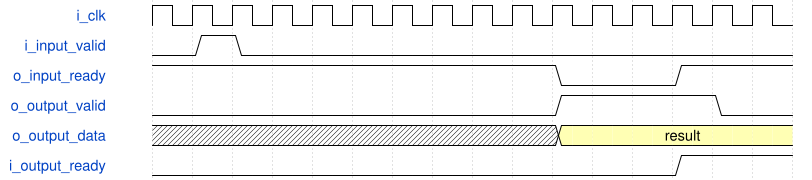

# road_dynamic_requant 模块规范

> RTL: `road_dynamic_requant.v`

## 1. 模块目的

Runtime INT32 times UINT31 followed by frozen RNE/saturating INT16 round pipeline.

## 2. 参数

| 参数 | 默认值 | 说明 |
| --- | --- | --- |
| — | — | 本模块没有可配置参数。 |

## 3. 时钟与复位

- 时钟：`{"name": "i_clk", "edge": "posedge", "frequency_hz": 100000000}`
- 复位：`{"name": "i_rstn", "active": "low", "synchronous": false, "values": "Cancel product and round valid immediately. Upstream provides synchronized release."}`

## 4. 接口信号规范

| 信号 | 方向 | 位宽 | 时钟域 | 语义角色 | 描述 |
| --- | --- | --- | --- | --- | --- |
| `i_clk` | input | 1 | i_clk | clock | clock |
| `i_rstn` | input | 1 | i_clk | reset | reset |
| `i_input_valid` | input | 1 | i_clk | input_valid | input_valid |
| `i_accumulator` | input | 32 | i_clk | accumulator | accumulator |
| `i_multiplier` | input | 31 | i_clk | multiplier | multiplier |
| `i_shift` | input | 6 | i_clk | shift | shift |
| `i_tag` | input | 16 | i_clk | tag | tag |
| `o_input_ready` | output | 1 | i_clk | input_ready | input_ready |
| `i_output_ready` | input | 1 | i_clk | output_ready | output_ready |
| `o_output_valid` | output | 1 | i_clk | output_valid | output_valid |
| `o_output_data` | output | 16 | i_clk | data | data |
| `o_output_tag` | output | 16 | i_clk | tag | tag |
| `o_fault` | output | 1 | i_clk | fault | fault |

## 5. 周期行为与延迟

- Input consumption requires valid and ready; all coefficients and tag captured atomically.
- One product register feeds the unchanged nine-stage round kernel.
- Output visible nine rising-edge intervals after input acceptance without stalls; earliest ACK ten intervals.
- II one within this scalar stream; an output stall freezes the complete pipeline.
- Shift63 returns zero and fault; shift0..62 uses RNE and INT16 saturation.

## 6. WaveDrom 时序图

### Whole-pipeline output backpressure

Contract illustration; output payload remains held before ACK.

- WaveJSON：[road_dynamic_requant_held-result.json5](waveforms/road_dynamic_requant_held-result.json5)

## 7. 边界、反压与错误

- Negative ties, zero multiplier, extreme INT32 products, shift63 fault, reset under stall.

## 8. CDC 与综合约束

- Nonnegative INT32 multipliers only; no SiLU, INT8 saturation, ROM or DDR in this module.
- Direct multiplication is a functional baseline, not a three-DSP mapping claim.

## 9. 验证与验收

- 2396 vectors, continuous input, random bubbles, long output stall, in-flight reset.

## 10. 可追溯性

- 规格模块：`road_dynamic_requant`
- RTL 路径：`road_dynamic_requant.v`
- 交付要求：本文档、WaveJSON 和 SVG 必须与同一版本规格一同发布。
