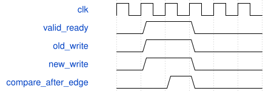

# tb_load_bank_equivalence 模块规范

> RTL: `tb_load_bank_equivalence.v`

## 1. 模块目的

原源与候选装载器锁步；每沿比较432权重和1296 halo字节及许可/完成/故障。

## 2. 参数

| 参数 | 默认值 | 说明 |
| --- | --- | --- |
| — | — | 本模块没有可配置参数。 |

## 3. 时钟与复位

- 时钟：`{"name": "clk", "frequency_hz": 100000000, "edge": "posedge", "internal": true}`
- 复位：`{"name": "rstn", "active": "low", "synchronous": false, "internal": true}`

## 4. 接口信号规范

| 信号 | 方向 | 位宽 | 时钟域 | 语义角色 | 描述 |
| --- | --- | --- | --- | --- | --- |
| `o_test_done` | output | 1 | clk | test_complete | 全部断言通过后置1并结束仿真。 |

## 5. 周期行为与延迟

- 相同输入同时驱动原源与候选；NBA后逐项case inequality比较全部目标数组和装载元数据。
- 先连续装载，再有界气泡；逐类越界/乱序/非法类型/数据、装载中异步复位及全X地址点测。
- 内部DW ready在reset期间沿原IDLE表达式可为高；必须立即取消写入，不能伪造ready=0的内部契约。

## 6. WaveDrom 时序图

### 接受沿后对比存储

同输入分别作用于原源和候选，NBA后比较，不允许新增写入拍。

- WaveJSON：[tb_load_bank_equivalence_lockstep.json5](waveforms/tb_load_bank_equivalence_lockstep.json5)

## 7. 边界、反压与错误

- 63/64、127/128、639/640、703/704、431/432、1295/1296及地址0重启。

## 8. CDC 与综合约束

- 测试专用，不综合，不属于数值精度或完整CNN FPS证据。

## 9. 验证与验收

- TB_PASS_LOAD_BANK_EQ；5531328字节比较，原8组回归和专门pending reset另行记录。

## 10. 可追溯性

- 规格模块：`tb_load_bank_equivalence`
- RTL 路径：`tb_load_bank_equivalence.v`
- 交付要求：本文档、WaveJSON 和 SVG 必须与同一版本规格一同发布。
